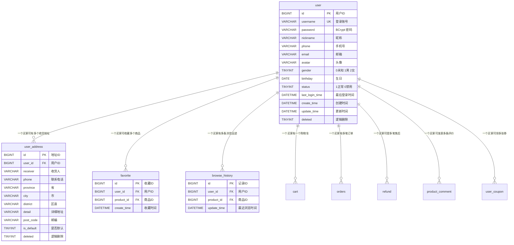
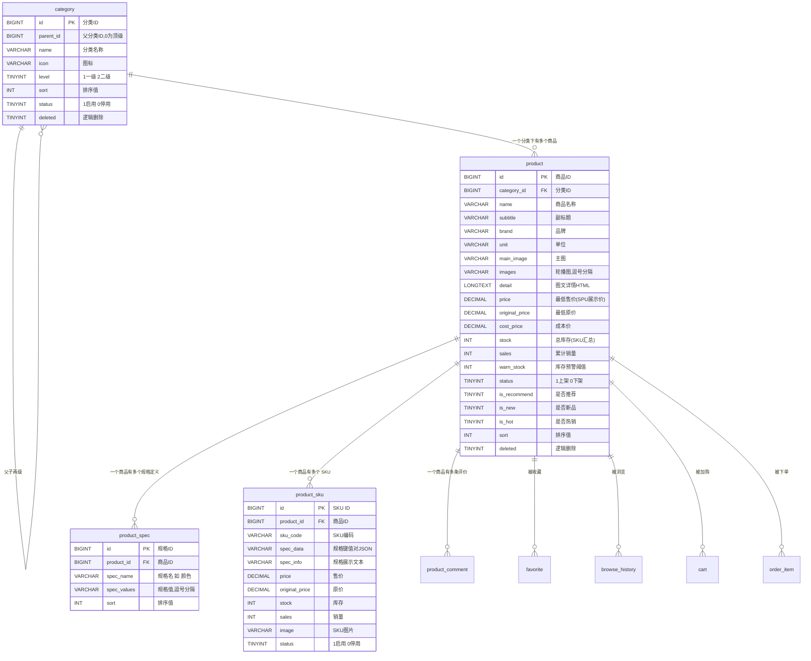
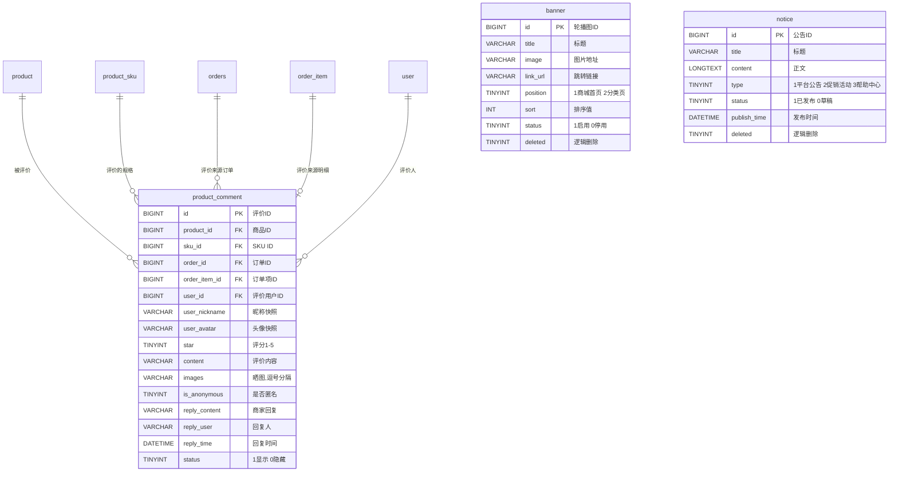
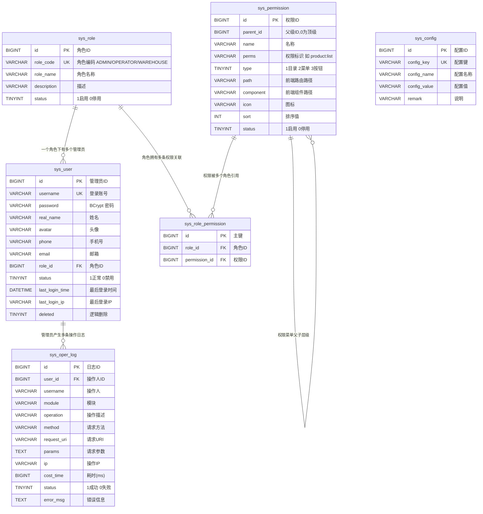

# 星辰商城 · 数据库设计说明书

> 本文档基于代码/脚本实际内容整理，生成日期 2026-10-13
>
> 核对来源：`sql/01-schema.sql`（24 张表完整 DDL）、`sql/02-data.sql`（演示数据）、`backend/src/main/java/com/mall/entity/**`（24 个实体）、`backend/src/main/java/com/mall/mapper/StatsMapper.java`（真实统计 SQL）、`backend/src/main/java/com/mall/service/impl/**`。

---

## 一、设计规范

### 1.1 存储引擎与字符集

| 项 | 取值 | 依据 |
| --- | --- | --- |
| 数据库名 | `mall_db` | `01-schema.sql:9` |
| 存储引擎 | `InnoDB` | 全部 24 张表显式声明 |
| 字符集 | `utf8mb4` | 全部表 `DEFAULT CHARSET = utf8mb4` |
| 排序规则 | `utf8mb4_general_ci` | 建库语句与 Docker `--collation-server` |
| 时区 | `Asia/Shanghai` / `+08:00` | JDBC `serverTimezone`、容器 `TZ` |
| 建库语句 | `CREATE DATABASE IF NOT EXISTS mall_db DEFAULT CHARACTER SET utf8mb4 COLLATE utf8mb4_general_ci` | 不删除已有库，仅重建表 |

**为什么选 InnoDB**：需要事务（下单：写订单 + 写明细 + 扣库存 + 核销券 + 清购物车必须原子）、行级锁（`stock = stock - ?` 条件扣减依赖行锁防超卖）、以及崩溃恢复能力。

**为什么选 utf8mb4 而非 utf8**：商品名、评价内容、收货地址可能包含 Emoji（如评价晒图文案）与生僻汉字，`utf8`（3 字节）无法存储 4 字节字符，`utf8mb4` 可以。

### 1.2 脚本可重复执行

```sql
-- 01-schema.sql 每个表前都有 DROP，脚本可反复执行（不会删除数据库本身）
SET FOREIGN_KEY_CHECKS = 0;
DROP TABLE IF EXISTS `user`;
CREATE TABLE `user` ( ... );
...
SET FOREIGN_KEY_CHECKS = 1;

-- 02-data.sql 每个表前 DELETE，脚本可反复导入
DELETE FROM `user`;
...
```

**注意**：`SET FOREIGN_KEY_CHECKS = 0` 的作用是允许乱序 DROP（虽然 24 张表**全部没有定义外键约束**，见 1.6）。DDL 中的表顺序按业务域分组（账户 → 商品 → 交易 → 内容 → 系统），而非依赖顺序。

### 1.3 命名规范

| 对象 | 规范 | 示例 |
| --- | --- | --- |
| 表名 | 小写 + 下划线，**单数形式** | `user`、`user_address`、`order_item`、`sys_role_permission` |
| 字段名 | 小写下划线，语义完整 | `original_price`、`is_default`、`last_login_time` |
| 主键 | 统一 `id` | 全部 24 张表 |
| 外键字段 | `{被引用表名}_{主键}` | `user_id`、`product_id`、`order_item_id`、`coupon_id` |
| 唯一索引 | `uk_{表名缩写}_{语义}` | `uk_user_username`、`uk_cart_user_sku`、`uk_orders_no` |
| 普通索引 | `idx_{表名缩写}_{语义}` | `idx_product_category`、`idx_orders_status` |
| 布尔字段 | `is_` 前缀 + `TINYINT(0/1)` | `is_default`、`is_commented`、`is_anonymous`、`is_recommend` |
| 状态字段 | `status` + `TINYINT`，含义在 `COMMENT` 中枚举 | `status TINYINT NOT NULL DEFAULT 1 COMMENT '状态 1上架 0下架'` |
| 时间字段 | `{动作}_time`，`DATETIME` | `pay_time`、`ship_time`、`receive_time`、`finish_time`、`close_time` |

**关于 `orders` 表名为复数**：这是唯一的例外。原因是 `order` 是 MySQL 保留字（`ORDER BY`），直接使用 `order` 必须始终反引号包裹，容易出错。实体类命名为 `Orders` 与之对应。

**关于主外键字段全部带 `_id` 后缀**：便于 `JOIN` 时书写条件，也避免与同名字段（如 `orders.order_no` 与 `order_item.order_no`）混淆——代码中确实存在这种冗余快照设计（见 1.5）。

### 1.4 通用字段

| 字段 | 类型 | 说明 | 出现范围 |
| --- | --- | --- | --- |
| `create_time` | `DATETIME NOT NULL DEFAULT CURRENT_TIMESTAMP` | 创建时间，数据库自动填充 | **全部 24 张表** |
| `update_time` | `DATETIME NOT NULL DEFAULT CURRENT_TIMESTAMP ON UPDATE CURRENT_TIMESTAMP` | 更新时间，数据库自动维护 | 18 张表（见下） |
| `deleted` | `TINYINT NOT NULL DEFAULT 0` | 逻辑删除：0 未删 / 1 已删 | 9 张表（见下） |

**没有 `update_time` 的 6 张表**（业务上不可变或极少变更）：

| 表 | 原因 |
| --- | --- |
| `favorite` | 收藏记录只有"存在/不存在"，无修改语义 |
| `product_spec` | 规格定义采用"先删后插"策略，不更新 |
| `order_item` | 订单明细为下单快照（仅 `is_commented` 会变，但未维护 `update_time`） |
| `express_track` | 物流轨迹为追加型事实记录 |
| `sys_permission` | 权限菜单为配置数据 |
| `sys_role_permission` | 关联表，采用"先删后插" |

**⚠️ 关于 `order_item.update_time`**：`CommentServiceImpl.addComment` 会更新 `order_item.is_commented = 1`，但该表没有 `update_time` 字段，因此这次更新不会留下时间戳。这是设计上的取舍（明细是快照），但意味着**无法通过 `order_item` 判断评价发生的时间**。

**没有 `deleted` 的 15 张表**（删除即物理删除）：

`favorite`、`browse_history`、`product_spec`、`product_sku`、`cart`、`order_item`、`express_track`、`refund`、`user_coupon`、`product_comment`、`sys_role`、`sys_permission`、`sys_role_permission`、`sys_config`、`sys_oper_log`

**有 `deleted` 的 9 张表**：

`user`、`user_address`、`category`、`product`、`orders`、`coupon`、`banner`、`notice`、`sys_user`

### 1.5 逻辑删除的适用范围与实现

**MyBatis-Plus 全局配置**（`application.yml:60-65`）：

```yaml
mybatis-plus:
  global-config:
    db-config:
      id-type: auto
      logic-delete-field: deleted      # 全局逻辑删除字段名
      logic-delete-value: 1
      logic-not-delete-value: 0
      table-underline: true
```

**生效机制**：

- 仅对**实体类**的 `selectById` / `selectList` / `selectPage` / `deleteById` 等操作生效，框架自动追加 `AND deleted = 0` 或转换为 `UPDATE ... SET deleted = 1`；
- 对 `selectMaps` + 原生 `QueryWrapper` **不生效**（如 `MemberServiceImpl.loadOrderStats` 的 `GROUP BY` 统计 SQL 就没有 `deleted = 0` 条件，需要框架层用其他方式保证——实际是靠首页查询已过滤来规避）；
- 对 `setSql` 原生的 `lambdaUpdate` 更新**不生效**（但这类更新都有明确的主键条件，风险可控）。

**如何判断一张表该不该有 `deleted`**：

| 判断依据 | 示例 |
| --- | --- |
| **需要保留历史可追溯** → 要 `deleted` | `orders`（订单是财务凭证，删除后仍应可查）、`user`（会员历史）、`sys_user`（操作日志中引用的操作人） |
| **被其他表快照引用** → 要 `deleted` | `product`（`order_item.product_name` 是快照，但商品本身不宜物理消失）、`coupon`（`user_coupon.coupon_name` 是快照） |
| **纯粹的过程性数据** → 不要 `deleted` | `cart`（购物车条目）、`browse_history`（足迹） |
| **事实型追加记录** → 不要 `deleted` | `express_track`（轨迹）、`sys_oper_log`（审计日志单独提供清理接口） |
| **关联表 / 配置表** → 不要 `deleted` | `sys_role_permission`、`sys_config` |

### 1.6 主键策略

| 项 | 取值 |
| --- | --- |
| 类型 | `BIGINT` |
| 属性 | `NOT NULL AUTO_INCREMENT` |
| 配置 | `id-type: auto`（数据库自增，非雪花算法） |
| 索引 | 每张表 `PRIMARY KEY (id)` |

**为什么用数据库自增而非分布式 ID**：

- 单库单表部署（`docker-compose.yml` 只有一个 MySQL 实例），无需全局唯一 ID；
- 自增主键写入局部性好，InnoDB 聚簇索引不会频繁分裂；
- 便于演示数据手工指定 ID（`02-data.sql` 显式插入 `id` 值，如 `product` 的 1~24、`sys_permission` 的 1~641）。

**外键约束**：**全部 24 张表均未定义 `FOREIGN KEY`**。关联完整性由应用层保证（如 `OrderServiceImpl.submit` 会校验 `address.userId == 当前用户`）。

**这样设计的原因**：

- 避免级联删除/更新带来的隐式副作用（如删商品时不应级联删订单明细）；
- 避免外键检查在批量导入时的性能损耗；
- 便于分库分表演进。

**代价**：数据库层无法阻止脏数据（如手工插入不存在的 `user_id`），需要靠代码规范与测试保障。

### 1.7 金额与数量类型

| 语义 | 类型 | 说明 |
| --- | --- | --- |
| 金额（价格、运费、优惠、实付、退款额） | `DECIMAL(10,2)` | 精确十进制，最大 `99999999.99` |
| 折扣率 | `DECIMAL(4,2)` | 如 `8.50` 表示 8.5 折，最大 `99.99` |
| 库存、销量、数量、排序、阈值 | `INT` | 32 位整数 |
| 状态、布尔、类型、层级、位置 | `TINYINT` | 8 位整数 |

**为什么金额必须用 `DECIMAL` 而非 `DOUBLE`**：`DOUBLE` 是 IEEE 754 二进制浮点，无法精确表示 `0.1`、`0.2` 等十进制小数，累加会产生 `0.30000000000000004` 这类误差。电商场景下分账、对账、退款金额必须精确到分，因此全部金额字段使用 `DECIMAL(10,2)`，Java 侧对应 `BigDecimal`，运算时统一 `setScale(2, RoundingMode.HALF_UP)`。

**`DECIMAL(10,2)` 的取值范围校验**：整数部分 8 位，最大 `99,999,999.99`。当前演示数据中最大金额为商品 `星辰 Book Pro 16 创作本` 的 SKU 原价 `13748.75`，远未触边界。

### 1.8 字符串长度约定

| 长度 | 典型字段 | 设计意图 |
| --- | --- | --- |
| `VARCHAR(20)` | `phone`、`unit`、`express_no`（50） | 固定长度的编码类 |
| `VARCHAR(32)` | `order_no`、`refund_no` | 号段长度确定：`MO`/`RF`(2) + 14 位时间 + 4 位随机 = **20** 字符，留出冗余 |
| `VARCHAR(50)` | `username`、`real_name`、`express_company`、`province/city/district` | 名称类 |
| `VARCHAR(100)` | `sys_config.config_key`、`coupon.name`、`banner.title` | 标题/键名 |
| `VARCHAR(200)` | `product.name`、`product_sku.spec_info`、`notice.title`、`sys_oper_log.method` | 商品名、规格展示文本 |
| `VARCHAR(255)` | `main_image`、`image`、`receiver_address`、`reason`、`refund.admin_remark` | 路径、地址、原因 |
| `VARCHAR(500)` | `product_sku.spec_data`、`refund.description`、`product_comment.content` | JSON、长文本 |
| `VARCHAR(1000)` | `product_spec.spec_values`、`refund.images`、`product_comment.images` | 逗号分隔列表 |
| `VARCHAR(2000)` | `product.images` | 轮播图 URL 列表（代码校验总长 ≤ 2000） |
| `LONGTEXT` | `product.detail`、`notice.content` | HTML 富文本 |
| `TEXT` | `sys_oper_log.params`、`sys_oper_log.error_msg` | 大文本，代码侧截断至 2000 字符 |

**应用层与数据库层的双重约束**：如 `product.images` 数据库允许 2000 字符，代码中 `MAX_IMAGES_LENGTH = 2000` 也做校验并在超限时抛出明确中文提示，避免直接暴露 `Data too long for column` 这类底层错误。

### 1.9 时间字段设计

| 场景 | 做法 |
| --- | --- |
| 创建/更新时间 | 数据库 `DEFAULT CURRENT_TIMESTAMP` / `ON UPDATE CURRENT_TIMESTAMP` 自动维护 |
| 业务事件时间 | 独立字段显式赋值：`pay_time`、`ship_time`、`receive_time`、`finish_time`、`close_time`、`audit_time`、`use_time`、`publish_time`、`accept_time` |
| Java 类型 | `LocalDateTime`（无时区），JDBC 显式指定 `serverTimezone=Asia/Shanghai` |

**为什么业务事件时间不用 `update_time` 代替**：`update_time` 只保留最后一次修改，而订单需要完整的时间轴（下单 → 支付 → 发货 → 收货 → 完成），这是订单详情的核心展示内容，也是售后判定的依据。

---

## 二、E-R 说明

按业务域分为 5 组。全部关系均为**逻辑外键**（无数据库级 `FOREIGN KEY`）。

### 2.1 账户域



**关键约束**：
- `favorite` 有唯一键 `uk_favorite_user_product (user_id, product_id)` → 同一用户对同一商品只能有一条收藏；
- `browse_history` 有唯一键 `uk_history_user_product (user_id, product_id)` → 重复浏览只刷新 `update_time`；
- `user_address` 无唯一约束，但应用层保证同一用户最多一条 `is_default=1`。

### 2.2 商品域



**多规格 SKU 数据模型（本设计的核心）**：

```
product (SPU)
  ├── product_spec × 2            规格定义：颜色=[曜石黑,月光银,晴空蓝]，存储=[12GB+256GB,16GB+512GB]
  └── product_sku × 6             SKU 笛卡尔积
        ├── spec_data = {"颜色":"曜石黑","存储":"12GB+256GB"}   ← 用于精确匹配
        └── spec_info = "曜石黑 / 12GB+256GB"                    ← 用于展示
```

**为什么 `spec_data` 用 JSON 字符串而不是关联表**：

| 方案 | 优点 | 缺点 |
| --- | --- | --- |
| **JSON 字符串（当前）** | 一行存完整规格组合；前端拿到即可按 key 匹配；无需三表 JOIN；SKU 数量变化无需改表结构 | 无法用 SQL 直接按规格值查询（如"查所有红色的 SKU"需 `LIKE`）；数据库不校验 JSON 合法性 |
| 关联表 `sku_spec_value(sku_id, spec_id, spec_value)` | 可任意维度查询；有外键约束 | 查询需 JOIN 与 GROUP BY；写入需多行；匹配一个组合要多次查询 |

**当前方案还配了一个防御措施**：`product_sku.spec_data` 被 `VARCHAR(500)` 限制长度，且 `ProductServiceImpl.normalizeSpecData` 用 Jackson 解析校验必须为合法 JSON **对象**，非法时抛 `BusinessException`。因此虽然数据库层不校验，应用层做了强校验。

**`spec_info` 为什么必须冗余存一份**：订单、售后、评价、购物车都要展示"这个 SKU 是什么规格"。如果每次都要解析 `spec_data` JSON 再拼字符串，一是性能损耗，二是**展示格式会被代码逻辑绑定**——一旦拼接规则改变，历史数据的展示也会跟着变。冗余存 `spec_info` 后，历史订单展示的永远是下单当时的文本，符合快照原则。

**SPU 派生字段的维护**：`product.price` / `original_price` / `stock` 都是从 SKU 汇总出来的冗余字段：

| 字段 | 维护时机 | 计算方式 |
| --- | --- | --- |
| `price` | 商品保存时 | `min(全部 SKU 的 price)` |
| `original_price` | 商品保存时 | `min(全部 SKU 的 original_price)` |
| `stock` | 商品保存时 / 调整 SKU 库存时 / 下单扣减时 / 取消回补时 | `Σ SKU 库存` 或增量同步 |
| `sales` | 下单时 +qty、取消/退货时 -qty | 增量同步 |

> **注意 `stock` 存在两种维护路径**：①**全量重算**（保存商品、调整 SKU 库存时取 `SUM`）；②**增量同步**（下单/取消时对商品维度也执行 `stock = stock ± qty`）。两条路径在并发下理论上可能产生偏差——但增量路径同时更新 SKU 与 SPU，且都用行锁保护，实测一致。若要绝对严谨，可在下单后异步重算，当前实现选择了性能优先。

### 2.3 交易域

```mermaid
erDiagram
    user ||--o{ cart : "拥有"
    product ||--o{ cart : "被加购"
    product_sku ||--o{ cart : "被加购"
    user ||--o{ orders : "下单"
    orders ||--|{ order_item : "一个订单含多个明细"
    orders ||--o{ express_track : "一个订单有多条轨迹"
    orders ||--o{ refund : "一个订单可有多笔售后"
    order_item ||--o{ refund : "单品售后关联明细"
    coupon ||--o{ user_coupon : "一个券模板被多次领取"
    user ||--o{ user_coupon : "领取"
    user_coupon ||--o| orders : "一张券用于一个订单"

    cart {
        BIGINT id PK "购物车ID"
        BIGINT user_id FK "用户ID"
        BIGINT product_id FK "商品ID"
        BIGINT sku_id FK "SKU ID"
        INT quantity "数量"
        TINYINT checked "是否选中"
    }

    orders {
        BIGINT id PK "订单ID"
        VARCHAR order_no UK "订单号"
        BIGINT user_id FK "买家ID"
        DECIMAL total_amount "商品总额"
        DECIMAL freight_amount "运费"
        DECIMAL discount_amount "优惠金额"
        DECIMAL pay_amount "实付金额"
        BIGINT user_coupon_id FK "使用的用户优惠券ID"
        TINYINT status "0待付款 1待发货 2待收货 3已完成 4已取消 5售后中"
        TINYINT pay_type "支付方式 1模拟支付"
        DATETIME pay_time "支付时间"
        DATETIME ship_time "发货时间"
        DATETIME receive_time "收货时间"
        DATETIME finish_time "完成时间"
        DATETIME close_time "关闭时间"
        VARCHAR receiver_name "收货人快照"
        VARCHAR receiver_phone "收货电话快照"
        VARCHAR receiver_address "收货地址快照"
        VARCHAR express_company "快递公司"
        VARCHAR express_no "快递单号"
        VARCHAR remark "买家备注"
        VARCHAR admin_remark "商家备注"
        INT item_count "商品件数"
        TINYINT deleted "逻辑删除"
    }

    order_item {
        BIGINT id PK "订单项ID"
        BIGINT order_id FK "订单ID"
        VARCHAR order_no "订单号"
        BIGINT user_id FK "买家ID"
        BIGINT product_id FK "商品ID"
        BIGINT sku_id FK "SKU ID"
        VARCHAR product_name "商品名称快照"
        VARCHAR product_image "商品图片快照"
        VARCHAR spec_info "规格快照"
        DECIMAL price "成交单价"
        INT quantity "数量"
        DECIMAL total_amount "小计"
        TINYINT is_commented "是否已评价"
    }

    express_track {
        BIGINT id PK "轨迹ID"
        BIGINT order_id FK "订单ID"
        VARCHAR order_no "订单号"
        VARCHAR express_company "快递公司"
        VARCHAR express_no "快递单号"
        VARCHAR status "节点状态"
        VARCHAR context "轨迹描述"
        VARCHAR location "所在城市"
        DATETIME accept_time "节点时间"
    }

    refund {
        BIGINT id PK "售后ID"
        VARCHAR refund_no UK "售后单号"
        BIGINT order_id FK "订单ID"
        VARCHAR order_no "订单号"
        BIGINT order_item_id FK "订单项ID(单品售后)"
        BIGINT user_id FK "买家ID"
        TINYINT type "1仅退款 2退货退款 3换货"
        VARCHAR reason "申请原因"
        VARCHAR description "问题描述"
        VARCHAR images "凭证图片,逗号分隔"
        DECIMAL refund_amount "申请退款金额"
        TINYINT status "0待审核 1已同意 2已拒绝 3待买家退货 4退款完成 5已撤销"
        BIGINT audit_user_id "审核人ID"
        VARCHAR audit_user "审核人"
        VARCHAR audit_remark "审核意见"
        DATETIME audit_time "审核时间"
        DATETIME finish_time "完成时间"
    }

    coupon {
        BIGINT id PK "优惠券ID"
        VARCHAR name "券名称"
        TINYINT type "1满减 2折扣"
        DECIMAL amount "满减金额"
        DECIMAL discount "折扣率"
        DECIMAL min_amount "使用门槛金额"
        INT total_count "发行总量"
        INT received_count "已领取数量"
        INT used_count "已使用数量"
        INT per_limit "每人限领"
        TINYINT scope "1全场 2指定分类 3指定商品"
        VARCHAR scope_ids "范围ID,逗号分隔"
        DATETIME start_time "生效时间"
        DATETIME end_time "失效时间"
        TINYINT status "1启用 0停用"
        TINYINT deleted "逻辑删除"
    }

    user_coupon {
        BIGINT id PK "用户券ID"
        BIGINT user_id FK "用户ID"
        BIGINT coupon_id FK "优惠券ID"
        VARCHAR coupon_name "券名称快照"
        TINYINT status "0未使用 1已使用 2已过期"
        BIGINT order_id FK "使用的订单ID"
        DATETIME receive_time "领取时间"
        DATETIME use_time "使用时间"
        DATETIME expire_time "过期时间"
    }
```



**订单快照设计**：`orders` 与 `order_item` 都大量冗余了"当时"的数据：

| 冗余位置 | 冗余内容 | 为什么 |
| --- | --- | --- |
| `orders.receiver_*` | 收货人、电话、完整地址 | 用户之后改地址或删地址，历史订单必须显示当时的收货信息 |
| `order_item.product_name/product_image/spec_info/price` | 商品名、图、规格、成交单价 | 商品之后改价、改名、换图、下架，历史订单金额与展示必须保持不变 |
| `order_item.order_no` | 订单号 | 按订单号查询明细时无需 JOIN `orders` |
| `order_item.user_id` | 买家ID | 评价"待评价列表"直接按 `user_id` 过滤明细，无需 JOIN |
| `refund.order_no` | 订单号 | 售后台账按单号搜索时可直接命中 |
| `user_coupon.coupon_name` | 券名称 | 券被改名或停用后，用户券包仍显示领取时的名称 |
| `product_comment.user_nickname/user_avatar` | 昵称、头像 | 用户改昵称后，历史评价仍显示评价时的昵称 |

**"快照 vs 关联"的取舍原则**：**凡是会被展示在历史单据上的、未来可能变化的数据，一律快照**。代价是数据冗余与存储增长，收益是历史数据永远自洽、查询无需 JOIN。

**`orders.user_coupon_id` 的单向引用**：订单记录用了哪张用户券；而 `user_coupon.order_id` 反向记录这张券用在了哪个订单。这是**双向冗余**，好处是：

- 取消订单时从 `orders.user_coupon_id` 直接拿到券ID，无需扫 `user_coupon`；
- 查询"这张券用在哪了"时从 `user_coupon.order_id` 直接读。

一致性由 `OrderServiceImpl` 的 `useCoupon` / `returnCoupon` 在**同一事务内**同时维护两个方向的字段。

### 2.4 内容域



**`product_comment` 的三个外键各有用途**：

| 字段 | 用途 |
| --- | --- |
| `order_id` | 管理端按订单追溯评价 |
| `order_item_id` | **评价前置校验**：发表评价时通过明细反查订单状态与 `is_commented` |
| `sku_id` | 展示该评价对应的规格（评价列表与商品详情需要） |

**评价的完整性由应用层保证**：`CommentServiceImpl.addComment` 会校验 `orderItem.userId == 当前用户`、`order.status == 3`、`orderItem.is_commented == 0`，三个条件缺一不可。数据库层无约束。

### 2.5 系统域



**RBAC 三层结构**：`sys_user` →（`role_id`）→ `sys_role` →（`sys_role_permission` 多对多）→ `sys_permission`。

**`sys_role_permission` 采用物理删除 + 全量覆盖**：`SysRoleServiceImpl.assignPermissions` 先 `DELETE` 该角色的全部关联，再逐条 `INSERT`。这比"计算差集后增删"更简单可靠，代价是主键 ID 会快速增长（每次分配都产生新 ID）。

**权限树的 `parent_id` 设计**：`0` 为顶级。`sys_permission` 的 ID 采用**有意义的编号方案**：

| ID 段 | 含义 |
| --- | --- |
| 1 | 数据看板（顶级菜单） |
| 2 | 商品管理（目录） |
| 21–24 | 商品管理下的 4 个菜单 |
| 211–216 | 商品列表（21）下的 6 个按钮 |
| 221–223 | 商品分类（22）下的 3 个按钮 |
| 231 | 库存预警（23）下的按钮 |
| 241–243 | 商品评价（24）下的 3 个按钮 |
| 3 | 订单管理（目录） |
| 31–33 | 订单管理下的 3 个菜单 |
| 311–315 / 321–322 / 331 | 各菜单下的按钮 |
| 4 | 营销管理（目录） |
| 41–43 | 优惠券 / 轮播图 / 公告 |
| 411–414 / 421–423 / 431–434 | 各菜单下的按钮 |
| 5 | 会员管理（目录） |
| 51 | 会员列表 |
| 511–512 | 查看详情 / 启用禁用 |
| 6 | 系统管理（目录） |
| 61–64 | 管理员 / 角色 / 配置 / 日志 |
| 611–614 / 621–624 / 631 / 641 | 各菜单下的按钮 |

> 这个编号方案让权限的层级关系**人眼可读**：一眼看出 `215` 是 `21`（商品列表）下的第 5 个按钮（导出商品）。但要注意它并不是严格的"父ID + 序号"，而是"父ID 后追加序号"，因此 `21` 的子节点是 3 位数，`2` 的子节点是 2 位数。

---

## 三、逐表说明

---

### 3.1 `user` —— 买家用户表

**业务用途**：存储商城前台的注册买家。所有买家侧业务的用户主体，与后台管理员（`sys_user`）**完全分离**——两张表、两套登录接口、两种 Token 类型。

**关键字段**：

| 字段名 | 类型 | 可空 | 说明 |
| --- | --- | :---: | --- |
| `id` | `BIGINT` | 否 | 主键，自增 |
| `username` | `VARCHAR(50)` | 否 | 登录账号，唯一 |
| `password` | `VARCHAR(100)` | 否 | BCrypt 哈希，形如 `$2a$10$...`（60 字符，留 100 冗余） |
| `nickname` | `VARCHAR(50)` | 是 | 昵称。注册时为空则由 `username` 回填 |
| `phone` | `VARCHAR(20)` | 是 | 手机号（不唯一，未做手机号登录） |
| `email` | `VARCHAR(100)` | 是 | 邮箱 |
| `avatar` | `VARCHAR(255)` | 是 | 头像地址，如 `/api/files/avatar/u1.svg` |
| `gender` | `TINYINT` | 否 | 0 未知 / 1 男 / 2 女，默认 0 |
| `birthday` | `DATE` | 是 | 生日 |
| `status` | `TINYINT` | 否 | 1 正常 / 0 禁用，默认 1。置 0 时应用层删除 Redis 登录态 |
| `last_login_time` | `DATETIME` | 是 | 最后登录时间，每次登录更新 |
| `create_time` | `DATETIME` | 否 | 创建时间 |
| `update_time` | `DATETIME` | 否 | 更新时间 |
| `deleted` | `TINYINT` | 否 | 逻辑删除，默认 0 |

**索引**：

| 索引名 | 类型 | 字段 | 用途 |
| --- | --- | --- | --- |
| `PRIMARY` | 主键 | `id` | — |
| `uk_user_username` | 唯一 | `username` | 登录查询 + 注册唯一性校验 |
| `idx_user_phone` | 普通 | `phone` | 后台会员按手机号模糊搜索 |
| `idx_user_create_time` | 普通 | `create_time` | 后台会员列表排序 + 看板"今日新增用户"统计 |

**业务规则**：
- `password` 永不明文，登录用 `passwordEncoder.matches()`；
- `deleted=1` 后登录会因 MyBatis-Plus 自动过滤而查不到，返回"用户名或密码错误"；
- 演示数据 6 条：`zhangsan`、`lisi`、`wangwu`、`zhaoliu`、`sunqi`、`zhouba`。

---

### 3.2 `user_address` —— 收货地址表

**业务用途**：买家的收货地址簿。下单时把选中的地址**快照**写入 `orders`，因此修改或删除地址不影响历史订单。

**关键字段**：

| 字段名 | 类型 | 可空 | 说明 |
| --- | --- | :---: | --- |
| `id` | `BIGINT` | 否 | 主键 |
| `user_id` | `BIGINT` | 否 | 所属买家，逻辑外键 → `user.id` |
| `receiver` | `VARCHAR(50)` | 否 | 收货人姓名 |
| `phone` | `VARCHAR(20)` | 否 | 联系电话 |
| `province` / `city` / `district` | `VARCHAR(50)` | 否 | 省 / 市 / 区县 |
| `detail` | `VARCHAR(255)` | 否 | 详细地址（街道门牌） |
| `post_code` | `VARCHAR(10)` | 是 | 邮编（未做格式校验） |
| `is_default` | `TINYINT` | 否 | 1 默认 / 0 非默认，默认 0 |
| `create_time` / `update_time` / `deleted` | — | 否 | 通用字段 |

**索引**：

| 索引名 | 类型 | 字段 | 用途 |
| --- | --- | --- | --- |
| `idx_addr_user` | 普通 | `user_id` | 查询某用户全部地址 |

**业务规则**：
- 同一用户**最多一条** `is_default=1`（应用层保证）；
- 新增时若为该用户首个地址，**强制置为默认**；
- 编辑时若尝试把首个地址改为非默认，**强制保持默认**（避免下单无地址可选）；
- 删除默认地址后，自动把**最新创建**的一条补为默认；
- 完整地址由 `province + city + district + detail` 拼接（`buildFullAddress`），无分隔符。

---

### 3.3 `favorite` —— 商品收藏表

**业务用途**：买家收藏商品，用于"我的收藏"列表与商品详情的收藏状态回显。

**关键字段**：

| 字段名 | 类型 | 可空 | 说明 |
| --- | --- | :---: | --- |
| `id` | `BIGINT` | 否 | 主键 |
| `user_id` | `BIGINT` | 否 | 买家ID |
| `product_id` | `BIGINT` | 否 | 商品ID |
| `create_time` | `DATETIME` | 否 | 收藏时间（收藏列表按此倒序） |

**索引**：

| 索引名 | 类型 | 字段 | 用途 |
| --- | --- | --- | --- |
| `uk_favorite_user_product` | 唯一 | `(user_id, product_id)` | 防重复收藏；也是"查询某用户是否收藏某商品"的覆盖索引 |
| `idx_favorite_product` | 普通 | `product_id` | 统计某商品被收藏数（为后续"收藏排行"预留） |

**业务规则**：
- **无 `update_time`、无 `deleted`**：收藏是"存在即收藏"的二元状态，取消即物理删除；
- 接口 `POST /api/user/favorites/{productId}` 是**切换语义**：已存在则删除返回 `false`，不存在则新增返回 `true`；
- 无分页时代价：收藏数无上限，但列表接口强制分页（`size` ≤ 200）。

---

### 3.4 `browse_history` —— 商品浏览记录表

**业务用途**：记录买家的浏览足迹，用于"浏览记录"页面与商品详情的推荐位。

**关键字段**：

| 字段名 | 类型 | 可空 | 说明 |
| --- | --- | :---: | --- |
| `id` | `BIGINT` | 否 | 主键 |
| `user_id` | `BIGINT` | 否 | 买家ID |
| `product_id` | `BIGINT` | 否 | 商品ID |
| `create_time` | `DATETIME` | 否 | 首次浏览时间 |
| `update_time` | `DATETIME` | 否 | **最近浏览时间**，重复浏览时更新 |

**索引**：

| 索引名 | 类型 | 字段 | 用途 |
| --- | --- | --- | --- |
| `uk_history_user_product` | 唯一 | `(user_id, product_id)` | 保证同一商品只留一条记录 |
| `idx_history_user_time` | 联合 | `(user_id, update_time)` | **浏览记录列表的排序索引**：`WHERE user_id=? ORDER BY update_time DESC` 走这条索引可避免 filesort |

**业务规则**：
- 重复浏览**不新增行**，只 `UPDATE update_time = now()`（`recordHistory` 先 `count` 再决定 insert/update）；
- `create_time` 保留首次浏览时间，`update_time` 是最近浏览时间，列表按 `update_time DESC` 排序；
- **无 `deleted`**：`DELETE /api/user/history` 为物理清空。

---

### 3.5 `category` —— 商品分类表

**业务用途**：商品的两级分类树。**固定两级**，不支持三级及更深。

**关键字段**：

| 字段名 | 类型 | 可空 | 说明 |
| --- | --- | :---: | --- |
| `id` | `BIGINT` | 否 | 主键 |
| `parent_id` | `BIGINT` | 否 | 父分类ID，**0 表示顶级**，默认 0 |
| `name` | `VARCHAR(50)` | 否 | 分类名称（**未加唯一约束**，允许重名） |
| `icon` | `VARCHAR(255)` | 是 | 图标（Element Plus 图标组件名，如 `Monitor`、`ShoppingBag`；一级分类有值，二级为 NULL） |
| `level` | `TINYINT` | 否 | 1 一级 / 2 二级，默认 1（由 `parent_id` 推导：`parentId == 0 ? 1 : 2`） |
| `sort` | `INT` | 否 | 排序值，越小越前，默认 0 |
| `status` | `TINYINT` | 否 | 1 启用 / 0 停用，默认 1 |
| `create_time` / `update_time` / `deleted` | — | 否 | 通用字段 |

**索引**：

| 索引名 | 类型 | 字段 | 用途 |
| --- | --- | --- | --- |
| `idx_category_parent` | 普通 | `parent_id` | **构建分类树的核心索引**：按 `parent_id` 批量取子分类 |

**业务规则**：
- 父分类必须是一级分类（`parent.parentId == 0`），否则报"仅支持两级分类，父分类必须是一级分类"；
- 父分类不能是自己；
- 有子分类的分类不能调整为二级分类；
- 删除前校验：无子分类 **且** 无关联商品；
- 停用分类在商城端不可见（`listTree` 只查 `status=1`），但管理端可见（`listAllTree`）；
- 演示数据 10 条：4 个一级（数码电器 / 服饰鞋包 / 食品生鲜 / 家居日用）+ 6 个二级。

> **注意 `sort` 的作用域**：演示数据中二级分类的 `sort` 是**在其父分类内**从 1 递增，而一级分类的 `sort` 是全局 1~4。代码排序为 `ORDER BY sort ASC, id ASC` 后再按 `parent_id` 分组，因此不会产生跨父级的排序错乱。

---

### 3.6 `product` —— 商品 SPU 表

**业务用途**：商品的主体信息（SPU, Standard Product Unit）。价格、库存、销量是**从 SKU 汇总的派生值**。

**关键字段**：

| 字段名 | 类型 | 可空 | 说明 |
| --- | --- | :---: | --- |
| `id` | `BIGINT` | 否 | 主键 |
| `category_id` | `BIGINT` | 否 | 分类ID，**只能指向二级分类**（演示数据全部指向 id 5~10） |
| `name` | `VARCHAR(200)` | 否 | 商品名称 |
| `subtitle` | `VARCHAR(255)` | 是 | 副标题/卖点 |
| `brand` | `VARCHAR(50)` | 是 | 品牌 |
| `unit` | `VARCHAR(20)` | 否 | 计量单位，默认「件」 |
| `main_image` | `VARCHAR(255)` | 是 | 主图 URL |
| `images` | `VARCHAR(2000)` | 是 | 轮播图 URL，**逗号分隔**，应用层限制总长 ≤ 2000 |
| `detail` | `LONGTEXT` | 是 | 图文详情（HTML 片段） |
| `price` | `DECIMAL(10,2)` | 否 | **最低售价**（SPU 展示价）= `min(SKU.price)` |
| `original_price` | `DECIMAL(10,2)` | 否 | **最低原价** = `min(SKU.original_price)` |
| `cost_price` | `DECIMAL(10,2)` | 否 | 成本价（仅后台可见，用于毛利分析预留；前台不返回，管理端详情返回） |
| `stock` | `INT` | 否 | **总库存** = `Σ SKU.stock` |
| `sales` | `INT` | 否 | 累计销量（下单 +，取消/退货 -） |
| `warn_stock` | `INT` | 否 | 库存预警阈值，默认 **10**。⚠️ **该字段在预警 SQL 中仅作为展示值返回，实际比较用的是全局阈值**（见 3.11 说明） |
| `status` | `TINYINT` | 否 | 1 上架 / 0 下架，默认 1 |
| `is_recommend` | `TINYINT` | 否 | 是否推荐，默认 0。首页"推荐"楼层按此 + `sort` 排序 |
| `is_new` | `TINYINT` | 否 | 是否新品，默认 0。⚠️ **前台"新品"楼层按 `create_time` 排序，未使用该字段** |
| `is_hot` | `TINYINT` | 否 | 是否热销，默认 0。首页"热销"楼层筛 `is_hot=1` 后按 `sales` 排序 |
| `sort` | `INT` | 否 | 排序值，默认 0（默认排序下 `is_recommend DESC, sort ASC`） |
| `create_time` / `update_time` / `deleted` | — | 否 | 通用字段 |

**索引**：

| 索引名 | 类型 | 字段 | 用途 |
| --- | --- | --- | --- |
| `idx_product_category` | 普通 | `category_id` | 按分类筛选商品 |
| `idx_product_status` | 联合 | `(status, deleted)` | **最高频索引**：商城端固定 `WHERE status=1 AND deleted=0`，走此索引 |
| `idx_product_sales` | 普通 | `sales` | 热销排序 |
| `idx_product_name` | 普通 | `name` | 名称模糊搜索（**注意：`LIKE '%keyword%'` 前缀通配符无法走索引**，此处索引仅在 `LIKE 'keyword%'` 场景有效） |

**业务规则**：
- 下架（`status=0`）后商城列表与详情均不可见，购物车中相应条目变为失效；
- 删除前必须无"未完成订单"（状态 0/1/2/5）；
- 删除时**逻辑删除 SPU，但物理删除 SKU 与规格定义**；
- 演示数据 24 条，价格区间 25.00 ~ 8999.00。

---

### 3.7 `product_spec` —— 商品规格定义表

**业务用途**：定义商品的规格维度与可选值，供前端渲染规格选择器。

**关键字段**：

| 字段名 | 类型 | 可空 | 说明 |
| --- | --- | :---: | --- |
| `id` | `BIGINT` | 否 | 主键 |
| `product_id` | `BIGINT` | 否 | 所属商品 |
| `spec_name` | `VARCHAR(50)` | 否 | 规格名，如「颜色」「存储」「尺码」「规格」 |
| `spec_values` | `VARCHAR(1000)` | 否 | 规格值，**逗号分隔**，如 `曜石黑,月光银,晴空蓝` |
| `sort` | `INT` | 否 | 顺序，保存时从 **1** 递增 |

**索引**：

| 索引名 | 类型 | 字段 | 用途 |
| --- | --- | --- | --- |
| `idx_spec_product` | 普通 | `product_id` | 查某商品全部规格（按 `sort, id` 排序） |

**业务规则**：
- **无 `create_time` / `update_time` / `deleted`**：规格定义随商品保存**全删全插**，不维护历史；
- 保存时先 `DELETE FROM product_spec WHERE product_id = ?`，再逐条插入（`sort` 从 1 递增）；
- **代价**：每次编辑商品，`product_spec.id` 全部变化，前端不应依赖该 ID；
- 演示数据 44 条：24 个商品 × 2 组规格（数码类为「颜色 + 存储/内存」，服饰类为「颜色 + 尺码」，食品/厨具为「规格」或「颜色 + 尺寸/容量/规格」）。
- **`spec_values` 的逗号分隔隐患**：规格值本身若含逗号会被错误切分。演示数据与导入模板均未出现含逗号的规格值（导入模板用分号 `;` 分隔多个规格名对），因此未做转义。

---

### 3.8 `product_sku` —— 商品 SKU 表

**业务用途**：商品的最小可售单元。**库存、销量的真实存放位置**在 SKU 维度，SPU 上是汇总值。

**关键字段**：

| 字段名 | 类型 | 可空 | 说明 |
| --- | --- | :---: | --- |
| `id` | `BIGINT` | 否 | 主键 |
| `product_id` | `BIGINT` | 否 | 所属商品 |
| `sku_code` | `VARCHAR(64)` | 是 | SKU 编码（如 `P001-01`），**未加唯一约束** |
| `spec_data` | `VARCHAR(500)` | 是 | **规格键值对 JSON**，如 `{"颜色":"曜石黑","存储":"12GB+256GB"}` |
| `spec_info` | `VARCHAR(200)` | 是 | **规格展示文本**，如 `曜石黑 / 12GB+256GB` |
| `price` | `DECIMAL(10,2)` | 否 | 售价（**下单时以此价为准**） |
| `original_price` | `DECIMAL(10,2)` | 否 | 原价（划线价） |
| `stock` | `INT` | 否 | 库存 |
| `sales` | `INT` | 否 | 销量 |
| `image` | `VARCHAR(255)` | 是 | SKU 图（购物车展示优先用它，为空回退商品主图） |
| `status` | `TINYINT` | 否 | 1 启用 / 0 停用。**停用后不可加购/下单**，商城详情也不返回 |
| `create_time` / `update_time` | — | 否 | 通用字段（**无 `deleted`**） |

**索引**：

| 索引名 | 类型 | 字段 | 用途 |
| --- | --- | --- | --- |
| `idx_sku_product` | 普通 | `product_id` | 商品详情加载全部 SKU；调整库存后重算总库存 |
| `idx_sku_code` | 普通 | `sku_code` | 按 SKU 编码搜索（库存预警页支持） |

**业务规则**：
- `spec_data` 必须为**合法 JSON 对象**，长度 ≤ 500（`normalizeSpecData` 用 Jackson 校验）；
- `spec_info` 优先取前端传入值，为空时由 `spec_data` 的所有 value 用 `" / "` 拼接，超 200 截断；
- **删除策略**：商品保存时，提交列表中带 `id` 的 SKU 更新，无 `id` 的新增，**不在列表中的旧 SKU 物理删除**；
- 有 `deleted` 字段吗？**没有**。SKU 物理删除意味着历史订单只能靠 `order_item` 的快照字段还原；
- 库存扣减 SQL：`UPDATE product_sku SET stock=stock-?, sales=sales+? WHERE id=? AND stock>=?`；
- 演示数据 129 条，`stock` 分布 0 ~ 480（有多个 SKU 库存为 0，用于演示"库存不足"分支）。

---

### 3.9 `cart` —— 购物车表

**业务用途**：买家购物车。**下单成功后立即删除对应条目**（不保留"已下单"标记）。

**关键字段**：

| 字段名 | 类型 | 可空 | 说明 |
| --- | --- | :---: | --- |
| `id` | `BIGINT` | 否 | 主键 |
| `user_id` | `BIGINT` | 否 | 买家ID |
| `product_id` | `BIGINT` | 否 | 商品ID（冗余，便于直接展示商品信息） |
| `sku_id` | `BIGINT` | 否 | SKU ID（**唯一定位依据**） |
| `quantity` | `INT` | 否 | 数量，默认 1。加购时校验 `≤ sku.stock` |
| `checked` | `TINYINT` | 否 | 是否选中，默认 1（加购即选中） |
| `create_time` / `update_time` | — | 否 | 通用字段（**无 `deleted`**） |

**索引**：

| 索引名 | 类型 | 字段 | 用途 |
| --- | --- | --- | --- |
| `uk_cart_user_sku` | 唯一 | `(user_id, sku_id)` | **同用户同 SKU 只能一条**；加购时命中此索引做累加 |
| `idx_cart_user` | 普通 | `user_id` | 购物车列表与角标计数 |

> **`uk_cart_user_sku` 与 `idx_cart_user` 冗余**：`(user_id, sku_id)` 的最左前缀 `user_id` 已能服务 `WHERE user_id = ?` 的查询，`idx_cart_user` 严格来说是多余的。保留它可能是为了明确表达"按用户查"的意图。这属于轻微索引冗余，写入时多维护一棵 B+ 树。

**业务规则**：
- 加购同 SKU 时**累加数量**，累加后仍校验 `≤ stock`，并把 `checked` 重置为 1；
- `product_id` 冗余存储，但**校验时以 `sku.product_id` 为准**（防止前端传错配对）；
- 失效判定：商品下架 或 SKU 停用 或 `quantity > sku.stock` → `status=0`（前端归入失效分组）；
- 下单成功后按 `cartIds` 删除条目；`DELETE /api/cart/batch` 为物理删除。

---

### 3.10 `orders` —— 订单主表

**业务用途**：订单主体，承载金额、状态、收货快照、物流信息。整个系统最核心的表。

**关键字段（分组说明）**：

**① 标识与归属**

| 字段名 | 类型 | 可空 | 说明 |
| --- | --- | :---: | --- |
| `id` | `BIGINT` | 否 | 主键，**管理端按此操作** |
| `order_no` | `VARCHAR(32)` | 否 | 订单号，唯一。**买家端按此操作**。格式 `MO` + `yyyyMMddHHmmss` + 4 位随机数（共 20 字符） |
| `user_id` | `BIGINT` | 否 | 买家ID |

**② 金额（全部为快照计算值，服务端重算）**

| 字段名 | 类型 | 可空 | 说明 |
| --- | --- | :---: | --- |
| `total_amount` | `DECIMAL(10,2)` | 否 | 商品总额 = `Σ(order_item.total_amount)` |
| `freight_amount` | `DECIMAL(10,2)` | 否 | 运费：`total_amount >= 99.00 ? 0 : 10.00` |
| `discount_amount` | `DECIMAL(10,2)` | 否 | 优惠金额（满减直减 / 折扣率折算，上限 100 且不超过商品总额） |
| `pay_amount` | `DECIMAL(10,2)` | 否 | 实付 = `max(total + freight - discount, 0.01)`，管理端改价会覆盖此值 |
| `user_coupon_id` | `BIGINT` | 是 | 使用的 `user_coupon.id`，未用券为 NULL |

**③ 状态与时间轴**

| 字段名 | 类型 | 可空 | 说明 |
| --- | --- | :---: | --- |
| `status` | `TINYINT` | 否 | 0 待付款 / 1 待发货 / 2 待收货 / 3 已完成 / 4 已取消 / 5 售后中，默认 0 |
| `pay_type` | `TINYINT` | 是 | 1 模拟支付（当前只有这一种） |
| `pay_time` | `DATETIME` | 是 | 支付时间 |
| `ship_time` | `DATETIME` | 是 | 发货时间 |
| `receive_time` | `DATETIME` | 是 | 收货时间（**售后状态回退的判定依据**） |
| `finish_time` | `DATETIME` | 是 | 完成时间 |
| `close_time` | `DATETIME` | 是 | 关闭/取消时间 |

**④ 收货信息快照**

| 字段名 | 类型 | 可空 | 说明 |
| --- | --- | :---: | --- |
| `receiver_name` | `VARCHAR(50)` | 否 | 收货人（下单时从 `user_address` 快照） |
| `receiver_phone` | `VARCHAR(20)` | 否 | 收货电话 |
| `receiver_address` | `VARCHAR(255)` | 否 | 完整地址（省+市+区+详细，无分隔符拼接） |

**⑤ 物流与备注**

| 字段名 | 类型 | 可空 | 说明 |
| --- | --- | :---: | --- |
| `express_company` | `VARCHAR(50)` | 是 | 快递公司（发货时写入） |
| `express_no` | `VARCHAR(50)` | 是 | 快递单号 |
| `remark` | `VARCHAR(255)` | 是 | 买家备注（下单时填） |
| `admin_remark` | `VARCHAR(255)` | 是 | 商家备注（管理端可随时改） |
| `item_count` | `INT` | 否 | 商品件数 = `Σ quantity` |

**索引**：

| 索引名 | 类型 | 字段 | 用途 |
| --- | --- | --- | --- |
| `uk_orders_no` | 唯一 | `order_no` | 按订单号查详情；生成订单号时校验唯一性 |
| `idx_orders_user` | 联合 | `(user_id, status)` | **买家订单列表的核心索引**：`WHERE user_id=? AND status=?`；只按 `user_id` 时也走最左前缀 |
| `idx_orders_status` | 普通 | `status` | 管理端按状态筛选；看板"待发货订单数"统计 |
| `idx_orders_create_time` | 普通 | `create_time` | 后台订单按时间排序与区间筛选；看板"今日订单数" |

**业务规则**：
- **买家端与管理端使用不同定位键**：买家接口路径用 `{orderNo}`（字符串），管理端用 `{id}`（数字）。这是有意设计——买家不应知道内部自增 ID，管理端则需稳定的数字主键用于表格操作；
- 订单号生成最多重试 **10** 次，全部冲突则抛"订单号生成失败，请稍后重试"；
- 删除为**逻辑删除**，仅 `status IN (3,4)` 可删；
- `order_item` 无 `deleted`，删除主表后明细仍在库中；
- 演示数据 40 条，覆盖全部 6 种状态。

> **⚠️ 累计销售额口径与 `orders` 的逻辑删除**：`StatsMapper.sumSalesBetween` 的 SQL 是原生 `@Select`，**不会自动追加 `deleted = 0`**。因此被买家删除（`deleted=1`）的已完成订单，其金额**仍然计入累计销售额**。这在财务口径上其实是合理的（已成交的订单不应因买家删除记录而从营收中消失），但需要在文档中明确，避免与"订单列表条数"对不上时产生疑惑。

---

### 3.11 `order_item` —— 订单明细表

**业务用途**：订单的商品行，**全部为下单时的快照**。也是"待评价"的唯一数据来源。

**关键字段**：

| 字段名 | 类型 | 可空 | 说明 |
| --- | --- | :---: | --- |
| `id` | `BIGINT` | 否 | 主键。**买家端申请售后、发表评价时使用此ID** |
| `order_id` | `BIGINT` | 否 | 订单ID |
| `order_no` | `VARCHAR(32)` | 否 | 订单号（冗余，免 JOIN） |
| `user_id` | `BIGINT` | 否 | 买家ID（冗余，免 JOIN） |
| `product_id` | `BIGINT` | 否 | 商品ID |
| `sku_id` | `BIGINT` | 否 | SKU ID（**取消订单时据此回补库存**） |
| `product_name` | `VARCHAR(200)` | 否 | 商品名称快照 |
| `product_image` | `VARCHAR(255)` | 是 | 商品图片快照（优先取 SKU 图，为空取商品主图） |
| `spec_info` | `VARCHAR(200)` | 是 | 规格快照 |
| `price` | `DECIMAL(10,2)` | 否 | 成交单价（下单时的 `sku.price`） |
| `quantity` | `INT` | 否 | 数量，默认 1 |
| `total_amount` | `DECIMAL(10,2)` | 否 | 小计 = `price × quantity` |
| `is_commented` | `TINYINT` | 否 | 是否已评价，默认 0。**待评价列表的筛选条件** |
| `create_time` | `DATETIME` | 否 | 创建时间（**无 `update_time`**） |

**索引**：

| 索引名 | 类型 | 字段 | 用途 |
| --- | --- | --- | --- |
| `idx_item_order` | 普通 | `order_id` | 订单详情加载明细；取消订单时遍历回补库存 |
| `idx_item_product` | 普通 | `product_id` | **商品删除前的"是否存在未完成订单"校验**按此索引反查 |

**业务规则**：
- 无 `deleted`、无 `update_time`：明细一经创建即不可变（除 `is_commented`）；
- `is_commented` 是**唯一的可变字段**，但该表没有 `update_time`，因此无法追溯评价时间；
- 待评价查询：`WHERE user_id=? AND is_commented=0 AND order_id IN (已完成订单ID集合)`；
- **性能关注点**：`pending` 查询先取该用户所有已完成订单 ID，再用 `IN` 过滤明细。若某用户历史订单极多，`IN` 列表会很长。当前演示数据下（40 单）无影响。

---

### 3.12 `express_track` —— 物流轨迹表

**业务用途**：订单物流节点时间线，买家端与管理端都以倒序时间轴展示。

**关键字段**：

| 字段名 | 类型 | 可空 | 说明 |
| --- | --- | :---: | --- |
| `id` | `BIGINT` | 否 | 主键 |
| `order_id` | `BIGINT` | 否 | 订单ID |
| `order_no` | `VARCHAR(32)` | 否 | 订单号（冗余） |
| `express_company` | `VARCHAR(50)` | 是 | 快递公司（发货时快照，避免订单改快递公司后轨迹显示不一致） |
| `express_no` | `VARCHAR(50)` | 是 | 快递单号 |
| `status` | `VARCHAR(20)` | 否 | 节点状态：已揽收 / 运输中 / 派送中 / 已签收（**字符串，非枚举数字**） |
| `context` | `VARCHAR(255)` | 否 | 轨迹描述文案 |
| `location` | `VARCHAR(100)` | 是 | 所在城市 |
| `accept_time` | `DATETIME` | 否 | **节点时间**（排序依据，允许早于 `create_time`） |
| `create_time` | `DATETIME` | 否 | 记录写入时间（**无 `update_time`、无 `deleted`**） |

**索引**：

| 索引名 | 类型 | 字段 | 用途 |
| --- | --- | --- | --- |
| `idx_track_order` | 普通 | `order_id` | 按订单查轨迹（配 `ORDER BY accept_time DESC`） |
| `idx_track_no` | 普通 | `express_no` | 按快递单号反查（为对接真实快递查询接口预留） |

**业务规则**：
- **`status` 用字符串而非 `TINYINT`**：这是全表少见的"非规范化"选择。优点是直观看库即可读懂；缺点是无法用数值排序，也无法做状态机校验。当前代码只做字符串写入与展示，不做逻辑判断，因此可接受；
- **发货自动生成 2 条轨迹**："已揽收"（`accept_time = now`）、"运输中"（`accept_time = now + 2 小时`）。**第二条的时间在未来**，这是为了让时间轴看起来合理（物流不会瞬间到达），但意味着"按时间倒序展示"时会出现一条未来时间的记录；
- 追加轨迹时 `status` 缺省「运输中」，`context` 缺省「物流信息更新」；
- 未发货（无快递公司或单号）时拒绝追加轨迹；
- 演示数据 104 条。

---

### 3.13 `refund` —— 售后工单表

**业务用途**：买家售后申请的完整工单，含申请信息与审核信息。

**关键字段**：

| 字段名 | 类型 | 可空 | 说明 |
| --- | --- | :---: | --- |
| `id` | `BIGINT` | 否 | 主键 |
| `refund_no` | `VARCHAR(32)` | 否 | 售后单号，唯一。格式 `RF` + `yyyyMMddHHmmss` + 4 位随机数 |
| `order_id` | `BIGINT` | 否 | 订单ID |
| `order_no` | `VARCHAR(32)` | 否 | 订单号（冗余，管理端搜索免 JOIN） |
| `order_item_id` | `BIGINT` | 是 | **订单项ID。NULL 表示整单售后**，非空表示单品售后 |
| `user_id` | `BIGINT` | 否 | 买家ID |
| `type` | `TINYINT` | 否 | 1 仅退款 / 2 退货退款 / 3 换货，默认 1 |
| `reason` | `VARCHAR(255)` | 否 | 申请原因 |
| `description` | `VARCHAR(500)` | 是 | 问题描述 |
| `images` | `VARCHAR(1000)` | 是 | 凭证图片，**逗号分隔** |
| `refund_amount` | `DECIMAL(10,2)` | 否 | 申请退款金额。**审核时可被覆盖** |
| `status` | `TINYINT` | 否 | 0 待审核 / 1 已同意 / 2 已拒绝 / 3 待买家退货 / 4 退款完成 / 5 已撤销，默认 0 |
| `audit_user_id` | `BIGINT` | 是 | 审核人管理员ID（`sys_user.id`） |
| `audit_user` | `VARCHAR(50)` | 是 | 审核人姓名快照 |
| `audit_remark` | `VARCHAR(255)` | 是 | 审核意见 |
| `audit_time` | `DATETIME` | 是 | 审核时间 |
| `finish_time` | `DATETIME` | 是 | 完成时间 |
| `create_time` / `update_time` | — | 否 | 通用字段（**无 `deleted`**） |

**索引**：

| 索引名 | 类型 | 字段 | 用途 |
| --- | --- | --- | --- |
| `uk_refund_no` | 唯一 | `refund_no` | 单号唯一性 + 生成时防重 |
| `idx_refund_order` | 普通 | `order_id` | 订单详情加载关联售后单；**重复申请校验**（查同订单进行中的售后） |
| `idx_refund_user` | 普通 | `user_id` | 买家售后列表 |
| `idx_refund_status` | 普通 | `status` | 管理端按状态筛选；看板"待处理售后"计数 |

**业务规则**：
- `order_item_id` 为 NULL 表示**整单售后**（回补库存时回补全部明细），非空表示单品售后；
- 退款金额默认值：单品取 `order_item.total_amount`，整单取 `orders.pay_amount`；不得超过订单实付；
- **重复申请防护**：同订单下若存在 `status IN (0,1,3)` 的售后，且 `order_item_id` 相同（含都为 NULL）则拒绝；
- 撤销（`status=5`）与拒绝（`status=2`）都会触发订单状态回退；
- 退货入库（`status=4`）才回补库存，**仅退款的同意不回补**；
- `audit_user` 是快照（管理员改名后历史审计记录不变），同时保留 `audit_user_id` 便于关联查询；
- 演示数据 3 条。

---

### 3.14 `coupon` —— 优惠券表

**业务用途**：优惠券模板定义（券的"面额、门槛、范围、有效期、限量"）。

**关键字段**：

| 字段名 | 类型 | 可空 | 说明 |
| --- | --- | :---: | --- |
| `id` | `BIGINT` | 否 | 主键 |
| `name` | `VARCHAR(100)` | 否 | 券名称 |
| `type` | `TINYINT` | 否 | 1 满减 / 2 折扣，默认 1 |
| `amount` | `DECIMAL(10,2)` | 否 | 满减金额（`type=1` 时生效），默认 0 |
| `discount` | `DECIMAL(4,2)` | 否 | 折扣率（`type=2` 时生效），如 **8.50 表示 8.5 折**，默认 **10.00**（不打折） |
| `min_amount` | `DECIMAL(10,2)` | 否 | 使用门槛金额，默认 0（无门槛） |
| `total_count` | `INT` | 否 | 发行总量，默认 0 |
| `received_count` | `INT` | 否 | 已领取数量，**冗余计数**，默认 0 |
| `used_count` | `INT` | 否 | 已使用数量，**冗余计数**，默认 0 |
| `per_limit` | `INT` | 否 | 每人限领张数，默认 1（应用层保证 ≥ 1） |
| `scope` | `TINYINT` | 否 | 1 全场 / 2 指定分类 / 3 指定商品，默认 1 |
| `scope_ids` | `VARCHAR(500)` | 是 | 范围 ID，逗号分隔。`scope=1` 时置 NULL |
| `start_time` | `DATETIME` | 否 | 生效时间 |
| `end_time` | `DATETIME` | 否 | 失效时间 |
| `status` | `TINYINT` | 否 | 1 启用 / 0 停用，默认 1 |
| `description` | `VARCHAR(255)` | 是 | 使用说明 |
| `create_time` / `update_time` / `deleted` | — | 否 | 通用字段 |

**索引**：

| 索引名 | 类型 | 字段 | 用途 |
| --- | --- | --- | --- |
| `idx_coupon_status` | 联合 | `(status, deleted)` | 商城领券中心 `WHERE status=1 AND deleted=0` 走此索引 |

**业务规则**：
- **折扣率的存储语义**：`8.50` 表示"8.5 折"（即付 85%）。计算优惠额：`total × (1 - discount / 10)`，且最高 **100.00** 元。代码中 `discount` 必须落在 `[0.1, 9.9]`，`>= 10` 视为非法并返回 0 优惠；
- `received_count` / `used_count` 是**冗余计数**，由应用层在领券和用券时 `+1` / 用券回滚时 `-1`（`GREATEST(...,0)`）；
- `total_count` 为 0 时**任何人都领不到**（`received_count >= total_count` 成立）；
- 编辑时 `total_count` 不得小于 `received_count`；
- 有领取记录（`received_count > 0`）的券**不可删除**，只能停用；
- 删除为**逻辑删除**（`deleted`）；
- **⚠️ 演示数据中 `total_count` 与 `received_count` 的对应关系**：需注意 5 张券的发行量与领取量是脚本生成的静态数据，与 `user_coupon` 的实际条数**不需要严格一致**（因为 `received_count` 是冗余字段）。这是一个潜在的数据一致性风险点：若要严格，应在初始化时用 `UPDATE coupon SET received_count = (SELECT COUNT(*) FROM user_coupon WHERE coupon_id = coupon.id)` 校准。

---

### 3.15 `user_coupon` —— 用户优惠券表

**业务用途**：记录"哪个买家领了哪张券、是否已用、用在哪笔订单"。

**关键字段**：

| 字段名 | 类型 | 可空 | 说明 |
| --- | --- | :---: | --- |
| `id` | `BIGINT` | 否 | 主键。**订单的 `user_coupon_id` 指向此ID** |
| `user_id` | `BIGINT` | 否 | 买家ID |
| `coupon_id` | `BIGINT` | 否 | 优惠券模板ID |
| `coupon_name` | `VARCHAR(100)` | 否 | 券名称**快照**（券改名后用户券包仍显示原名） |
| `status` | `TINYINT` | 否 | 0 未使用 / 1 已使用 / 2 已过期，默认 0 |
| `order_id` | `BIGINT` | 是 | 使用的订单ID（用券时写入，取消订单时置回 NULL） |
| `receive_time` | `DATETIME` | 否 | 领取时间，默认 `CURRENT_TIMESTAMP`（**代码中仍显式赋值**） |
| `use_time` | `DATETIME` | 是 | 使用时间 |
| `expire_time` | `DATETIME` | 否 | 过期时间（取券的 `end_time`，为空则 `now + 30 天`） |

**索引**：

| 索引名 | 类型 | 字段 | 用途 |
| --- | --- | --- | --- |
| `idx_uc_user` | 联合 | `(user_id, status)` | 我的优惠券列表按状态筛选；`availableCoupons` 查可用券 |
| `idx_uc_coupon` | 普通 | `coupon_id` | 后台查看某券的领取记录；统计持有量 |

**业务规则**：
- **`receive_time` 有数据库默认值但代码仍显式赋值**：`UserServiceImpl.receiveCoupon` 的注释写明"receive_time 无自动填充，必须显式赋值"。这是因为实体类不走 MyBatis-Plus 的自动填充（`MybatisMetaObjectHandler` 未覆盖该字段），若依赖数据库默认值则在 insert 后无法立即拿到该值用于返回；
- `status=2 已过期` 是"逻辑状态"：数据库中 `status` 保持 0，由 VO 层在 `expire_time < now` 时**统一展示为 2**，避免定时任务批量刷库；
- 取消订单时回滚：`status=0`、`order_id=NULL`、`use_time=NULL`，同时 `coupon.used_count - 1`；
- **无唯一约束**：同一用户领同一张券允许多条（受 `coupon.per_limit` 限制）；
- **无 `deleted`**：不提供删除能力（用过的券是凭证）。

---

### 3.16 `product_comment` —— 商品评价表

**业务用途**：买家对已完成订单商品的评价，含商家回复。

**关键字段**：

| 字段名 | 类型 | 可空 | 说明 |
| --- | --- | :---: | --- |
| `id` | `BIGINT` | 否 | 主键 |
| `product_id` | `BIGINT` | 否 | 商品ID |
| `sku_id` | `BIGINT` | 是 | SKU ID（展示评价对应的规格） |
| `order_id` | `BIGINT` | 是 | 来源订单ID |
| `order_item_id` | `BIGINT` | 是 | 来源订单项ID（**发表时的校验依据**） |
| `user_id` | `BIGINT` | 否 | 评价人 |
| `user_nickname` | `VARCHAR(50)` | 是 | 昵称**快照** |
| `user_avatar` | `VARCHAR(255)` | 是 | 头像**快照** |
| `star` | `TINYINT` | 否 | 评分 1–5，默认 5 |
| `content` | `VARCHAR(500)` | 是 | 评价内容 |
| `images` | `VARCHAR(1000)` | 是 | 晒图，逗号分隔 |
| `is_anonymous` | `TINYINT` | 否 | 是否匿名，默认 0 |
| `reply_content` | `VARCHAR(500)` | 是 | 商家回复内容 |
| `reply_user` | `VARCHAR(50)` | 是 | 回复人（管理员昵称/账号） |
| `reply_time` | `DATETIME` | 是 | 回复时间 |
| `status` | `TINYINT` | 否 | 1 显示 / 0 隐藏，默认 1 |
| `create_time` / `update_time` | — | 否 | 通用字段（**无 `deleted`**） |

**索引**：

| 索引名 | 类型 | 字段 | 用途 |
| --- | --- | --- | --- |
| `idx_cmt_product` | 联合 | `(product_id, status)` | **商品评价列表与统计的核心索引**：`WHERE product_id=? AND status=1` |
| `idx_cmt_user` | 普通 | `user_id` | 我的评价；会员详情的评价数统计 |
| `idx_cmt_order` | 普通 | `order_id` | 按订单追溯评价 |

**业务规则**：
- **评价前置校验**（应用层）：明细属于当前用户 + 订单 `status=3` + `is_commented=0`；
- 匿名评价的脱敏**只在 VO 层**做：商城侧显示「匿名用户」+ `/api/files/avatar/u0.svg`，**数据库仍存真实昵称头像**，本人查看自己的评价时不脱敏；
- 隐藏（`status=0`）后商城不可见，但数据保留，商品评价数与均分统计也会排除它；
- 删除为**物理删除**（无 `deleted` 字段）；
- 平均分计算：`AVG(star)` 保留 1 位小数（`ProductServiceImpl.calcAvgStar` 用 `IFNULL(AVG(star), 0)`；`CommentServiceImpl` 用内存计算并 `Math.round(sum * 10.0 / total) / 10.0`）；
- 演示数据 19 条。

---

### 3.17 `banner` —— 首页轮播图表

**业务用途**：商城首页与分类页的轮播图。

**关键字段**：

| 字段名 | 类型 | 可空 | 说明 |
| --- | --- | :---: | --- |
| `id` | `BIGINT` | 否 | 主键 |
| `title` | `VARCHAR(100)` | 否 | 标题 |
| `image` | `VARCHAR(255)` | 否 | 图片地址 |
| `link_url` | `VARCHAR(255)` | 是 | 跳转链接（前端路由或外链） |
| `position` | `TINYINT` | 否 | 1 商城首页 / 2 分类页，默认 1 |
| `sort` | `INT` | 否 | 排序值，越小越前，默认 0 |
| `status` | `TINYINT` | 否 | 1 启用 / 0 停用，默认 1 |
| `create_time` / `update_time` / `deleted` | — | 否 | 通用字段 |

**索引**：

| 索引名 | 类型 | 字段 | 用途 |
| --- | --- | --- | --- |
| `idx_banner_position` | 联合 | `(position, status)` | 商城端 `WHERE status=1 AND position=?` 走此索引 |

**业务规则**：
- 商城端只返回 `status=1`，按 `sort ASC, id ASC`；管理端按 `sort ASC, id DESC`（新建的排在前面，便于运营看到刚加的图）；
- 删除为逻辑删除；
- 演示数据 5 条（商品图使用内置 SVG 占位图，不依赖外网）。

---

### 3.18 `notice` —— 公告表

**业务用途**：平台公告 / 促销活动 / 帮助中心三类内容，供商城公告中心展示。

**关键字段**：

| 字段名 | 类型 | 可空 | 说明 |
| --- | --- | :---: | --- |
| `id` | `BIGINT` | 否 | 主键 |
| `title` | `VARCHAR(200)` | 否 | 标题 |
| `content` | `LONGTEXT` | 否 | 正文（HTML 或纯文本） |
| `type` | `TINYINT` | 否 | 1 平台公告 / 2 促销活动 / 3 帮助中心，默认 1 |
| `status` | `TINYINT` | 否 | 1 已发布 / 0 草稿，**默认 0（草稿）** |
| `publish_time` | `DATETIME` | 是 | 发布时间（首次发布时写入，之后不覆盖） |
| `create_time` / `update_time` / `deleted` | — | 否 | 通用字段 |

**索引**：

| 索引名 | 类型 | 字段 | 用途 |
| --- | --- | --- | --- |
| `idx_notice_status` | 联合 | `(status, type)` | 商城端 `WHERE status=1` + 可选按 type 过滤 |

**业务规则**：
- **默认状态是 0 草稿**（与 `product.status` 默认 1 上架不同）：公告是内容型数据，误发布的成本高于商品，因此默认存草稿；
- 商城端只展示 `status=1`，按 `publish_time DESC`；未发布的详情返回"公告不存在或尚未发布"；
- 首次保存为已发布，或首次执行发布操作时，自动补 `publish_time = now()`；之后再次发布**不覆盖**已有时间（保留首发时间）；
- 删除为逻辑删除（`notice.deleted`）；
- 演示数据 5 条。

---

### 3.19 `sys_user` —— 后台管理员表

**业务用途**：管理后台登录账号。**与买家表 `user` 完全独立**。

**关键字段**：

| 字段名 | 类型 | 可空 | 说明 |
| --- | --- | :---: | --- |
| `id` | `BIGINT` | 否 | 主键。**`id=1` 是内置超级管理员，受保护** |
| `username` | `VARCHAR(50)` | 否 | 登录账号，唯一 |
| `password` | `VARCHAR(100)` | 否 | BCrypt 密码 |
| `real_name` | `VARCHAR(50)` | 是 | 真实姓名（**登录后作为 `nickname` 使用**，日志与评价回复显示此名） |
| `avatar` | `VARCHAR(255)` | 是 | 头像 |
| `phone` | `VARCHAR(20)` | 是 | 手机号 |
| `email` | `VARCHAR(100)` | 是 | 邮箱 |
| `role_id` | `BIGINT` | 否 | 角色ID → `sys_role.id`（**单角色模型，非多角色**） |
| `status` | `TINYINT` | 否 | 1 正常 / 0 禁用，默认 1 |
| `last_login_time` | `DATETIME` | 是 | 最后登录时间 |
| `last_login_ip` | `VARCHAR(50)` | 是 | 最后登录IP（`CommonUtils.getIp` 解析，支持代理头） |
| `create_time` / `update_time` / `deleted` | — | 否 | 通用字段 |

**索引**：

| 索引名 | 类型 | 字段 | 用途 |
| --- | --- | --- | --- |
| `uk_sys_user_username` | 唯一 | `username` | 登录查询 + 新增/编辑时唯一性校验 |
| `idx_sys_user_role` | 普通 | `role_id` | 按角色查管理员（**分配权限时遍历该角色下的全部管理员强制下线**）；角色详情统计 `userCount` |

**业务规则**：
- **单角色模型**：一个管理员只有一个 `role_id`。若需要"一个人既是运营又是仓储"，需新建一个合并权限的角色；
- `id=1` 受保护：禁止删除、禁止禁用（`SUPER_ADMIN_ID`）；
- 禁止删除或禁用**当前登录的管理员自己**；
- 删除为**逻辑删除**，并强制下线；
- 登录成功后写入 `last_login_time` 与 `last_login_ip`；
- 演示数据 4 条：`admin`（角色1）、`operator`（角色2）、`warehouse`（角色3）、`kefu`（角色2），密码均为 `123456` 的 BCrypt 哈希。

---

### 3.20 `sys_role` —— 后台角色表

**业务用途**：角色的定义。系统内置 3 个角色，也可由管理员自定义。

**关键字段**：

| 字段名 | 类型 | 可空 | 说明 |
| --- | --- | :---: | --- |
| `id` | `BIGINT` | 否 | 主键 |
| `role_code` | `VARCHAR(50)` | 否 | 角色编码，唯一。**只能是大写字母与下划线**（`^[A-Z_]+$`），保存时自动转大写 |
| `role_name` | `VARCHAR(50)` | 否 | 角色名称 |
| `description` | `VARCHAR(255)` | 是 | 描述 |
| `status` | `TINYINT` | 否 | 1 启用 / 0 停用，默认 1。停用后该角色下管理员**无法登录** |
| `create_time` / `update_time` | — | 否 | 通用字段（**无 `deleted`**） |

**索引**：

| 索引名 | 类型 | 字段 | 用途 |
| --- | --- | --- | --- |
| `uk_role_code` | 唯一 | `role_code` | 编码唯一（**代码还把编码统一转大写后再校验，避免大小写绕过唯一约束**） |

**业务规则**：
- **内置角色 `ADMIN` / `OPERATOR` / `WAREHOUSE` 受保护**：不可删除，不可修改 `role_code`（但可改名称、描述、状态，以及调整权限）；
- 删除前校验：该角色下无管理员；
- 删除为**物理删除**（`sys_role` 与 `sys_role_permission` 都无 `deleted` 字段，二者一并物理删除）；
- 角色停用后，登录时会报"账号角色已停用，请联系管理员"；
- **⚠️ 角色停用不会立即踢下线**：`updateStatus` 只更新状态，未调用 `kickOutRoleUsers`。已在线的管理员需等 Token 过期或重新登录才受影响。这是一个可改进点。

---

### 3.21 `sys_permission` —— 权限菜单表

**业务用途**：RBAC 的权限定义，同时承担**前端动态菜单**的数据源角色。

**关键字段**：

| 字段名 | 类型 | 可空 | 说明 |
| --- | --- | :---: | --- |
| `id` | `BIGINT` | 否 | 主键。**采用有意义的编号方案**（见 2.5 节） |
| `parent_id` | `BIGINT` | 否 | 父级ID，**0 为顶级**，默认 0 |
| `name` | `VARCHAR(50)` | 否 | 名称（菜单标题或按钮名） |
| `perms` | `VARCHAR(100)` | 是 | **权限标识**，如 `product:list`。目录通常为 NULL |
| `type` | `TINYINT` | 否 | 1 目录 / 2 菜单 / 3 按钮，默认 2 |
| `path` | `VARCHAR(200)` | 是 | 前端路由路径（仅目录与菜单有值，按钮为 NULL） |
| `component` | `VARCHAR(200)` | 是 | 前端组件路径（仅菜单有值） |
| `icon` | `VARCHAR(100)` | 是 | Element Plus 图标名 |
| `sort` | `INT` | 否 | 排序值，默认 0 |
| `status` | `TINYINT` | 否 | 1 启用 / 0 停用，默认 1 |
| `create_time` | `DATETIME` | 否 | 创建时间（**无 `update_time`、无 `deleted`**） |

**索引**：

| 索引名 | 类型 | 字段 | 用途 |
| --- | --- | --- | --- |
| `idx_perm_parent` | 普通 | `parent_id` | 构建权限树 / 菜单树 |

**业务规则**：
- **`perms` 是前后端权限判定的契约字符串**：后端 `@PreAuthorize("hasAuthority('product:add')")`、前端 `v-perm="'product:add'"` 与路由 `meta.perm` 都引用它。任何一方拼写不一致都会导致权限失效；
- **目录不需要 `perms`**：`type=1` 的记录 `perms` 为 NULL，因此不会被 `extractPermissions` 收入权限集合（该方法会过滤空值）；
- **菜单树的构建只取 `type IN (1,2)` 且 `status=1`**，因此按钮（type=3）不会出现在侧边栏；
- 演示数据 **65 条**：5 个目录 + 19 个菜单 + 41 个按钮（其中"数据看板"是 `type=2` 但 `parent_id=0` 的顶级菜单）；
- **权限被删除的后果**：当前没有提供权限的增删改接口（只有查询树）。因此 65 条是**固定的**，只能通过直接改库调整。

> **⚠️ `data 看板` 的类型**：`id=1` 的记录 `type=2`（菜单）但 `parent_id=0`。`buildMenuTree` 对"父节点缺失"的情况按顶级处理（`parent == null` → `roots.add`），因此它能正确出现在侧边栏顶层。

---

### 3.22 `sys_role_permission` —— 角色权限关联表

**业务用途**：多对多关联，实现"角色拥有哪些权限"。

**关键字段**：

| 字段名 | 类型 | 可空 | 说明 |
| --- | --- | :---: | --- |
| `id` | `BIGINT` | 否 | 主键（**无业务含义，纯代理键**） |
| `role_id` | `BIGINT` | 否 | 角色ID |
| `permission_id` | `BIGINT` | 否 | 权限ID |

**索引**：

| 索引名 | 类型 | 字段 | 用途 |
| --- | --- | --- | --- |
| `uk_role_perm` | 唯一 | `(role_id, permission_id)` | **防重复分配**；同时服务"查某角色的全部权限"（最左前缀 `role_id`） |

**业务规则**：
- **无 `create_time` / `update_time` / `deleted`**：纯关联表，采用"先删后插"全量覆盖策略；
- 分配权限时先 `DELETE WHERE role_id = ?`，再逐条 `INSERT`；
- 由于是全量覆盖，**`id` 会快速增长**（每次分配都产生全新的行）；
- 唯一键的作用是防御性的（防止同一批 `permissionIds` 里出现重复值，虽然应用层已 `distinct()`）；
- 演示数据 **118 条**：ADMIN 65 条（全部权限）、OPERATOR 42 条、WAREHOUSE 11 条。

**各角色权限分布（核对 `sys_role_permission` 计数）**：

| 角色 | 关联条数 | 说明 |
| --- | --- | --- |
| ADMIN (role_id=1) | **65** | 拥有全部权限（id 1~641 全覆盖） |
| OPERATOR (role_id=2) | **42** | 无系统管理、无库存预警、无评价删除、无改价/关闭订单/发货 |
| WAREHOUSE (role_id=3) | **11** | 看板 + 商品列表 + 库存预警 + 订单列表/详情 + 发货管理 + 发货/物流 |

---

### 3.23 `sys_config` —— 系统配置表

**业务用途**：键值对形式的系统参数。

**关键字段**：

| 字段名 | 类型 | 可空 | 说明 |
| --- | --- | :---: | --- |
| `id` | `BIGINT` | 否 | 主键 |
| `config_key` | `VARCHAR(100)` | 否 | 配置键，唯一 |
| `config_name` | `VARCHAR(100)` | 否 | 配置名称（中文展示） |
| `config_value` | `VARCHAR(500)` | 否 | 配置值（**字符串存储，使用时自行解析**） |
| `remark` | `VARCHAR(255)` | 是 | 说明 |
| `create_time` / `update_time` | — | 否 | 通用字段（**无 `deleted`**） |

**索引**：

| 索引名 | 类型 | 字段 | 用途 |
| --- | --- | --- | --- |
| `uk_config_key` | 唯一 | `config_key` | 按 key 查配置（`getValue` / `selectThresholdConfig`）；防重复键 |

**演示数据 9 项与运行时生效情况（⚠️ 重要）**：

| config_key | config_name | config_value | 运行时是否生效 |
| --- | --- | --- | :---: |
| `stock_warn_threshold` | 库存预警阈值 | `10` | ✅ **生效**（`StockServiceImpl.getThreshold`、`DashboardServiceImpl.resolveStockWarnThreshold` 每次查库） |
| `freight_fee` | 默认运费(元) | `10.00` | ❌ **不生效**。运费实际由 `@Value("${mall.shop.freight-fee:10.00}")` 从 `application.yml` 注入 |
| `free_freight_amount` | 包邮门槛(元) | `99.00` | ❌ **不生效**。同上，来自 `application.yml` |
| `order_auto_cancel_minutes` | 未支付自动取消(分钟) | `30` | ❌ **不生效**。来自 `application.yml` |
| `order_auto_finish_days` | 发货后自动收货(天) | `15` | ❌ **代码中无任何读取点** |
| `after_sale_days` | 可申请售后天数 | `7` | ❌ **代码中无任何读取点**（售后只校验订单状态，不校验签收天数） |
| `shop_name` | 商城名称 | `星辰商城` | ❌ **代码中无任何读取点**（前端写死为「星辰商城」） |
| `shop_notice` | 商城公告 | `满 99 元包邮，七天无理由退换货` | ❌ **代码中无任何读取点** |
| `hot_search_keywords` | 热门搜索词 | `智能手机,笔记本电脑,T恤,坚果,保温杯` | ❌ **代码中无任何读取点** |

> **结论**：后台"系统配置"页面看起来能改 9 项，但实际只有**库存预警阈值**是真正动态生效的。这是当前实现与界面呈现不一致的地方，使用者需特别注意（修改运费/门槛不会影响下单金额，修改商城名称不会改变前台标题）。

**业务规则**：
- 值与名称长度受 `VARCHAR` 限制（500 / 100）；
- `batchUpdate` 接收**数组**（即使只改一项）；
- 不存在则新增（`config_name` 为空时回退为 `config_key`，`config_value` 为空时写空串，因为库中为 `NOT NULL`）；
- 无逻辑删除，也没有删除接口。

---

### 3.24 `sys_oper_log` —— 后台操作日志表

**业务用途**：审计管理员的关键写操作。

**关键字段**：

| 字段名 | 类型 | 可空 | 说明 |
| --- | --- | :---: | --- |
| `id` | `BIGINT` | 否 | 主键 |
| `user_id` | `BIGINT` | 是 | 操作人ID（`sys_user.id`） |
| `username` | `VARCHAR(50)` | 是 | 操作人账号（**快照**，管理员改名后日志不变） |
| `module` | `VARCHAR(50)` | 是 | 模块，如「商品管理」「订单管理」 |
| `operation` | `VARCHAR(100)` | 是 | 操作描述，如「新增商品」「订单发货」 |
| `method` | `VARCHAR(200)` | 是 | `类全名.方法名`，如 `com.mall.controller.admin.AdminProductController.save` |
| `request_uri` | `VARCHAR(255)` | 是 | 请求 URI，如 `/api/admin/products` |
| `params` | `TEXT` | 是 | 请求参数 JSON（截断 2000 字符；`saveParams=false` 时为空） |
| `ip` | `VARCHAR(50)` | 是 | 操作IP |
| `cost_time` | `BIGINT` | 是 | 耗时（毫秒），默认 0 |
| `status` | `TINYINT` | 否 | 1 成功 / 0 失败，默认 1 |
| `error_msg` | `TEXT` | 是 | 异常信息（截断 2000 字符） |
| `create_time` | `DATETIME` | 否 | 操作时间（**无 `update_time`、无 `deleted`**） |

**索引**：

| 索引名 | 类型 | 字段 | 用途 |
| --- | --- | --- | --- |
| `idx_log_create_time` | 普通 | `create_time` | 日志列表按时间排序；**"清理 N 天前"按此索引批量删除** |
| `idx_log_user` | 普通 | `user_id` | 按操作人筛选 |

**业务规则**：
- 由 `@OperLog` 注解 + `OperLogAspect` 环绕通知自动写入，在 `finally` 中执行（**异常也会记录**）；
- `saveParams=false` 用于避免把密码、文件流等敏感/无用参数落库。当前标注 `saveParams = false` 的接口：管理员重置密码、导入商品、上传/删除文件；
- **删除为物理删除**：无 `deleted` 字段，`clean(days)` 与 `deleteByIds` 都是真实删除；
- `clean` 的 `days <= 0` 表示清空全部；
- 写入失败**不影响业务**（切面整体 `try/catch`，仅 `log.warn`）；
- 演示数据 20 条（含 3 条"演示用失败日志"与若干 `status=0` 记录）。

> **⚠️ 日志表无清理策略的风险**：`sys_oper_log` 会随每次写操作增长。虽有手动清理接口（默认 30 天），但**没有定时任务自动执行**。长期运行需要运维定期调用或直接加定时任务。

---

## 四、视图与统计口径说明

本项目**没有创建数据库视图**（`01-schema.sql` 中无 `CREATE VIEW`）。所有统计通过 `StatsMapper` 的注解 SQL 或 `QueryWrapper` 的聚合查询实现。以下口径全部来自代码。

### 4.1 销售额口径

**核心规则：只统计"已支付"订单，即 `status IN (1, 2, 3, 5)`。**

依据（`common/enums/OrderStatus.java`）：

```java
/** 已付款（含后续所有状态），用于销售额统计 */
public static boolean isPaid(Integer code) {
    return code != null && (code == 1 || code == 2 || code == 3 || code == 5);
}
```

| 状态 | 是否计入销售额 | 原因 |
| --- | :---: | --- |
| 0 待付款 | ❌ | 未收到钱 |
| 1 待发货 | ✅ | 已支付 |
| 2 待收货 | ✅ | 已支付 |
| 3 已完成 | ✅ | 已支付 |
| 4 已取消 | ❌ | 已退款/未支付 |
| 5 售后中 | ✅ | **已支付**。售后中的订单钱还在平台账上，只有走到"退款完成"且金额达实付才转 4 |

**SQL 实现（`StatsMapper.sumSalesBetween`）**：

```sql
SELECT IFNULL(ROUND(SUM(pay_amount), 2), 0)
FROM orders
WHERE pay_time >= #{start} AND pay_time < #{end} AND status IN (1, 2, 3, 5)
```

**时间窗口**：

| 指标 | 起始 | 结束 |
| --- | --- | --- |
| 今日销售额 | 今天 `00:00:00` | 明天 `00:00:00` |
| 累计销售额 | `2000-01-01 00:00:00`（常量 `TOTAL_STAT_START`） | 明天 `00:00:00` |

**三个必须注意的口径细节**：

1. **按 `pay_time` 归集，不是 `create_time`**。因此昨天创建、今天支付的订单，计入**今日**销售额；
2. **`status IN (1,2,3,5)` 是"当前状态"过滤，不是"支付时状态"**。一笔已支付但随后被买家申请售后（变 5）的订单**仍计入**；而被取消（变 4）的订单**从销售额中扣除**——因此 `SUM` 会随订单状态变化而波动；
3. **不追加 `deleted = 0`**（原生 `@Select`）。买家删除（逻辑删除）已完成订单后，其金额仍计入累计销售额。这是财务上合理的（成交事实不因买家删除记录而消失），但会导致"订单列表条数"与"销售额"在极端情况下口径不一致。

**与"今日订单数"的口径差异**：

```sql
-- countOrdersBetween：按 create_time 统计，且不限状态
SELECT COUNT(*) FROM orders WHERE create_time >= #{start} AND create_time < #{end}
```

因此看板上"今日订单数"包含**当天创建的全部订单**（含未支付、已取消），而"今日销售额"只含当天支付的已支付订单。**两者不可直接相除算客单价**。

### 4.2 热销榜口径

**SQL（`StatsMapper.selectTopProducts`）**：

```sql
SELECT oi.product_id                      AS product_id,
       oi.product_name                    AS product_name,
       IFNULL(SUM(oi.quantity), 0)         AS sale_count,
       IFNULL(ROUND(SUM(oi.total_amount), 2), 0) AS total_amount
FROM order_item oi
         JOIN orders o ON oi.order_id = o.id
WHERE o.status IN (1, 2, 3, 5)
GROUP BY oi.product_id, oi.product_name
ORDER BY sale_count DESC
LIMIT #{limit}
```

**口径要点**：

| 项 | 说明 |
| --- | --- |
| 数据源 | `order_item JOIN orders`（**从明细出发**，保证计入的是商品维度而非订单维度） |
| 过滤 | 仅 `orders.status IN (1,2,3,5)`，与销售额口径一致 |
| 排序键 | **`SUM(quantity)` 销量倒序**，不是金额 |
| 分组键 | `(product_id, product_name)` —— **同时按商品名分组**，意味着若同一 `product_id` 有过改名，会分裂成多行 |
| 默认条数 | 10（`DEFAULT_TOP_LIMIT`） |
| 上限 | 100（`MAX_TOP_LIMIT`） |
| `sale_count` | 累计售出**件数**（数量之和） |
| `total_amount` | 累计销售**金额**（明细小计之和，**未扣减运费与优惠**） |

**与商品列表"销量"的区别**：`product.sales` 是增量维护的字段（下单 +、取消/退货 -），而 `TopProductVO.sale_count` 是**实时聚合**。二者在正常情况下应一致，但若出现数据修复、手工改库或跨表不同步，实时聚合的榜单才是"真值"。

**`product_name` 参与分组的影响**：例如商品 ID=3 先叫「极光 Note 12」后改名为「极光 Note 12 长续航版」，若两种名称的历史订单都存在，则榜单会出现两行。当前演示数据不存在改名场景，因此无影响。**若要避免，应从 `GROUP BY` 中去掉 `product_name`，改用 `MAX(product_name)` 或 JOIN 商品表取当前名**。

### 4.3 分类销售口径

**SQL（`StatsMapper.selectCategorySales`）**：

```sql
SELECT c.id                                AS category_id,
       c.name                              AS category_name,
       IFNULL(SUM(oi.quantity), 0)         AS sale_count,
       IFNULL(ROUND(SUM(oi.total_amount), 2), 0) AS total_amount
FROM order_item oi
         JOIN orders o ON oi.order_id = o.id
         JOIN product p ON oi.product_id = p.id
         JOIN category c ON p.category_id = c.id
WHERE o.status IN (1, 2, 3, 5)
GROUP BY c.id, c.name
ORDER BY total_amount DESC
```

**口径要点**：

| 项 | 说明 |
| --- | --- |
| 四表 JOIN | `order_item → orders → product → category` |
| **分类粒度** | 取 `product.category_id`，而**商品只能挂在二级分类上**（演示数据为 id 5~10）。因此结果为**二级分类**的销售统计，不含一级分类的汇总 |
| 过滤 | `orders.status IN (1,2,3,5)` |
| 排序 | **金额倒序**（与热销榜按销量不同） |
| 商品已删除的影响 | JOIN 是 `INNER JOIN product`，商品被逻辑删除后**仍能 JOIN 上**（因为 `deleted` 只影响 MyBatis-Plus 生成的 SQL，原生 SQL 不加条件）。因此历史分类销量不会因删除商品而消失——这是正确的行为 |

**一级分类的销售占比需要前端或额外 SQL 汇总**：由于 `category.parent_id` 存在，若需要一级分类维度，需再 JOIN 一次 `category` 取父级。当前接口**未做**这层汇总。

### 4.4 库存预警口径

**SQL（`StatsMapper.selectStockWarnings`，分页版）**：

```sql
SELECT s.id            AS sku_id,
       s.product_id    AS product_id,
       p.name          AS product_name,
       s.sku_code      AS sku_code,
       s.spec_info     AS spec_info,
       p.main_image    AS main_image,
       s.stock         AS stock,
       p.warn_stock    AS warn_stock,
       p.status        AS product_status
FROM product_sku s
         JOIN product p ON s.product_id = p.id
WHERE p.deleted = 0
  AND s.stock <= #{threshold}
  [AND (p.name LIKE CONCAT('%', #{keyword}, '%') OR s.sku_code LIKE CONCAT('%', #{keyword}, '%'))]
ORDER BY s.stock ASC, s.id ASC
```

**口径要点**：

| 项 | 说明 |
| --- | --- |
| **粒度** | **SKU 维度**（不是商品维度）。一个商品有多个低库存 SKU 时会返回多行 |
| 阈值来源 | 参数传入，取自 `StockServiceImpl.getThreshold()` |
| 比较符 | **`<=`（小于等于）**，即库存恰好等于阈值也算预警 |
| 商品过滤 | `p.deleted = 0`（排除已删除商品）。**未过滤 `p.status`**，因此已下架商品的低库存 SKU **也会出现在预警列表** |
| SKU 状态过滤 | **无**。已停用（`status=0`）的 SKU 也会出现 |
| 排序 | `s.stock ASC, s.id ASC` —— 最紧急的排最前 |
| 分页 | 使用 MyBatis-Plus 的 `IPage` 参数，框架自动生成 `COUNT` 与 `LIMIT`；`size` 上限 200 |

**计数版（`countStockWarnings`，用于看板）**：

```sql
SELECT COUNT(*)
FROM product_sku s
         JOIN product p ON s.product_id = p.id
WHERE p.deleted = 0
  AND s.stock <= #{threshold}
```

**阈值解析优先级（`getThreshold`）**：

```
1. 查 sys_config WHERE config_key = 'stock_warn_threshold'
2. 解析成功 && value >= 0  → 返回该值
3. 否则                    → 返回 mall.shop.stock-warn-threshold（默认 10），并 log.warn
```

**`product.warn_stock` 字段的真实作用**：

`product.warn_stock`（默认 10）在预警列表中**只作为 `warn_stock` 列返回给前端展示**，**不参与 `WHERE` 条件**。真正决定是否预警的是全局阈值。

这意味着：即使某个商品把 `warn_stock` 设为 100，只要全局阈值是 10，它的 SKU 库存为 50 时**不会**进入预警列表（虽然返回的 `warnStock` 显示 100，会让人困惑）。

**这是当前实现的一个明显不一致点**。若要让"每个商品自定义阈值"生效，应改为：

```sql
WHERE p.deleted = 0 AND s.stock <= p.warn_stock
```

### 4.5 会员消费统计口径

**SQL（由 `MemberServiceImpl.loadOrderStats` 的 `QueryWrapper` 生成）**：

```sql
SELECT user_id, COUNT(*) AS cnt, COALESCE(SUM(pay_amount), 0) AS amount
FROM orders
WHERE user_id IN (...) AND status IN (1, 2, 3, 5)
GROUP BY user_id
```

**口径要点**：

| 项 | 说明 |
| --- | --- |
| 常量 | `PAID_ORDER_STATUS = List.of(1, 2, 3, 5)`，代码注释明确"与 `OrderStatus.isPaid` 口径一致，不含待付款与已取消" |
| `orderCount` | `COUNT(*)`，即**已支付订单数**（不是全部订单数） |
| `totalConsumption` | `SUM(pay_amount)`，即**实付金额之和**（不是商品总额） |
| 批量优化 | 一次 SQL 统计**当前页所有会员**，避免逐个会员查询（N+1） |
| **不追加 `deleted = 0`** | 使用 `selectMaps` + 原生 `QueryWrapper`，MyBatis-Plus 的逻辑删除不生效。因此**被买家逻辑删除的订单仍计入该会员的消费统计** |

**为什么"删除的订单仍计入消费"是合理的**：订单删除是买家侧的"列表整理"行为（`DELETE /api/order/{orderNo}`），不代表交易不存在。会员消费总额作为运营指标，应反映真实成交。

**最近订单（`loadRecentOrders`）的口径不同**：

```java
Page<Orders> page = new Page<>(1, RECENT_ORDER_LIMIT, false);  // 第三个参数 false = 不查总数
ordersMapper.selectPage(page, new LambdaQueryWrapper<Orders>()
        .eq(Orders::getUserId, userId)
        .orderByDesc(Orders::getCreateTime)
        .orderByDesc(Orders::getId));
```

| 项 | 说明 |
| --- | --- |
| 条数 | **10**（常量 `RECENT_ORDER_LIMIT`） |
| 状态 | **不过滤**，包含待付款与已取消 |
| 逻辑删除 | **生效**（走的是 `selectPage`，框架自动追加 `deleted = 0`） |
| 总数查询 | 跳过（`new Page<>(1, 10, false)`），避免无谓的 `COUNT` |
| 返回字段 | `orderNo`、`payAmount`、`status`、`statusName`、`createTime` |

**因此会员详情里会出现"最近 10 笔订单"（可能含待付款）与"累计消费（只含已支付）"两个不同口径的数据并列展示**，这不是 bug，但需要使用者理解差异。

### 4.6 订单状态分布口径

**SQL（`StatsMapper.selectOrderStatusCount`）**：

```sql
SELECT status,
       COUNT(*)                             AS order_count,
       IFNULL(ROUND(SUM(pay_amount), 2), 0) AS total_amount
FROM orders
GROUP BY status
ORDER BY status
```

**口径要点**：

| 项 | 说明 |
| --- | --- |
| 过滤 | **无状态过滤**，包含 0 待付款与 4 已取消 |
| 因此 | `totalAmount` 之和 **≠** 累计销售额（前者含未支付与已取消） |
| 排序 | 按 `status` 升序，即 0→5 |
| 应用层补全 | `statusName` 由 `OrderStatus.descOf` 填充 |

**看板展示建议**：饼图用 `order_count`，不要用 `total_amount` 直接与"累计销售额"对比。

### 4.7 销售趋势口径

**SQL（`StatsMapper.selectSalesTrend`）**：

```sql
SELECT DATE_FORMAT(pay_time, '%Y-%m-%d') AS sale_date,
       COUNT(*)                          AS order_count,
       IFNULL(ROUND(SUM(pay_amount), 2), 0) AS total_amount
FROM orders
WHERE pay_time IS NOT NULL
  AND status IN (1, 2, 3, 5)
  AND pay_time >= #{startTime}
GROUP BY DATE_FORMAT(pay_time, '%Y-%m-%d')
ORDER BY sale_date
```

**口径要点**：

| 项 | 说明 |
| --- | --- |
| 归集字段 | **`pay_time`**（与销售额口径一致） |
| `pay_time IS NOT NULL` | 显式排除未支付订单（双重保险，因为 `status IN (1,2,3,5)` 已隐含） |
| 天数 | 起始 `LocalDate.now().minusDays(days - 1)`，缺省 7 天，上限 90 天 |
| **缺失日期补 0** | SQL 只返回有数据的日期；`DashboardServiceImpl.salesTrend` 在内存中**补齐连续 N 天**，缺失日期填充 `orderCount=0, totalAmount=0`，保证前端折线图 X 轴连续 |
| `orderCount` | 当天**已支付**订单数（不是创建数） |

**补齐逻辑（代码）**：

```java
LocalDate startDate = LocalDate.now().minusDays(dayCount - 1L);
// rows → Map<saleDate, SalesTrendVO>
for (int i = 0; i < dayCount; i++) {
    String saleDate = startDate.plusDays(i).format(DATE_FORMATTER);
    SalesTrendVO row = rowMap.get(saleDate);
    if (row == null) { /* 新建空行补 0 */ }
    result.add(row);
}
```

### 4.8 数据看板总览口径汇总

| 指标 | SQL/实现 | 口径 |
| --- | --- | --- |
| `todaySales` | `sumSalesBetween(今天0点, 明天0点)` | `pay_time` 在区间 && `status IN (1,2,3,5)` 的 `SUM(pay_amount)` |
| `todayOrders` | `countOrdersBetween(今天0点, 明天0点)` | `create_time` 在区间，**不限状态** |
| `todayNewUsers` | `userMapper.selectCount(create_time >= 今天0点)` | 新增买家数 |
| `totalSales` | `sumSalesBetween(2000-01-01, 明天0点)` | 与今日销售额同口径，时间放宽 |
| `totalOrders` | `ordersMapper.selectCount(null)` | `orders` 全表（框架追加 `deleted=0`） |
| `totalUsers` | `userMapper.selectCount(null)` | `user` 全表 |
| `totalProducts` | `productMapper.selectCount(status=1)` | 在架商品数 |
| `pendingShipOrders` | `ordersMapper.selectCount(status=1)` | 待发货订单数 |
| `pendingRefunds` | `refundMapper.selectCount(status=0)` | 待审核售后数 |
| `stockWarnings` | `countStockWarnings(阈值)` | 低库存 SKU 数 |
| `onlineUsers` | `tokenService.countOnline()` | Redis `mall:login:*` 的 Key 数量（**买家和管理员都算**） |
| `totalComments` | `productCommentMapper.selectCount(null)` | 全部评价（**含隐藏 `status=0`**） |

**`onlineUsers` 的口径细节（`TokenService.countOnline`）**：

```java
Set<String> keys = redisTemplate.keys(LOGIN_KEY_PREFIX + "*");   // "mall:login:*"
return keys == null ? 0L : (long) keys.size();
```

| 项 | 说明 |
| --- | --- |
| 统计对象 | **买家 + 管理员合计**（Key 前缀统一是 `mall:login:`，后缀区分 `BUYER:` / `ADMIN:`） |
| 语义 | "当前持有有效登录态的账号数"，**不是并发在线数**——一个账号在多设备登录时只有 1 个 Key（后登录的覆盖前者），因此数值偏小 |
| 性能 | `KEYS` 命令在 Redis 中是 O(N) **阻塞操作**，生产环境大 Key 空间下应改用 `SCAN` 或维护计数器。当前演示场景 Key 数量极少，可接受 |

### 4.9 口径一致性总表

| 统计/指标 | 状态过滤 | 时间字段 | 跟随 `deleted` |
| --- | --- | --- | :---: |
| 销售额（今日/累计） | `IN (1,2,3,5)` | `pay_time` | ❌ 不跟随 |
| 销售趋势 | `IN (1,2,3,5)` | `pay_time` | ❌ 不跟随 |
| 今日订单数 | 无（全部状态） | `create_time` | ❌ 不跟随 |
| 累计订单数 | 无 | — | ✅ 框架追加 |
| 热销排行 | `IN (1,2,3,5)` | — | ❌ 不跟随 |
| 分类销售 | `IN (1,2,3,5)` | — | ❌ 不跟随 |
| 订单状态分布 | 无（全部状态） | — | ❌ 不跟随 |
| 会员消费统计 | `IN (1,2,3,5)` | — | ❌ 不跟随 |
| 会员最近订单 | 无 | `create_time` | ✅ 框架追加 |
| 库存预警 | `p.deleted=0` + `stock <= 阈值` | — | ✅ 显式条件 |
| 待发货订单数 | `=1` | — | ✅ 框架追加 |
| 待审核售后数 | `=0` | — | ✅ 框架追加（`refund` 无 `deleted` 字段，实为全表） |
| 在线用户数 | — | — | Redis Key 计数 |

> **实践建议**：做数据核对时，先确认对比的两个指标是否同口径。最容易踩坑的三组是：①销售额（`pay_time` + 已支付）vs 今日订单数（`create_time` + 全状态）；②累计销售额（不排除已删除订单）vs 累计订单数（排除已删除订单）；③会员累计消费（已支付）vs 会员最近订单（全状态）。

---

## 五、表清单速查

| # | 表名 | 中文名 | 业务域 | 记录数（演示） | `deleted` | `update_time` |
| --- | --- | --- | --- | :---: | :---: | :---: |
| 1 | `user` | 买家用户表 | 账户 | 6 | ✅ | ✅ |
| 2 | `user_address` | 收货地址表 | 账户 | — | ✅ | ✅ |
| 3 | `favorite` | 商品收藏表 | 账户 | — | — | — |
| 4 | `browse_history` | 商品浏览记录表 | 账户 | — | — | ✅ |
| 5 | `category` | 商品分类表 | 商品 | 10 | ✅ | ✅ |
| 6 | `product` | 商品SPU表 | 商品 | 24 | ✅ | ✅ |
| 7 | `product_spec` | 商品规格定义表 | 商品 | 44 | — | — |
| 8 | `product_sku` | 商品SKU表 | 商品 | 129 | — | ✅ |
| 9 | `cart` | 购物车表 | 交易 | — | — | ✅ |
| 10 | `orders` | 订单主表 | 交易 | 40 | ✅ | ✅ |
| 11 | `order_item` | 订单明细表 | 交易 | 77 | — | — |
| 12 | `express_track` | 物流轨迹表 | 交易 | 104 | — | — |
| 13 | `refund` | 售后工单表 | 交易 | 3 | — | ✅ |
| 14 | `coupon` | 优惠券表 | 交易 | 5 | ✅ | ✅ |
| 15 | `user_coupon` | 用户优惠券表 | 交易 | — | — | — |
| 16 | `product_comment` | 商品评价表 | 内容 | 19 | — | ✅ |
| 17 | `banner` | 首页轮播图表 | 内容 | 5 | ✅ | ✅ |
| 18 | `notice` | 公告表 | 内容 | 5 | ✅ | ✅ |
| 19 | `sys_user` | 后台管理员表 | 系统 | 4 | ✅ | ✅ |
| 20 | `sys_role` | 后台角色表 | 系统 | 3 | — | ✅ |
| 21 | `sys_permission` | 权限菜单表 | 系统 | 65 | — | — |
| 22 | `sys_role_permission` | 角色权限关联表 | 系统 | 118 | — | — |
| 23 | `sys_config` | 系统配置表 | 系统 | 9 | — | ✅ |
| 24 | `sys_oper_log` | 后台操作日志表 | 系统 | 20 | — | — |

**合计：24 张表**。索引总数：主键 24 个 + 唯一索引 10 个 + 普通索引 35 个。

---

> 本文档所有字段类型、长度、默认值、注释均取自 `sql/01-schema.sql`；所有统计口径均取自 `StatsMapper.java` 与各 `*ServiceImpl.java` 的真实实现。
> 若代码变更导致口径调整，请以代码为准并同步更新本文档。
