# 星辰商城 · 系统架构设计说明书

> 本文档基于代码/脚本实际内容整理，生成日期 2026-10-13
>
> 核对来源：`backend/pom.xml`、`backend/src/main/resources/application.yml`、`backend/src/main/java/com/mall/{common,config,security,entity,mapper,dto,vo,service,controller}`、`frontend/package.json`、`frontend/src/{main.js,router,api,store,layouts,directives}`、`frontend/vite.config.js`、`frontend/nginx.conf`、`docker-compose.yml`、`backend/Dockerfile`、`frontend/Dockerfile`。

---

## 一、总体架构

### 1.1 架构图

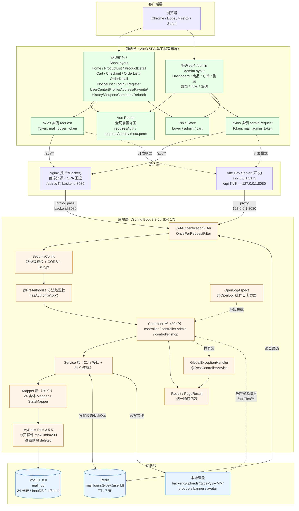

### 1.2 请求链路（以"管理端新增商品"为例）

```
1. 浏览器  →  POST /api/admin/products
              Header: Authorization: Bearer <JWT>
              Body:   {categoryId, name, skus:[...], specs:[...]}

2. Nginx（或 Vite dev server）
   →  location /api/  proxy_pass http://backend:8080/api/

3. JwtAuthenticationFilter（OncePerRequestFilter）
   →  resolveToken(request)：读 Authorization，剥离 "Bearer " 前缀
   →  tokenService.getLoginUser(token)：
        a) jwtUtil.parseToken(token) 验签 + 校验过期
        b) redisTemplate.get("mall:login:ADMIN:{userId}")
        c) 比对 redis 中的 token 与请求 token 是否一致
   →  构建 UsernamePasswordAuthenticationToken(loginUser, null, authorities)
      authorities = [TYPE_ADMIN, ROLE_ADMIN, dashboard:view, product:list, product:add, ...]
   →  SecurityContextHolder.setAuthentication(...)

4. SecurityConfig.authorizeHttpRequests
   →  .requestMatchers("/api/admin/**").hasAuthority("TYPE_ADMIN")  ✅ 通过
   →  .anyRequest().hasAuthority("TYPE_BUYER")

5. @EnableMethodSecurity → @PreAuthorize("hasAuthority('product:add')")  ✅ 通过

6. OperLogAspect.around()  —— 前置：记录方法入参、开始计时

7. AdminProductController.save(dto)
   →  @Valid 触发 Bean Validation（categoryId 非空、name 非空、SKU 价格库存等）

8. ProductServiceImpl.save(dto)  —— @Transactional(rollbackFor = Exception.class)
   →  校验分类存在、SKU 列表非空
   →  遍历 SKU：normalizeSpecData（Jackson 校验 JSON 对象）、resolveSpecInfo、累计 minPrice / totalStock
   →  productMapper.insert(product)            写 SPU（price=最低价，stock=SKU汇总）
   →  productSpecMapper.delete(...)            规格先删
   →  productSpecMapper.insert(...) × N        规格后插
   →  productSkuMapper.insert/updateById/...   SKU 新增/更新/删除

9. MyBatis-Plus → MySQL（InnoDB 事务提交）

10. Result.success("新增成功", productId)
    →  Jackson 序列化为 {code:200, message:"新增成功", data:5, timestamp:...}

11. OperLogAspect.around()  —— finally：写 sys_oper_log（module/operation/method/uri/params/ip/costTime/status）

12. 前端 adminRequest 响应拦截器
    →  res.code === 200 → return res（业务代码取 res.data）
    →  否则 ElMessage.error(res.message) 并 reject
```

### 1.3 分层职责

| 层 | 包/目录 | 职责 | 数量 |
| --- | --- | --- | --- |
| 控制器 | `com.mall.controller` | 接收请求、参数校验（`@Valid`）、权限声明（`@PreAuthorize`）、调用 Service、包装 `Result` | **30** 个 |
| 服务接口 | `com.mall.service` | 业务能力声明 | **21** 个 |
| 服务实现 | `com.mall.service.impl` | 业务编排、事务边界、DTO/VO 转换、跨表校验 | **21** 个 |
| 数据访问 | `com.mall.mapper` | MyBatis-Plus `BaseMapper` 继承 + 自定义注解 SQL | **25** 个（24 实体 + `StatsMapper`） |
| 实体 | `com.mall.entity` | 与数据库表一一映射，逻辑删除标记 | **24** 个 |
| 请求对象 | `com.mall.dto` | 入参载体 + Bean Validation 注解 | **42** 个 |
| 响应对象 | `com.mall.vo` | 出参载体，屏蔽敏感字段（如 `password`），聚合展示字段 | **43** 个 |
| 基础设施 | `com.mall.common` | 统一响应、异常、枚举、AOP 切面、Excel/通用工具 | 9 个类 |
| 配置 | `com.mall.config` | Security / MyBatis-Plus / Redis / Jackson / WebMvc / Knife4j / 字段填充 | 7 个配置类 |
| 安全 | `com.mall.security` | JWT 工具、Token 服务、认证过滤器、登录用户模型、上下文工具 | 5 个类 |

**总计 Java 文件数**：30 + 21 + 21 + 25 + 24 + 42 + 43 + 9 + 7 + 5 + 1（`MallApplication`）+ 2（`common/annotation/OperLog`、`common/enums/{OrderStatus,RefundStatus}` 已计入 common）+ 2（`common/util`）= **约 230 个 Java 文件**。

---

## 二、技术选型与理由

### 2.1 后端技术栈

| 技术 | 版本 | 选型理由 |
| --- | --- | --- |
| **Spring Boot** | **3.3.5** | ① 3.x 原生支持 Jakarta EE 9+ 命名空间（`jakarta.servlet.*`、`jakarta.validation.*`），与 JDK 17 完全对齐；② 内置 Tomcat 10.1，无需外部容器；③ 自动配置大幅减少样板代码（数据源、Redis、Jackson、Multipart、AOP 开箱即用）；④ 3.3.x 是当前 LTS 附近的稳定版本，社区资料丰富。**选 3.3 而非 2.7** 的核心原因是 2.7 基于 `javax.*`，与 JDK 17+ 生态的新库（Knife4j 4.x、MyBatis-Plus 3.5.5 的 `spring-boot3-starter`）不兼容。 |
| **JDK** | **17** | Spring Boot 3.x 的最低要求；同时是当前主流 LTS，`switch` 表达式（`OrderStatus.descOf` 使用了箭头 switch）、`record`（`MemberServiceImpl.OrderStat`）、`instanceof` 模式匹配（`principal instanceof LoginUser loginUser`）、文本块（`StatsMapper` 的 `@Select("""...""")`）等新特性在代码中被大量使用。 |
| **MyBatis-Plus** | **3.5.5** | ① 相比原生 MyBatis，`BaseMapper` 免写单表 CRUD；② `LambdaQueryWrapper` 提供**编译期类型安全**的查询构造（`Orders::getOrderNo` 而非字符串 `"order_no"`），重构时不会漏改；③ **内置分页插件**（`PaginationInnerInterceptor`），统一处理 `COUNT` + `LIMIT`，并支持 `maxLimit` 防大分页攻击；④ **全局逻辑删除**（配置一次，所有实体查询自动追加 `deleted = 0`）；⑤ 支持 `@Select` 注解写原生 SQL（`StatsMapper`），复杂统计不必引入 XML。 |
| **Spring Security** | **6.3**（随 Boot 3.3.5） | ① 工业级认证授权框架，`SecurityFilterChain` 配置式声明鉴权规则；② `@EnableMethodSecurity` + `@PreAuthorize` 提供**方法级**细粒度权限；③ `BCryptPasswordEncoder` 内置；④ 与 `OncePerRequestFilter` 天然集成，便于插入 JWT 过滤器。 |
| **jjwt**（Java JWT） | **0.12.3** | ① 纯 Java 实现，无额外依赖；② 0.12.x 采用**流式 API**（`Jwts.builder().claim(...).signWith(key)`、`Jwts.parser().verifyWith(key).parseSignedClaims()`），比 0.11 的 `setClaims`/`parseClaimsJws` 更清晰；③ `Keys.hmacShaKeyFor()` 直接支持 HS256/HS384/HS512；④ 支持 `id()`（jti）设置唯一标识。 |
| **MySQL** | **8.0** | ① InnoDB 提供事务与行级锁，是库存扣减原子性的基础；② 支持 `utf8mb4` 完整 4 字节字符集；③ 8.0 的 `GREATEST`、`IFNULL`、`DATE_FORMAT` 等函数满足全部统计需求；④ 生态成熟，是电商系统的默认选择。 |
| **Redis** | **5+**（镜像用 7-alpine） | ① **实现"可主动失效的登录态"**：纯 JWT 是无状态的，签发后无法撤销；本方案把 `LoginUser` 存入 Redis，请求时比对 token 字符串，从而支持退出登录、禁用账号、角色变更后立即失效；② `SETEX` 的 TTL 与 JWT 有效期对齐，无需额外清理；③ 读取性能远高于数据库查询权限信息（每次请求都要用）。 |
| **Knife4j** | **4.5.0** | ① 基于 OpenAPI 3（`springdoc`）的**增强 UI**，比原生 Swagger UI 更适合中文团队：支持分组、离线文档导出、全局参数设置；② `knife4j-openapi3-jakarta-spring-boot-starter` 适配 Jakarta 命名空间；③ 提供 `/doc.html` 页面，配置 `language: zh_cn` 后界面中文化；④ 代码中以 `@Tag` + `@Operation` 注解生成文档，**文档与代码同源**，不会脱节。 |
| **Apache POI** | **5.2.5** | ① `poi-ooxml` 同时支持 `.xlsx`（XSSF）与 `.xls`（HSSF）；② Excel 导入导出是电商后台的刚需（商品批量维护、订单对账）；③ 5.2.5 修复了多个 CVE，且 API 稳定；④ 通过 `WorkbookFactory.create(InputStream)` 自动识别格式，无需按扩展名分支。 |
| **HikariCP** | 随 Boot | Spring Boot 3 默认连接池，性能优于 DBCP/Tomcat JDBC；配置 `maximum-pool-size=20`、`minimum-idle=5`，兼顾吞吐与数据库连接数控制。 |
| **Lettuce** | 随 Boot | Redis 客户端默认实现，基于 Netty 的异步驱动，配置连接池 `max-active=16` 适配中等并发。 |
| **Lombok** | 随 Boot | 消除 getter/setter/构造器样板代码（`@Data`、`@RequiredArgsConstructor`、`@Slf4j`），使类文件聚焦业务逻辑。`annotationProcessorPaths` 显式声明，保证编译期生效。 |

### 2.2 前端技术栈

| 技术 | 版本 | 选型理由 |
| --- | --- | --- |
| **Vue 3** | **3.5** | ① Composition API + `<script setup>` 让复杂页面（如商品编辑的多规格 SKU 表格）逻辑可拆分复用；② 响应式系统基于 `Proxy`，支持数组/对象深层变更检测；③ 相比 Vue 2 有更好的 TypeScript 支持与更小的包体；④ 模板语法对后端开发者友好。 |
| **Vite** | **5** | ① 开发态基于 esbuild 预构建 + 原生 ESM，**冷启动秒级**（相比 webpack 的构建式开发服务器）；② HMR 粒度细，改单个 `.vue` 文件只更新该模块；③ 生产构建用 Rollup，产物可读性好；④ 配置极简（本项目的 `vite.config.js` 仅 29 行，含 alias、dev server 与 `/api` 代理）。 |
| **Element Plus** | 随 `package.json` | ① 与 Vue 3 配套的成熟组件库，表格、分页、表单、上传、树、对话框等后台常用组件齐全；② `main.js` 中通过 `app.use(ElementPlus, { locale: zhCn })` 全局中文化；③ 全量注册 `@element-plus/icons-vue` 图标，模板中可直接用 `<Monitor />` 这类标签；④ 商品分类的 `icon` 字段直接存 Element Plus 图标名，实现"图标可配置"。 |
| **Pinia** | 随 `package.json` | ① Vue 3 官方推荐的状态管理，替代 Vuex；② 无 mutation 概念，`actions` 中可直接改 `state`；③ 三个 store（`buyer`、`admin`、`cart`）职责清晰：登录态、权限、购物车角标。 |
| **Vue Router** | **4** | ① `createWebHistory` 模式，URL 无 `#`；② **路由 `meta` 承载元信息**（`requiresAuth`、`requiresAdmin`、`perm`、`title`），全局前置守卫据此做统一拦截；③ 支持嵌套路由（`/user` 下的 7 个子页面）与懒加载（`() => import(...)`，按页面自动分包）。 |
| **ECharts** | 随 `package.json` | 数据看板的折线图（销售趋势）、饼图（分类销售占比）、柱状图（热销 TOP10、订单状态分布）渲染。相比 Chart.js 更适合中文标注与大数据量渲染。 |
| **axios** | 随 `package.json` | ① 拦截器机制完善，本项目的**双实例隔离**（买家/管理端各持一个 Token 键）与统一错误提示都基于它；② 支持 `responseType: 'blob'` 处理 Excel 下载；③ `baseURL: '/api'` 配合代理，避免硬编码后端地址。 |

### 2.3 版本约束与兼容性矩阵

| 组件 | 版本要求 | 说明 |
| --- | --- | --- |
| JDK | 17+ | `pom.xml` 的 `<java.version>17</java.version>` |
| Maven | 3.8+ | 支持 `annotationProcessorPaths` |
| Node.js | 18+ | Vite 5 要求 Node 18+ |
| MySQL | 8.0 | 排除了 5.7（`utf8mb4_general_ci` 与部分函数行为差异） |
| Redis | 5+ | RedisTemplate 与 Lettuce 的最低要求 |

---

## 三、后端分层与包结构

### 3.1 包结构

```
backend/src/main/java/com/mall/
├── MallApplication.java                    # @SpringBootApplication 启动类
│
├── common/                                 # 基础设施（无业务依赖）
│   ├── Result.java                         # 统一响应 {code, message, data, timestamp}
│   ├── PageResult.java                     # 统一分页 {records, total, page, size, pages}
│   ├── ResultCode.java                     # 状态码枚举 200/400/401/403/404/500/600
│   ├── BusinessException.java              # 业务异常（携带 code，默认 600）
│   ├── GlobalExceptionHandler.java         # @RestControllerAdvice 全局异常兜底
│   ├── annotation/
│   │   └── OperLog.java                    # 操作日志注解（module / value / saveParams）
│   ├── aspect/
│   │   └── OperLogAspect.java              # @Around 切面，写 sys_oper_log
│   ├── enums/
│   │   ├── OrderStatus.java                # 订单状态 + descOf / isPaid / canApplyAfterSale
│   │   └── RefundStatus.java               # 售后状态 + descOf
│   └── util/
│       ├── CommonUtils.java                # getIp(request) 解析真实IP
│       └── ExcelUtils.java                 # 导出 / 导出模板 / 读单元格
│
├── config/                                 # 配置类
│   ├── SecurityConfig.java                 # 过滤器链、CORS、BCrypt、白名单
│   ├── MybatisPlusConfig.java              # 分页插件（maxLimit=200, overflow=false）
│   ├── MybatisMetaObjectHandler.java       # 字段自动填充
│   ├── RedisConfig.java                    # RedisTemplate 序列化策略
│   ├── JacksonConfig.java                  # LocalDateTime 序列化格式
│   ├── WebMvcConfig.java                   # /api/files/** 静态资源映射 + Knife4j 资源
│   └── Knife4jConfig.java                  # OpenAPI 分组（买家商城端 / 管理后台）
│
├── security/                               # 认证授权
│   ├── LoginUser.java                      # 登录用户模型（存 Redis）
│   ├── JwtUtil.java                        # JWT 生成 / 解析
│   ├── TokenService.java                   # Redis 登录态管理（create/refresh/get/delete/kickOut/countOnline）
│   ├── JwtAuthenticationFilter.java        # OncePerRequestFilter，构建 SecurityContext
│   └── SecurityUtils.java                  # 静态工具：getUserId / getLoginUser / getToken
│
├── entity/                                 # 24 个实体（与表一一对应）
├── mapper/                                 # 25 个 Mapper（24 实体 + StatsMapper）
├── dto/                                    # 42 个请求对象（含 Bean Validation 注解）
├── vo/                                     # 43 个响应对象
│
├── service/                                # 21 个服务接口
│   └── impl/                               # 21 个服务实现
│
└── controller/                             # 30 个控制器
    ├── CartController.java                 # /api/cart
    ├── AddressController.java              # /api/address
    ├── admin/                              # 18 个：/api/admin/**
    │   ├── AdminAuthController.java
    │   ├── AdminDashboardController.java
    │   ├── AdminProductController.java
    │   ├── AdminCategoryController.java
    │   ├── AdminStockController.java
    │   ├── AdminCommentController.java
    │   ├── AdminOrderController.java
    │   ├── AdminRefundController.java
    │   ├── AdminCouponController.java
    │   ├── AdminBannerController.java
    │   ├── AdminNoticeController.java
    │   ├── AdminMemberController.java
    │   ├── AdminSysUserController.java
    │   ├── AdminSysRoleController.java
    │   ├── AdminSysPermissionController.java
    │   ├── AdminSysConfigController.java
    │   ├── AdminSysLogController.java
    │   └── AdminUploadController.java
    └── shop/                               # 11 个：买家端
        ├── AuthController.java             # /api/auth
        ├── ShopCategoryController.java     # /api/shop/categories
        ├── ShopProductController.java      # /api/shop/products
        ├── ShopCommentController.java      # /api/shop/products/{id}/comments
        ├── ShopBannerController.java       # /api/shop/banners
        ├── ShopNoticeController.java       # /api/shop/notices
        ├── ShopCouponController.java       # /api/shop/coupons
        ├── CartController.java（见上层）
        ├── OrderController.java            # /api/order
        ├── RefundController.java           # /api/refund
        ├── CommentController.java          # /api/comment
        └── UserCenterController.java       # /api/user
```

### 3.2 依赖方向（单向，无循环）

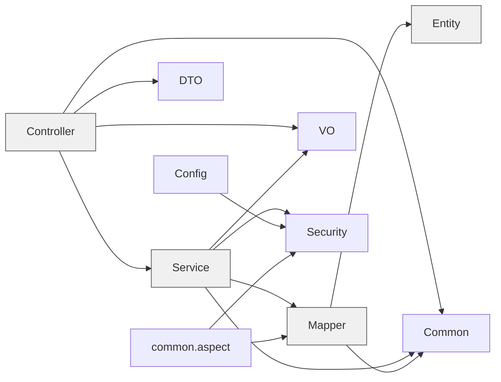

**关键约束**：

1. **Controller 不直接依赖 Mapper**：所有数据访问经 Service，便于事务与业务规则集中；
2. **Entity 不出现在 Controller 签名中**：Controller 的入参是 DTO、出参是 VO，避免实体字段（如 `SysUser.password`）意外暴露；
3. **Service 之间可以互相调用**：如 `OrderServiceImpl` 依赖 `RefundService`（`refundService::toVO` 复用售后 VO 转换），`SysUserServiceImpl` 依赖 `SysRoleService`（`listAllRoles` 复用角色列表）。这是**同层调用**，需注意避免循环依赖；
4. **`common` 不依赖任何业务包**：`Result`、`PageResult`、`ResultCode`、`BusinessException` 是纯基础设施。

### 3.3 关键基础设施类

#### 3.3.1 统一响应 `Result<T>`

```java
public class Result<T> implements Serializable {
    private Integer code;         // 200 表示成功
    private String message;       // 提示信息
    private T data;               // 业务数据
    private Long timestamp = System.currentTimeMillis();   // 服务端时间戳

    public static <T> Result<T> success() { ... }
    public static <T> Result<T> success(T data) { ... }
    public static <T> Result<T> success(String message, T data) { ... }
    public static <T> Result<T> error(String message) { ... }           // code=600
    public static <T> Result<T> error(Integer code, String message) { ... }
    public static <T> Result<T> error(ResultCode resultCode) { ... }
    public boolean isSuccess() { ... }
}
```

**设计要点**：`timestamp` 字段在声明时初始化（`= System.currentTimeMillis()`），因此**只要构造 `Result` 就自动带时间戳**，无需在每个工厂方法中赋值。

#### 3.3.2 统一分页 `PageResult<T>`

```java
public class PageResult<T> implements Serializable {
    private List<T> records = new ArrayList<>();
    private Long total = 0L;
    private Long page = 1L;
    private Long size = 10L;
    private Long pages = 0L;      // 自动计算：(total + size - 1) / size

    public static <T> PageResult<T> of(IPage<T> page) { ... }
    public static <E, T> PageResult<T> of(IPage<E> page, Function<E, T> converter) { ... }
    public static <T> PageResult<T> empty() { ... }
}
```

**两个便利点**：
- 构造器中对 `null` 与非法值做兜底（`total` 为 null → 0，`size <= 0` → 10），防御性编程；
- `of(page, converter)` 直接在构造时完成**实体 → VO 转换**，Service 无需先 stream map 再 new，减少 3 行样板代码。

#### 3.3.3 状态码 `ResultCode`

| 枚举 | code | message |
| --- | :---: | --- |
| `SUCCESS` | 200 | 操作成功 |
| `PARAM_ERROR` | 400 | 请求参数错误 |
| `UNAUTHORIZED` | 401 | 未登录或登录已过期，请重新登录 |
| `FORBIDDEN` | 403 | 抱歉，您没有该操作权限 |
| `NOT_FOUND` | 404 | 请求的资源不存在 |
| `ERROR` | 500 | 系统繁忙，请稍后重试 |
| `BUSINESS_ERROR` | 600 | 业务处理失败 |

**HTTP 状态码 vs 业务 code**：

- **401/403 会同时设置 HTTP 状态码**（`SecurityConfig.writeJson` 中 `response.setStatus(resultCode.getCode())`），因为浏览器/axios 需要据此触发跳转登录；
- **400/500/600 的 HTTP 状态码是 200**，仅业务 `code` 不同。这样做让前端只需检查 `res.code`，不必区分 HTTP 层错误。

#### 3.3.4 异常体系

```mermaid
graph TB
    Root["RuntimeException"]
    Root --> BE["BusinessException<br/>code 默认 600<br/>message 为中文业务提示"]
    Root --> AE["AccessDeniedException<br/>Spring Security"]
    Root --> AuthE["AuthenticationException"]

    Handler["GlobalExceptionHandler<br/>@RestControllerAdvice"]
    BE -->|"handleBusinessException"| Handler
    AE -->|"handleAccessDeniedException"| Handler
    AuthE -->|"handleAuthenticationException"| Handler

    MVE["MethodArgumentNotValidException<br/>@RequestBody + @Valid"]
    BEX["BindException<br/>表单对象绑定"]
    CVE["ConstraintViolationException<br/>@RequestParam/@PathVariable 约束"]
    MPE["MissingServletRequestParameterException"]
    HMR["HttpMessageNotReadableException"]
    HMS["HttpRequestMethodNotSupportedException"]
    MUS["MaxUploadSizeExceededException"]
    NHF["NoHandlerFoundException"]
    EX["Exception 兜底"]
    MVE --> Handler
    BEX --> Handler
    CVE --> Handler
    MPE --> Handler
    HMR --> Handler
    HMS --> Handler
    MUS --> Handler
    NHF --> Handler
    EX --> Handler

    classDef ex fill:#ffe8e8,stroke:#c00
    classDef h fill:#e8f4ff,stroke:#1c6fb8
    class BE,AE,AuthE,MVE,BEX,CVE,MPE,HMR,HMS,MUS,NHF,EX ex
    class Handler h
```

**异常处理的组合技巧**：`handleValidException` 会把 `BindingResult` 中的**多条**字段错误用中文分号 `；` 拼接，如「商品名称不能为空；SKU 售价不能为空」，用户一次就能看到全部问题，而不是改一个报一个。

**兜底日志**：`handleException` 会 `log.error` 完整堆栈（含请求方法与 URI），便于排查；而业务异常只 `log.warn`，避免正常的业务校验污染错误日志。

#### 3.3.5 操作日志切面

```java
@Around("@annotation(operLog)")
public Object around(ProceedingJoinPoint joinPoint, OperLog operLog) throws Throwable {
    long start = System.currentTimeMillis();
    Throwable error = null;
    try {
        return joinPoint.proceed();
    } catch (Throwable throwable) {
        error = throwable;
        throw throwable;              // ← 异常继续抛出，不吞掉
    } finally {
        saveLog(joinPoint, operLog, System.currentTimeMillis() - start, error);
    }
}
```

**设计要点**：

| 点 | 说明 |
| --- | --- |
| 用 `finally` 而非 `@AfterReturning` | **异常也要记日志**（`status=0` + `error_msg`），否则"操作失败"无迹可查 |
| 异常继续抛出 | 切面只做记录，不改变业务行为 |
| `saveLog` 整体 `try/catch` | 日志写入失败仅 `log.warn`，**绝不影响主业务**（日志表字段异常、磁盘满等场景） |
| 过滤敏感/无用参数 | 排除 `HttpServletRequest`、`HttpServletResponse`、`MultipartFile`（序列化它们会失败或产生巨大字符串） |
| 参数截断 | `params` 与 `error_msg` 均截断至 **2000** 字符（`MAX_PARAM_LENGTH`），避免 `TEXT` 字段被超长 JSON 撑爆 |
| `saveParams=false` | 密码类、文件流类接口显式关闭参数记录 |

#### 3.3.6 Excel 工具

`ExcelUtils` 提供三个能力（被 `ProductServiceImpl` 与 `OrderServiceImpl` 复用）：

| 方法 | 用途 |
| --- | --- |
| `export(response, fileName, sheetName, headers, rows)` | 导出数据，自动设置响应头（`Content-Disposition`，含 UTF-8 编码的文件名） |
| `exportTemplate(response, fileName, sheetName, headers, tips)` | 导出带填写说明的导入模板 |
| `readCell(cell)` | 安全读取单元格为字符串（处理数字、日期、布尔、公式等类型） |

**注意导出与导入的分工**：Excel 逻辑没有独立的 Service，而是由 `ProductServiceImpl` / `OrderServiceImpl` 直接调用工具类。这是因为导入导出的**字段映射与业务规则强绑定**（如商品导入要解析规格字符串并合并分组），抽成通用服务反而增加复杂度。

---

## 四、认证与授权链路

### 4.1 登录时序图

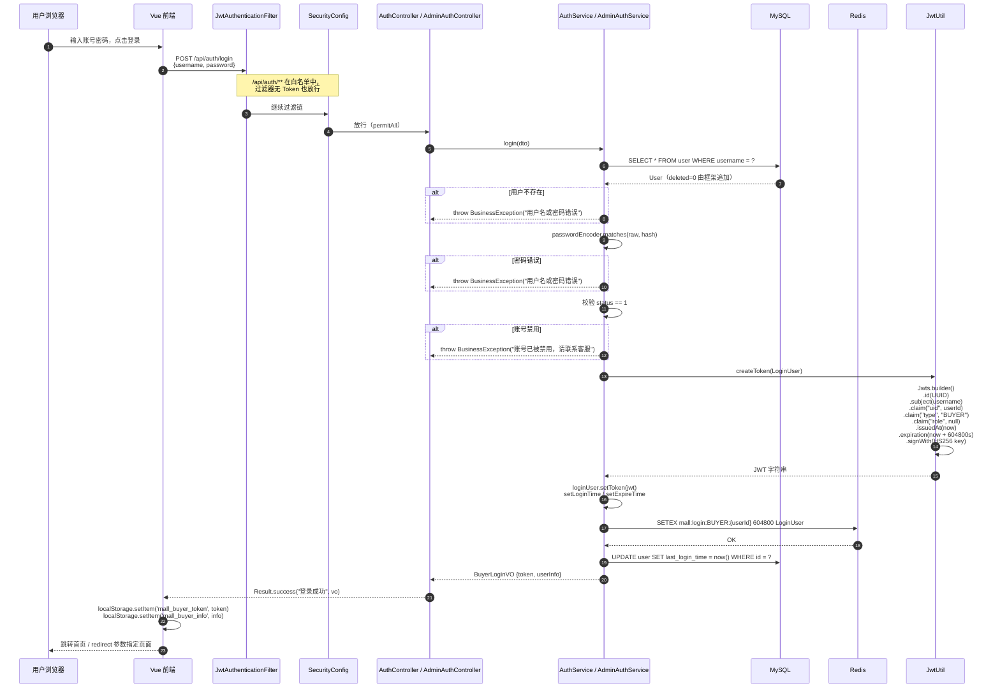

### 4.2 携带 Token 请求的校验时序

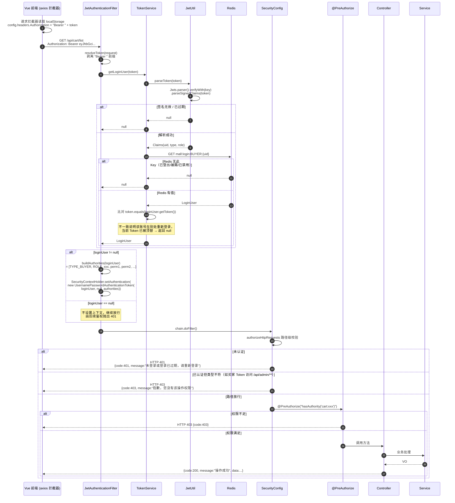

### 4.3 权限集合的构建

```java
// JwtAuthenticationFilter.buildAuthorities
public static List<GrantedAuthority> buildAuthorities(LoginUser loginUser) {
    List<GrantedAuthority> authorities = new ArrayList<>();
    // ① 用户类型：TYPE_ADMIN / TYPE_BUYER
    if (loginUser.getUserType() != null) {
        authorities.add(new SimpleGrantedAuthority(TYPE_AUTHORITY_PREFIX + loginUser.getUserType()));
    }
    // ② 角色编码：ROLE_ADMIN / ROLE_OPERATOR / ROLE_WAREHOUSE
    if (loginUser.getRoleCode() != null && !loginUser.getRoleCode().isBlank()) {
        authorities.add(new SimpleGrantedAuthority(ROLE_AUTHORITY_PREFIX + loginUser.getRoleCode()));
    }
    // ③ 具体权限标识：dashboard:view / product:add / ...
    if (loginUser.getPermissions() != null) {
        loginUser.getPermissions().stream()
                .filter(p -> p != null && !p.isBlank())
                .distinct()
                .forEach(p -> authorities.add(new SimpleGrantedAuthority(p)));
    }
    return authorities;
}
```

**三类权限的用途**：

| 前缀 | 示例 | 判定方式 | 使用者 |
| --- | --- | --- | --- |
| `TYPE_` | `TYPE_ADMIN`、`TYPE_BUYER` | `hasAuthority('TYPE_ADMIN')` | `SecurityConfig` 的路径级规则 |
| `ROLE_` | `ROLE_ADMIN` | `hasRole('ADMIN')` 或 `hasAuthority('ROLE_ADMIN')` | **当前代码未使用**，为后续按角色整体授权预留 |
| 无前缀 | `product:add` | `hasAuthority('product:add')` | 各 Controller 的 `@PreAuthorize` |

**为什么不用 Spring Security 的 `UserDetails`**：`LoginUser` 的类注释明确说明：

> 刻意不实现 Spring Security 的 UserDetails：该类会被序列化进 Redis，计算型 getter 会干扰 JSON 反序列化，权限集合在过滤器中另行构建。

`UserDetails` 接口的 `isAccountNonExpired()`、`isEnabled()` 等 `isXxx()` 方法会被 Jackson 当作属性序列化（生成 `accountNonExpired` 等字段），反序列化时因无对应字段而报错或产生冗余数据。因此选择**纯 POJO + 显式构建 authorities**。

### 4.4 登录态失效（主动登出）机制

**核心设计**：JWT 负责"验签 + 过期"，Redis 负责"是否仍然有效"。

```java
// TokenService.getLoginUser —— 三道校验
public LoginUser getLoginUser(String token) {
    Claims claims = jwtUtil.parseToken(token);          // ① 验签 + 过期
    if (claims == null) return null;

    Long userId = jwtUtil.getUserId(claims);
    String userType = jwtUtil.getUserType(claims);
    if (userId == null || userType == null) return null;

    Object cached = redisTemplate.opsForValue()
            .get(buildKey(userType, userId));           // ② Redis 登录态存在
    if (!(cached instanceof LoginUser loginUser)) return null;

    if (!token.equals(loginUser.getToken())) return null;  // ③ Token 未被顶替
    return loginUser;
}
```

**Redis Key 结构**：`mall:login:{userType}:{userId}`

| Key 示例 | 值 | TTL |
| --- | --- | --- |
| `mall:login:BUYER:1` | `LoginUser{userId=1, username="zhangsan", userType="BUYER", token="eyJ...", loginTime, expireTime, permissions=[]}` | 604800 秒 |
| `mall:login:ADMIN:1` | `LoginUser{userId=1, username="admin", userType="ADMIN", roleCode="ADMIN", permissions=[65个], token="eyJ..."}` | 604800 秒 |

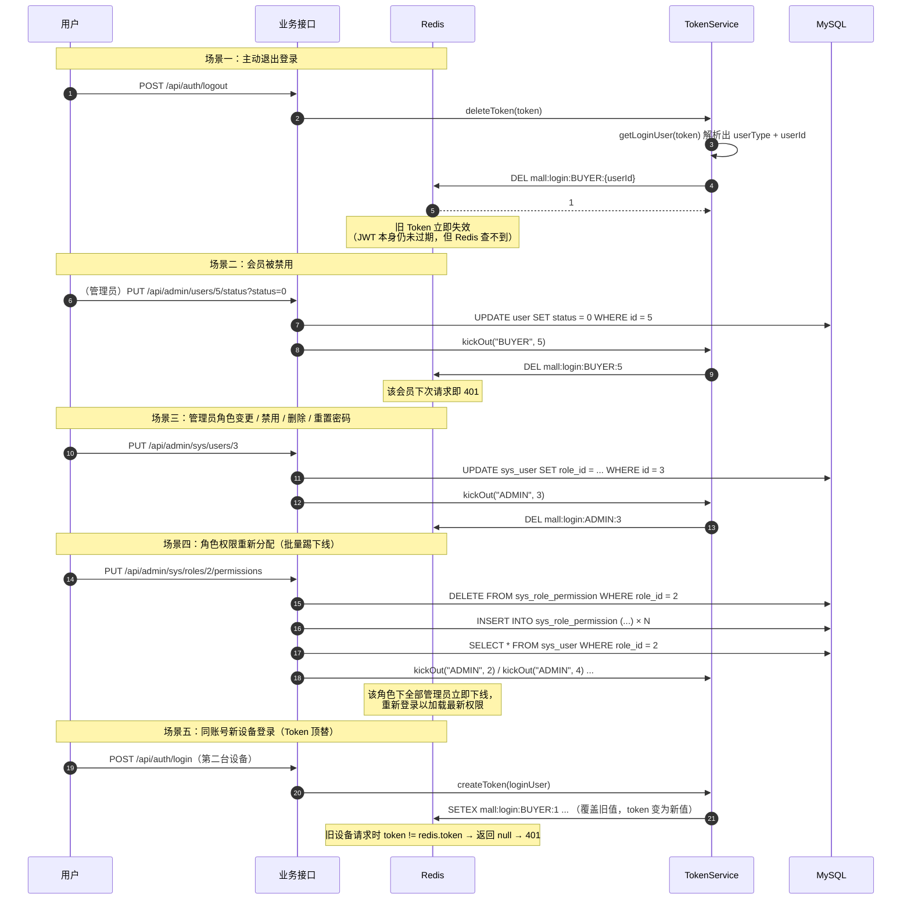

**失效场景与触发点汇总**：

| 场景 | 触发代码 | 效果 |
| --- | --- | --- |
| 主动退出登录 | `AuthServiceImpl.logout` → `deleteToken`；`AdminAuthServiceImpl.logout` → `deleteToken` | 立即失效 |
| 同账号异设备登录 | `TokenService.createToken` → `refreshToken` 覆盖 | 旧 Token 立即失效 |
| 会员被禁用 | `MemberServiceImpl.updateStatus(status=0)` → `kickOut("BUYER", id)` | 立即失效 |
| 管理员被禁用 | `SysUserServiceImpl.updateStatus(0)` / `save`（目标状态为 0）→ `kickOut("ADMIN", id)` | 立即失效 |
| 管理员被删除 | `SysUserServiceImpl.delete` → `kickOut("ADMIN", id)` | 立即失效 |
| 管理员角色变更 | `SysUserServiceImpl.save`（`roleChanged == true`）→ `kickOut("ADMIN", id)` | 立即失效 |
| 管理员密码被重置 | `SysUserServiceImpl.resetPassword` → `kickOut("ADMIN", id)` | 立即失效 |
| 角色权限重新分配 | `SysRoleServiceImpl.assignPermissions` → `kickOutRoleUsers` | 该角色下全部管理员立即失效 |
| Token 自然过期 | JWT `expiration` + Redis TTL 双到期 | 604800 秒后失效 |
| 买家自行修改密码 | `UserServiceImpl.updatePassword` | **不失效**（代码注释："密码修改后保留当前登录态，不强制下线"） |
| 角色被停用 | `SysRoleServiceImpl.updateStatus` | **不失效**（已知改进点：仅更新状态，未踢下线） |

### 4.5 为什么选择"JWT + Redis"而不是纯 JWT 或纯 Session

| 方案 | 优点 | 缺点 | 本项目是否采用 |
| --- | --- | --- | --- |
| **纯 JWT（无状态）** | 服务器不存储任何状态，水平扩展无压力 | **签发后无法撤销**。禁用账号、改权限、退出登录都无法立即生效，只能等过期。7 天有效期下这是不可接受的安全窗口 | ❌ |
| **纯 Session（`HttpSession`）** | 服务端完全可控，随时失效 | 有状态，多实例需 Session 共享（Redis 存储 Session 或粘性会话）；每次请求要查会话存储；与前后端分离 + 多端（买家/管理员）的场景需要额外区分处理 | ❌ |
| **JWT + Redis（本方案）** | ① JWT 提供**验签与过期**，避免每次请求都查库；② Redis 提供**可撤销性**，支持主动登出与强制下线；③ Redis 的读取（O(1)）远快于数据库查询权限；④ 无状态与可控性兼得 | ① 每次请求仍要访问 Redis（比纯 JWT 多一次网络往返）；② Redis 不可用时全站登录态失效（但可用性要求下 Redis 通常与 MySQL 同级别保障）；③ Token 字符串会被"顶替"，同一账号只能单设备在线 | ✅ |

**"单设备在线"是不是缺陷**：这是本方案的**有意取舍**。实现方式是把 `token` 存进 Redis 的 `LoginUser` 并逐字比对，因此一个账号只有一个有效 Token。好处是安全（密码泄露后重新登录即可踢掉攻击者），代价是不支持多端同时在线。若要支持多端，可把 Key 改为 `mall:login:{type}:{userId}:{deviceId}` 并用 Set 存储多个 Token。

### 4.6 双层权限校验的必要性

**只用前端校验的问题**：前端 `v-perm` 指令只是**移除 DOM 节点**，用户可以：
- 用 curl / Postman 直接调接口；
- 在控制台手动 `axios.delete('/api/admin/products/1')`；
- 修改 localStorage 里的 `mall_admin_info` 伪造权限数组。

**只用后端校验的问题**：功能上安全，但用户会看到点不动的按钮、进不去的页面，体验差且困惑。

**本项目的两层设计**：

| 层 | 位置 | 判定 | 是否安全边界 |
| --- | --- | --- | :---: |
| 前端路由守卫 | `router.beforeEach` | `adminStore.hasPermission(to.meta.perm)`，无权限跳回看板并提示 | ❌ 仅体验 |
| 前端按钮指令 | `v-perm` | 无权限则从 DOM 移除元素 | ❌ 仅体验 |
| 后端路径级 | `SecurityConfig` | `/api/admin/**` 需 `TYPE_ADMIN`，其余受保护接口需 `TYPE_BUYER` | ✅ |
| 后端方法级 | `@PreAuthorize` | `hasAuthority('具体权限标识')` | ✅ |

**前端的 `isSuperAdmin` 短路**（`store/admin.js`）：

```js
hasPermission(code) {
  if (!code) return true
  if (this.isSuperAdmin) return true      // roleCode === 'ADMIN' 时直接放行
  return this.permissions.includes(code)
}
```

**⚠️ 前后端判定规则不一致的隐患**：前端的 `ADMIN` 角色直接返回 `true`（不看 `permissions` 数组）；后端则严格按 Redis 中缓存的 `permissions` 逐项判定。

因此**如果管理员用"角色权限"页面把 ADMIN 角色的某个权限取消掉**，会出现：前端仍显示该按钮（因为 `isSuperAdmin` 短路），但后端返回 403。这是一个需要知晓的不一致点——前端这样写是为了容错（避免因权限数组加载失败导致超管什么都看不到），但确实会造成"按钮可见却点击报错"的体验问题。

---

## 五、下单流程与售后状态机

### 5.1 下单全流程时序图

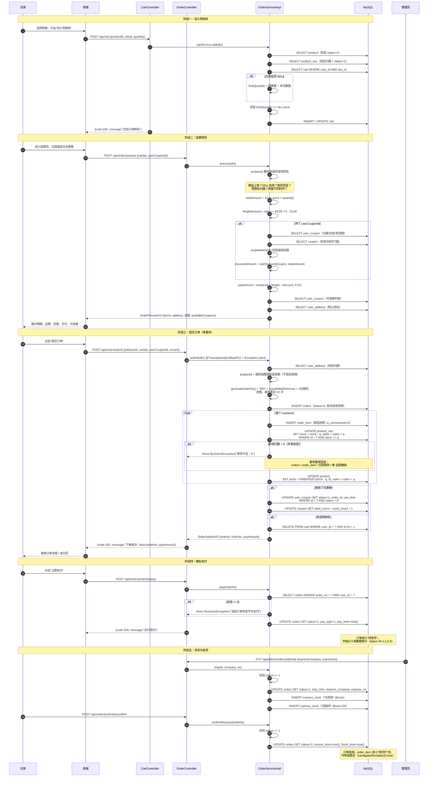

### 5.2 取消订单的库存与优惠券回滚

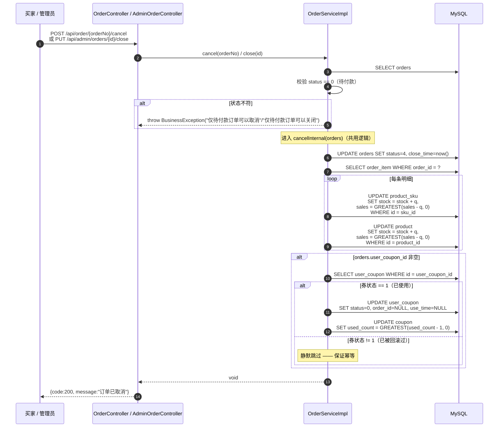

**幂等性保障细节**：

```java
private void returnCoupon(Long userCouponId) {
    if (userCouponId == null) return;
    UserCoupon userCoupon = userCouponMapper.selectById(userCouponId);
    // ← 只有「已使用」状态才回滚，重复调用第二次会自动跳过
    if (userCoupon == null || userCoupon.getStatus() == null || userCoupon.getStatus() != 1) {
        return;
    }
    userCouponMapper.update(null, Wrappers.<UserCoupon>lambdaUpdate()
            .set(UserCoupon::getStatus, 0)
            .set(UserCoupon::getOrderId, null)
            .set(UserCoupon::getUseTime, null)
            .eq(UserCoupon::getId, userCouponId));
    // ← GREATEST 保证 used_count 不会被减成负数
    couponMapper.update(null, Wrappers.<Coupon>lambdaUpdate()
            .setSql("used_count = GREATEST(used_count - 1, 0)")
            .eq(Coupon::getId, userCoupon.getCouponId()));
}
```

### 5.3 售后流程状态机

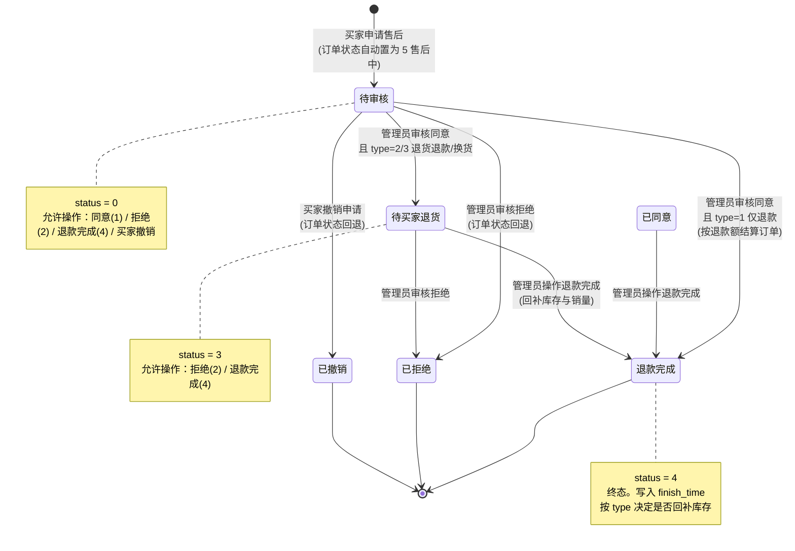

**状态机校验代码（`RefundServiceImpl.audit`）**：

```java
Integer target = dto.getStatus();
if (target == null || (target != 1 && target != 2 && target != 4)) {
    throw new BusinessException("审核结果不合法");
}
Integer current = refund.getStatus();

if (target == 1 && !RefundStatus.PENDING.getCode().equals(current)) {
    throw new BusinessException("仅待审核的售后单可以审核同意");
}
if (target == 2 && !(RefundStatus.PENDING.getCode().equals(current)
        || RefundStatus.WAIT_RETURN.getCode().equals(current))) {
    throw new BusinessException("当前售后状态不可拒绝");
}
if (target == 4 && !(RefundStatus.PENDING.getCode().equals(current)
        || RefundStatus.AGREED.getCode().equals(current)
        || RefundStatus.WAIT_RETURN.getCode().equals(current))) {
    throw new BusinessException("当前售后状态不可操作退款完成");
}
```

**注意 `已同意(1)` 是一个"瞬时态"**：`type=1 仅退款` 审核同意时**直接跳到 4 退款完成**，不会停留在 1。因此 `status=1` 只可能由"某种中间流转"产生——当前代码路径下**没有入口能产生 status=1**（`target=1` 时 `type=1` 直接到 4，`type≠1` 到 3）。

`status=1 已同意` 在状态机校验中被允许作为"退款完成"的前置状态（`target == 4` 的第二个条件），属于**向后兼容的宽松设计**，以便外部数据或未来扩展可以产生该状态。

### 5.4 售后审核对订单与库存的影响

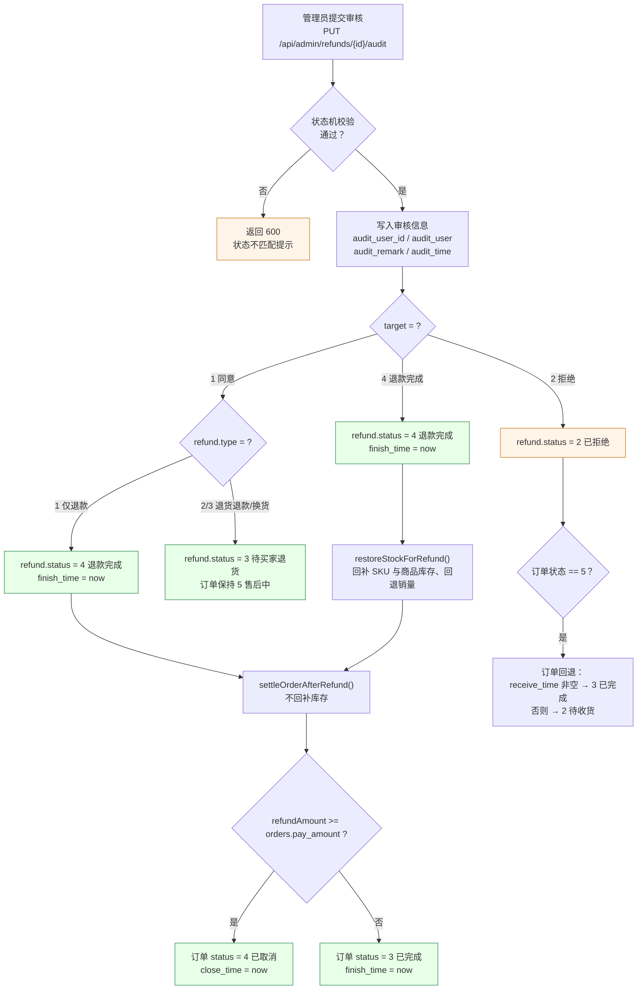

**库存回补的范围（`restoreStockForRefund`）**：

| `refund.order_item_id` | 回补范围 |
| --- | --- |
| **非空（单品售后）** | 只回补该 `order_item` 对应的 SKU 与商品 |
| **NULL（整单售后）** | 回补该订单的**全部** `order_item` |

**回补 SQL**：

```java
productSkuMapper.update(null, Wrappers.<ProductSku>lambdaUpdate()
        .setSql("stock = stock + " + qty)
        .setSql("sales = GREATEST(sales - " + qty + ", 0)")
        .eq(ProductSku::getId, item.getSkuId()));
```

**为什么"仅退款"不回补库存**：仅退款场景下商品仍在买家手上，没有实物退回仓库，因此库存不应增加。只有走到"退货退款/换货"的退款完成，才代表商品回到仓库。

---

## 六、关键设计决策

### 6.1 库存扣减的原子 SQL 与并发考虑

**问题**：高并发下多个买家同时购买同一 SKU，如何避免超卖？

**方案对比**：

| 方案 | 实现 | 问题 |
| --- | --- | --- |
| **① 先查后改** | `SELECT stock` → 判断 `stock >= qty` → `UPDATE stock = stock - qty` | **经典超卖**。两个事务同时读到 `stock=1`，都判断通过，都执行减 1，最终 `stock=-1`。需要加 `SELECT ... FOR UPDATE` 悲观锁才能避免 |
| **② 悲观锁** | `SELECT ... FOR UPDATE` → 判断 → `UPDATE` | 正确但**串行化**，同一 SKU 的所有下单排队等待，吞吐低；且需注意锁范围（`WHERE id = ?` 才是行锁，`WHERE` 无索引会锁表） |
| **③ 乐观锁（版本号）** | `UPDATE ... SET stock = stock - qty, version = version + 1 WHERE id = ? AND version = ?` | 正确，但高冲突下**大量失败重试**，需要业务层实现重试逻辑 |
| **④ 条件原子更新（本方案）** | `UPDATE ... SET stock = stock - qty WHERE id = ? AND stock >= qty`，检查影响行数 | 正确且**无需重试**。把"判断"和"扣减"合并为一条 SQL，由 InnoDB 行锁保证原子性 |

**本方案的实现**：

```java
private void deductStock(LineItem item) {
    int qty = item.getQuantity();
    int rows = productSkuMapper.update(null, Wrappers.<ProductSku>lambdaUpdate()
            .setSql("stock = stock - " + qty)
            .setSql("sales = sales + " + qty)
            .eq(ProductSku::getId, item.getSku().getId())
            .ge(ProductSku::getStock, qty));        // ← WHERE stock >= qty
    if (rows == 0) {
        // 并发下库存被抢空，抛出异常让事务整体回滚
        throw new BusinessException("库存不足：" + item.getProduct().getName());
    }
    productMapper.update(null, Wrappers.<Product>lambdaUpdate()
            .setSql("stock = GREATEST(stock - " + qty + ", 0)")
            .setSql("sales = sales + " + qty)
            .eq(Product::getId, item.getProduct().getId()));
}
```

**为什么这样是安全的**：

```
事务 A: UPDATE product_sku SET stock = stock - 1 WHERE id = 5 AND stock >= 1
事务 B: UPDATE product_sku SET stock = stock - 1 WHERE id = 5 AND stock >= 1

时序：
1. A 获取 id=5 的行锁，读到 stock=1，条件 1>=1 成立，更新为 0，影响 1 行
2. B 尝试获取 id=5 的行锁 → 阻塞等待
3. A 提交，释放锁
4. B 获得锁，**重新读取最新值**（InnoDB 在 READ COMMITTED / REPEATABLE READ 下 UPDATE 都读最新版本）
   → stock=0，条件 0>=1 不成立
   → 影响 0 行
5. B 检测到 rows == 0，抛异常，B 的事务回滚
```

**关键点**：InnoDB 的 `UPDATE` 语句本身会在**加锁后重新求值 WHERE 条件**（当前读），因此不会出现在"锁等待前读到的旧值"基础上做扣减的问题。这是方案 ④ 优于方案 ① 的根本原因。

**SQL 注入防护说明**：`.setSql("stock = stock - " + qty)` 是字符串拼接，但 `qty` 来自 `LineItem.getQuantity()`，其值已在 `buildLineItem` 中校验为 `>= 1` 的整数（`Integer` 类型，无法注入字符串）。因此这里安全。

**其他并发考量**：

| 场景 | 处理 |
| --- | --- |
| **同一订单多 SKU 并发** | 订单提交在**单事务**内逐条扣减。若第 3 个 SKU 扣减失败，前 2 个的扣减随事务一起回滚 |
| **不同订单涉及相同 SKU 集合，加锁顺序不同** | 存在死锁可能（A 锁 SKU1 等 SKU2，B 锁 SKU2 等 SKU1）。MySQL 会自动检测死锁并回滚其中一个事务，该请求返回 500 由前端重试。当前演示场景并发低，未做"按 SKU ID 排序后依次加锁"的优化 |
| **超时未支付占用库存** | 通过"30 分钟自动取消"释放。但如 4.6 所述，该逻辑是**惰性触发**的（买家查询订单时才执行），高并发下可能长时间占用库存 |
| **商品维度库存的下界保护** | `GREATEST(stock - qty, 0)`，即使出现异常数据也不会变成负数 |
| **销量回退的下界保护** | `GREATEST(sales - qty, 0)`，防止退货/取消导致负销量 |

### 6.2 金额服务端重算

**原则**：**前端传入的任何金额字段一律忽略，服务端按 SKU 现价重算**。

```java
// OrderSubmitDTO 中根本没有金额字段，只有 addressId / cartIds / buyNow / userCouponId / remark
public class OrderSubmitDTO implements Serializable {
    @NotNull(message = "请选择收货地址")
    private Long addressId;
    private List<Long> cartIds;
    @Valid
    private OrderItemDTO buyNow;          // 只有 skuId + quantity
    private Long userCouponId;
    private String remark;
}
```

**重算链路**：

```java
List<LineItem> items = prepare(userId, dto.getCartIds(), dto.getBuyNow());
BigDecimal totalAmount = sumTotal(items);                    // Σ(SKU现价 × 数量)
BigDecimal freightAmount = calcFreight(totalAmount);         // >= 99 ? 0 : 10
BigDecimal discountAmount = BigDecimal.ZERO;
if (dto.getUserCouponId() != null) {
    CouponSelection selection = requireAvailableCoupon(userId, dto.getUserCouponId(), totalAmount, items);
    discountAmount = calcDiscount(selection.getCoupon(), totalAmount);
}
BigDecimal payAmount = calcPayAmount(totalAmount, freightAmount, discountAmount);
```

| 金额 | 计算规则 | 常量 |
| --- | --- | --- |
| `totalAmount` | `Σ(sku.price × quantity)`，`setScale(2, HALF_UP)` | — |
| `freightAmount` | `totalAmount >= 99.00` → 0，否则 10.00 | `freeFreightAmount=99.00`、`freightFee=10.00` |
| `discountAmount` | 满减：`coupon.amount`；折扣：`total × (1 - discount/10)`，上限 100.00；不超过 `totalAmount` | `MAX_DISCOUNT_AMOUNT=100.00` |
| `payAmount` | `max(total + freight - discount, 0.01)` | `MIN_PAY_AMOUNT=0.01` |

**为什么预览与提交都要重算（而不复用预览结果）**：

1. 预览与提交是**两次独立请求**，中间可能过了很久（用户犹豫）；
2. 期间商品可能改价、下架、SKU 可能停用、库存可能被抢空、优惠券可能过期；
3. 如果提交时信任预览时前端算出的金额，就会出现"用旧价格下单"的漏洞。

**代价**：`prepare()` 在预览和提交时各执行一次（各查一遍商品与 SKU）。相比安全收益，这点重复查询是值得的。

**`getUserCouponId` 的校验链**（`requireAvailableCoupon`）：

```
1. 券存在且 user_id 匹配        → 否则"优惠券不存在或无权使用"
2. user_coupon.status == 0      → 否则"该优惠券已使用或已过期"
3. expire_time >= now           → 否则"该优惠券已过期"
4. coupon 存在                  → 否则"优惠券信息不存在"
5. coupon.status == 1           → 否则"该优惠券已停用"
6. start_time <= now            → 否则"该优惠券尚未生效"
7. end_time >= now              → 否则"该优惠券已过期"
8. totalAmount >= min_amount    → 否则"订单金额未满 N 元，无法使用该优惠券"
9. scopeMatched(coupon, items)  → 否则"该优惠券不适用于本次购买的商品"
```

**9 道校验全部在服务端**，前端只能通过 `/api/order/preview` 拿到"可用券列表"来引导用户，无法绕过。

### 6.3 优惠券的核销与回滚

**核销（下单时，`useCoupon`）**：

```java
private void useCoupon(UserCoupon userCoupon, Long orderId) {
    userCouponMapper.update(null, Wrappers.<UserCoupon>lambdaUpdate()
            .set(UserCoupon::getStatus, 1)              // 已使用
            .set(UserCoupon::getOrderId, orderId)       // 记录订单
            .set(UserCoupon::getUseTime, LocalDateTime.now())
            .eq(UserCoupon::getId, userCoupon.getId())
            .eq(UserCoupon::getStatus, 0));             // ← 条件：仍为未使用
    if (userCoupon.getCouponId() != null) {
        couponMapper.update(null, Wrappers.<Coupon>lambdaUpdate()
                .setSql("used_count = used_count + 1")
                .eq(Coupon::getId, userCoupon.getCouponId()));
    }
}
```

**`WHERE id = ? AND status = 0` 的作用**：防止同一张券被并发用于两个订单。第二个请求的 UPDATE 影响 0 行，但**代码没有检查影响行数**——这是一个理论上的漏洞：并发下两个订单可能都用上同一张券。

不过实际风险极低，因为：
- 同一用户同一时刻只在一个浏览器中操作；
- 券的 `availableCoupons` 查询会过滤 `status=0`；
- 提交是用户主动点击触发的串行操作。

**若要严格，可改为**：

```java
int rows = userCouponMapper.update(null, ... .eq(UserCoupon::getStatus, 0));
if (rows == 0) {
    throw new BusinessException("该优惠券已被使用");
}
```

**回滚（取消/关闭订单时，`returnCoupon`）**：见 5.2 节的幂等实现。

**双向字段的一致性维护**：

| 方向 | 字段 | 下单时 | 取消时 |
| --- | --- | --- | --- |
| 订单 → 券 | `orders.user_coupon_id` | 写入选中的券ID | 保留（不置空，便于追溯） |
| 券 → 订单 | `user_coupon.order_id` | 写入订单ID | **置回 NULL** |
| 券状态 | `user_coupon.status` | 0 → 1 | 1 → 0 |
| 券使用时间 | `user_coupon.use_time` | `now()` | **置回 NULL** |
| 券使用计数 | `coupon.used_count` | +1 | -1（`GREATEST(...,0)`） |

**注意 `orders.user_coupon_id` 取消后不清空**：这样订单详情仍能显示"本单使用了 XX 券（已退回）"，保留完整的历史信息。因此**不能通过 `orders.user_coupon_id` 是否为空来判断该订单当前是否占用券**，必须查 `user_coupon.status`。

### 6.4 订单状态机

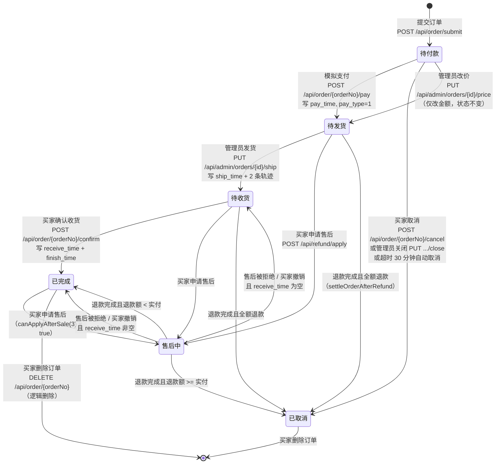

**状态与允许操作矩阵**：

| 当前状态 | 支付 | 取消 | 改价 | 关闭 | 发货 | 收货 | 申请售后 | 删除 |
| --- | :---: | :---: | :---: | :---: | :---: | :---: | :---: | :---: |
| 0 待付款 | ✅ | ✅ | ✅ | ✅ | — | — | ❌ | ❌ |
| 1 待发货 | — | ❌ | ❌ | ❌ | ✅ | — | ✅ | ❌ |
| 2 待收货 | — | ❌ | ❌ | ❌ | — | ✅ | ✅ | ❌ |
| 3 已完成 | — | ❌ | ❌ | ❌ | — | — | ✅ | ✅ |
| 4 已取消 | — | ❌ | ❌ | ❌ | — | — | ❌ | ✅ |
| 5 售后中 | — | ❌ | ❌ | ❌ | — | — | ❌ | ❌ |

**状态流转的守卫（全部在 Service 层）**：

| 操作 | 守卫条件 | 异常提示 |
| --- | --- | --- |
| 支付 | `status == 0` | 当前订单状态不可支付 |
| 买家取消 | `status == 0` | 仅待付款订单可以取消 |
| 管理员关闭 | `status == 0` | 仅待付款订单可以关闭 |
| 管理员改价 | `status == 0` | 仅待付款订单可以改价 |
| 管理员发货 | `status == 1` | 仅待发货订单可以发货 |
| 买家收货 | `status == 2` | 仅待收货订单可以确认收货 |
| 买家删除 | `status IN (3,4)` | 仅已完成或已取消的订单可以删除 |
| 申请售后 | `status IN (1,2,3)` | 当前订单状态（X）不支持申请售后 |

### 6.5 操作日志 AOP

**注解定义**：

```java
@Target(ElementType.METHOD)
@Retention(RetentionPolicy.RUNTIME)
public @interface OperLog {
    String module();                    // 模块，如「商品管理」
    String value();                     // 操作描述，如「新增商品」
    boolean saveParams() default true;  // 是否记录请求参数
}
```

**使用示例**：

```java
@Operation(summary = "新增商品")
@PostMapping
@PreAuthorize("hasAuthority('product:add')")
@OperLog(module = "商品管理", value = "新增商品")
public Result<Long> save(@Valid @RequestBody ProductSaveDTO dto) { ... }

@PutMapping("/{id}/password")
@PreAuthorize("hasAuthority('sys:user:reset')")
@OperLog(module = "系统管理", value = "重置管理员密码", saveParams = false)   // ← 密码不落库
public Result<Void> resetPassword(@PathVariable Long id, @Valid @RequestBody PasswordResetDTO dto) { ... }
```

**记录字段与来源**：

| `sys_oper_log` 字段 | 来源 |
| --- | --- |
| `user_id` / `username` | `SecurityUtils.getLoginUserOrNull()` |
| `module` / `operation` | 注解的 `module()` / `value()` |
| `method` | `joinPoint.getSignature().getDeclaringTypeName() + "." + getName()` |
| `request_uri` / `ip` | `RequestContextHolder` 取当前 `HttpServletRequest` |
| `params` | `objectMapper.writeValueAsString(过滤后的参数数组)` |
| `cost_time` | `System.currentTimeMillis() - start` |
| `status` | `error == null ? 1 : 0` |
| `error_msg` | `error.getMessage()`（截断 2000） |

**当前已标注 `@OperLog` 的接口（按模块统计）**：

| 模块 | 操作数 |
| --- | --- |
| 商品管理 | 新增商品、编辑商品、删除商品、修改商品上下架、修改商品推荐、新增分类、编辑分类、删除分类、导入商品 |
| 订单管理 | 订单发货、追加物流轨迹、订单备注、订单改价、关闭订单、导出订单 |
| 售后管理 | 售后审核 |
| 营销管理 | 新增/编辑/删除优惠券、修改优惠券状态、新增/编辑/删除轮播图、修改轮播图状态、新增/编辑/删除公告、发布公告 |
| 会员管理 | 启用/禁用会员 |
| 系统管理 | 新增/编辑/删除管理员、启用/禁用管理员、重置管理员密码、新增/编辑/删除角色、分配角色权限、启用/禁用角色、修改系统配置、清空操作日志、批量删除操作日志 |
| 库存管理 | 调整库存、修改库存预警阈值 |
| 评价管理 | 回复评价、修改评价显示状态、删除评价 |
| 文件管理 | 上传文件、删除文件 |

**未标注 `@OperLog` 的接口**：所有**查询类**接口（GET），以及少数写操作（如 `AdminStockController` 的 `updateConfig` 有标注但 `config` 查询无标注；`AdminSysRoleController` 的 `updateStatus` 有标注）。这是有意的——日志只记录**状态变更**，不记录读取。

### 6.6 图片本地存储与静态资源映射

**存储路径规则**：

```
{mall.upload.path}/{type}/yyyyMM/{uuid}.{ext}

示例（默认 mall.upload.path=./uploads，启动目录为 backend/）：
backend/uploads/product/202610/a3f8e9d1c4b74f2e8a6d5b3c1e9f0a2b.png
backend/uploads/banner/202610/...jpg
backend/uploads/avatar/202610/...svg
```

**访问 URL 规则**：

```
{mall.upload.url-prefix}/{type}/yyyyMM/{uuid}.{ext}

示例：
/api/files/product/202610/a3f8e9d1c4b74f2e8a6d5b3c1e9f0a2b.png
```

**映射实现（`WebMvcConfig`）**：

```java
@Override
public void addResourceHandlers(ResourceHandlerRegistry registry) {
    Path root = resolveUploadRoot(uploadPath);
    String location = root.toUri().toString();     // file:///C:/.../backend/uploads/
    if (!location.endsWith("/")) location = location + "/";
    registry.addResourceHandler(urlPrefix + "/**")  // /api/files/**
            .addResourceLocations(location)
            .setCachePeriod(3600);                  // 浏览器缓存 1 小时
    // Knife4j 静态资源
    registry.addResourceHandler("/doc.html").addResourceLocations("classpath:/META-INF/resources/");
    registry.addResourceHandler("/webjars/**").addResourceLocations("classpath:/META-INF/resources/webjars/");
}
```

**为什么 `resolveUploadRoot` 里要 `Files.createDirectories(root)`**：启动时目录可能不存在（首次部署），提前创建避免第一次上传时才发现问题，并且能把绝对路径打进日志（`log.info("静态资源映射: {}/** -> {}", urlPrefix, location)`）方便排查。

**为什么用 `Path.toUri().toString()` 而不是拼字符串**：Windows 路径含盘符（`C:\`）与反斜杠，直接拼成 `file:C:\...` 在 Spring 的资源解析中不合法。`toUri()` 会生成 `file:///C:/.../uploads/` 这种跨平台正确的形式。

**目录穿越防护（`FileUploadServiceImpl`）**：

```java
Path root = WebMvcConfig.resolveUploadRoot(uploadPath);
Path dir = root.resolve(dirType).resolve(month).normalize();
if (!dir.startsWith(root)) {                     // ① 上传时校验
    throw new BusinessException("上传目录不合法");
}
Files.createDirectories(dir);
Path target = dir.resolve(newFileName).normalize();
if (!target.startsWith(root)) {                  // ② 目标路径再次校验
    throw new BusinessException("上传目录不合法");
}
```

```java
// 删除时同样校验
Path target = root.resolve(relative).normalize();
if (!target.startsWith(root) || target.equals(root)) {
    throw new BusinessException("文件地址不合法");
}
```

**`normalize()` 的作用**：把 `product/../../etc/passwd` 规整为 `../etc/passwd`，再与 root 比对，`startsWith` 失败即拦截。注意 `target.equals(root)` 也被拦截（防止删除整个上传目录）。

**上传校验矩阵**：

| 校验项 | 规则 | 失败提示 |
| --- | --- | --- |
| 文件非空 | `file != null && !file.isEmpty()` | 上传文件不能为空 |
| 大小 | `<= 10MB` | 文件大小不能超过 10MB |
| 文件名 | 非空 | 上传文件名不能为空 |
| 扩展名存在 | `lastIndexOf('.')` 有效 | 无法识别文件类型，请上传带扩展名的文件，仅支持 ... |
| 扩展名白名单 | `jpg,jpeg,png,gif,bmp,webp,svg` | 不支持的文件类型：X，仅支持 ... |
| `type` 参数 | 白名单 `product/banner/avatar`，**非法值静默回退 `product`** | （不报错） |

**URL 与文件的对应关系（删除逻辑）**：

```java
String relative = url.trim();
if (relative.startsWith(prefix)) {              // 剥离 "/api/files"
    relative = relative.substring(prefix.length());
}
relative = relative.replace('\\', '/');
while (relative.startsWith("/")) relative = relative.substring(1);
// "/api/files/product/202610/xxx.png" → "product/202610/xxx.png"
```

**为什么删除要传 URL 而不是 ID**：图片没有独立的元数据表（没有 `sys_file` 表），URL 就是唯一标识。这是"轻量存储"设计的代价——无法记录上传人、上传时间、引用关系，因此**无法检测"图片仍被商品引用"**，删除是物理删除且不可恢复。

**演示数据的无外网依赖设计**：`tools/gen_seed.py` 生成的是 **SVG 占位图**（矢量、体积极小），存放在 `backend/uploads/` 下，因此演示环境不需要访问任何外部 CDN。演示数据的图片 URL 形如 `/api/files/product/p1_1.svg`。

### 6.7 多规格 SKU 数据模型

**数据结构**：

```
                  product（SPU）
        ┌────────────────┬────────────────┐
        │                │                │
  product_spec × N   product_sku × M   product（派生字段）
  规格定义            SKU 实例           price / stock / sales
```

**具体示例（商品 ID=1「星辰 X9 Pro 5G 智能手机」）**：

```sql
-- 规格定义（2 组）
INSERT INTO product_spec VALUES
(1, 1, '颜色', '曜石黑,月光银,晴空蓝', 1),
(2, 1, '存储', '12GB+256GB,16GB+512GB', 2);

-- SKU（2 × 3 = 6 个笛卡尔积组合）
INSERT INTO product_sku VALUES
(1, 1, 'P001-01', '{"颜色":"曜石黑","存储":"12GB+256GB"}', '曜石黑 / 12GB+256GB', 3299.00, 4123.75, 480, 140, '/api/files/product/p1_1.svg', 1),
(2, 1, 'P001-02', '{"颜色":"曜石黑","存储":"16GB+512GB"}', '曜石黑 / 16GB+512GB', 3299.00, 4123.75,  35, 203, '...', 1),
(3, 1, 'P001-03', '{"颜色":"月光银","存储":"12GB+256GB"}', '月光银 / 12GB+256GB', 3299.00, 4123.75, 120, 118, '...', 1),
(4, 1, 'P001-04', '{"颜色":"月光银","存储":"16GB+512GB"}', '月光银 / 16GB+512GB', 3899.00, 4873.75, 480, 252, '...', 1),
(5, 1, 'P001-05', '{"颜色":"晴空蓝","存储":"12GB+256GB"}', '晴空蓝 / 12GB+256GB', 3899.00, 4873.75,   5, 267, '...', 1),
(6, 1, 'P001-06', '{"颜色":"晴空蓝","存储":"16GB+512GB"}', '晴空蓝 / 16GB+512GB', 3899.00, 4873.75, 260, 178, '...', 1);

-- SPU 派生字段（自动化汇总）
-- price = min(3299, 3299, 3299, 3899, 3899, 3899) = 3299.00
-- stock = 480 + 35 + 120 + 480 + 5 + 260 = 1380
```

**三张表的职责划分**：

| 表 | 职责 | 消费者 |
| --- | --- | --- |
| `product` | SPU 主体信息 + 汇总价格库存 | 商品列表（展示价格区间起点与总库存） |
| `product_spec` | 规格维度与可选值 | 商品详情页的**规格选择器**（渲染"颜色"行、"存储"行） |
| `product_sku` | 具体组合的价格库存 | 加购、下单（**唯一定价与扣库存的依据**） |

**前端规格联动逻辑**：

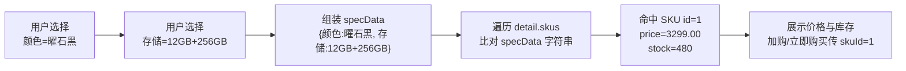

**`spec_data` 的字符串比对方式**：`ProductServiceImpl.normalizeSpecData` 用 `objectMapper.readTree(specData).toString()` 规范化（去掉多余空格、统一 key 顺序为插入顺序），因此前端组装时应保持一致。**当前前端是通过解析 `spec_data` 为对象再比对 key/value，而不是字符串直接比较**，更健壮。

**规格定义"先删后插"的实现**：

```java
// ① 删除该商品的全部规格
productSpecMapper.delete(new LambdaQueryWrapper<ProductSpec>()
        .eq(ProductSpec::getProductId, productId));

// ② 按提交顺序重新插入，sort 从 1 递增
if (dto.getSpecs() != null) {
    int sort = 1;
    for (SpecSaveDTO specDTO : dto.getSpecs()) {
        if (specDTO == null || !StringUtils.hasText(specDTO.getSpecName())) continue;
        ProductSpec spec = new ProductSpec();
        spec.setProductId(productId);
        spec.setSpecName(specDTO.getSpecName().trim());
        spec.setSpecValues(joinSpecValues(specDTO.getSpecValues()));   // List → "a,b,c"
        spec.setSort(sort++);
        productSpecMapper.insert(spec);
    }
}
```

**SKU 的"增改删"三态处理**：

```java
List<ProductSku> existing = productSkuMapper.selectList(...);   // 现有 SKU
Set<Long> existingIds = ...;
Set<Long> keepIds = new HashSet<>();

for (ProductSku entity : skuEntities) {
    if (entity.getId() == null) {
        entity.setProductId(productId);
        productSkuMapper.insert(entity);          // ① 新增：无 id
        keepIds.add(entity.getId());
        continue;
    }
    if (!existingIds.contains(entity.getId())) {
        throw new BusinessException("SKU 不存在或不属于当前商品：" + entity.getId());  // 防越权挂载
    }
    entity.setProductId(productId);
    productSkuMapper.updateById(entity);          // ② 更新：有 id
    keepIds.add(entity.getId());
}
for (Long oldId : existingIds) {
    if (!keepIds.contains(oldId)) {
        productSkuMapper.deleteById(oldId);       // ③ 删除：不在提交列表中的
    }
}
```

**"防越权挂载"校验的意义**：如果不检查 `existingIds.contains(entity.getId())`，攻击者可以在编辑商品 A 时提交商品 B 的 SKU ID，把 B 的 SKU "偷"到 A 名下（`updateById` 时会连带改 `product_id`）。这是**水平越权**防护。

**导入时的规格合并**：

```java
// 「颜色:红色;尺码:M」形式的文本 → LinkedHashMap（保持顺序）
private LinkedHashMap<String, String> parseSpecText(String specText) {
    for (String part : specText.split("[;；]")) {        // 兼容半角/全角分号
        int index = indexOfSeparator(item);               // 兼容半角:与全角：
        String name = item.substring(0, index).trim();
        String value = item.substring(index + 1).trim();
        map.put(name, value);
    }
}
```

导入时同一商品名的多行会合并，规格值按出现顺序用 `LinkedHashSet` 去重收集，生成 `product_spec`；每行生成一个 SKU。

### 6.8 分页设计

**统一配置（`MybatisPlusConfig`）**：

```java
PaginationInnerInterceptor pagination = new PaginationInnerInterceptor(DbType.MYSQL);
pagination.setMaxLimit(200L);      // 单页最大 200 条，防恶意大分页
pagination.setOverflow(false);     // 超出最大页数返回空数据，而不是回到首页
```

**`setOverflow(false)` 的作用**：默认情况下 MyBatis-Plus 在请求页码超过总页数时会**回到第一页**（`overflow=true`），这会让前端产生"翻到第 100 页却看到第 1 页数据"的困惑。设为 `false` 后返回空列表，语义更清晰。

**各 Service 的分页参数兜底**：

```java
// 典型的 buildPage 实现（CommentServiceImpl / CouponServiceImpl / BannerServiceImpl / NoticeServiceImpl）
private <T> Page<T> buildPage(Integer page, Integer size) {
    long current = page == null || page < 1 ? 1L : page;
    long limit = size == null || size < 1 ? 10L : Math.min(size, 200);
    return new Page<>(current, limit);
}
```

**与插件 `maxLimit` 的分工**：插件的 `maxLimit=200` 在 SQL 层兜底；Service 的 `Math.min(size, 200)` 在应用层提前截断，二者是**双重保险**。

**`OrderServiceImpl.pageOrders` 的手工分页**：

```java
long current = query.getPage() == null || query.getPage() < 1 ? 1 : query.getPage();
long size = query.getSize() == null || query.getSize() < 1 ? 10 : query.getSize();
Page<Orders> page = ordersMapper.selectPage(new Page<>(current, size), wrapper);
// 手工构造 PageResult（因为需要额外的 VO 装配）
PageResult<OrderVO> result = new PageResult<>();
result.setRecords(list);
result.setTotal(page.getTotal());
result.setPage(page.getCurrent());
result.setSize(page.getSize());
result.setPages((page.getTotal() + page.getSize() - 1) / page.getSize());
```

**注意 `pages` 的计算**：`PageResult` 的构造器本来自动算 `pages`，但这里是 setter 赋值（默认 `pages` 保持 0），因此代码**手动计算**了 `pages`。而其他的 `PageResult.of(page, converter)` 走构造器会自动算。两种路径都正确。

**`PageResult.of` 的两种用法**：

```java
// ① 不需要转换（实体即出参）
return PageResult.of(page);

// ② 需要实体 → VO 转换，批量场景下 converter 内部使用预加载的 Map 避免 N+1
return PageResult.of(page, refund -> convert(refund, nicknameMap.get(refund.getUserId()),
        resolveItem(refund, itemMap, firstItemMap)));
```

### 6.9 逻辑删除与快照的配合

**问题**：商品被逻辑删除后，历史订单里的商品名、图片、规格怎么办？

**答案**：`order_item` 保存了完整快照（`product_name`、`product_image`、`spec_info`、`price`），因此**历史订单完全不依赖 `product` 表**。

```java
// 下单时写入快照
orderItem.setProductName(item.getProduct().getName());
orderItem.setProductImage(StringUtils.hasText(item.getSku().getImage())
        ? item.getSku().getImage() : item.getProduct().getMainImage());
orderItem.setSpecInfo(item.getSku().getSpecInfo());
orderItem.setPrice(item.getSku().getPrice());
orderItem.setTotalAmount(item.totalAmount());
```

**快照 vs 关联的对比**：

| 场景 | 若用关联（JOIN 商品表） | 用快照（当前） |
| --- | --- | --- |
| 商品被删除 | 订单详情**丢失商品信息**（或需特殊处理 `deleted=1`） | 展示正常 |
| 商品改名 | 历史订单显示**新名字**（错误） | 显示下单时的名字（正确） |
| 商品改价 | 历史订单显示**新价格**（财务错误） | 显示成交价（正确） |
| 商品换图 | 历史订单显示新图 | 显示下单时的图 |
| 存储成本 | 低 | 每行多约 300 字节 |
| 查询性能 | 需 JOIN | 无需 JOIN |

**结论**：对于**交易类**数据，快照是必要的；对于**展示类**数据（如首页商品列表），关联查询是正确的（需要显示最新信息）。

**逻辑删除与快照的边界**：

| 表 | 逻辑删除 | 快照冗余 | 说明 |
| --- | :---: | :---: | --- |
| `product` | ✅ | — | 被删除后商城不可见，但**订单明细已快照，不受影响** |
| `orders` | ✅ | — | 买家删除后其列表不可见，但管理端仍可查（管理端查询也不带 `user_id` 过滤，需注意 `deleted` 的影响） |
| `coupon` | ✅ | `user_coupon.coupon_name` | 券被删除后用户券包仍显示名称 |
| `user` | ✅ | `product_comment.user_nickname`、`orders.receiver_name` | 会员删除后评价与订单仍可展示 |

> **⚠️ 管理端订单查询与 `deleted`**：`pageAdminOrders` 走的是 `ordersMapper.selectPage`，MyBatis-Plus 会自动追加 `deleted = 0`。因此**买家删除的订单，管理端也看不到了**。这可能是设计疏漏（运营可能希望看到被买家删除的订单），也可能是刻意为之（买家删除表示该单已结束）。当前行为需在运维手册中说明。

### 6.10 自动取消超时订单的惰性触发

**实现**：

```java
private void autoCancelExpiredOrders(Long userId) {
    if (orderAutoCancelMinutes == null || orderAutoCancelMinutes <= 0) {
        return;
    }
    LocalDateTime deadline = LocalDateTime.now().minusMinutes(orderAutoCancelMinutes);
    List<Orders> expired = ordersMapper.selectList(Wrappers.<Orders>lambdaQuery()
            .eq(Orders::getUserId, userId)
            .eq(Orders::getStatus, OrderStatus.UNPAID.getCode())
            .lt(Orders::getCreateTime, deadline));
    for (Orders orders : expired) {
        cancelInternal(orders);
        log.info("订单超时未支付自动取消：orderNo={}", orders.getOrderNo());
    }
}
```

**调用点**（仅两处）：

```java
public PageResult<OrderVO> pageBuyerOrders(OrderQueryDTO query) {
    Long userId = SecurityUtils.getUserId();
    autoCancelExpiredOrders(userId);       // ← 买家查订单列表时触发
    ...
}

public OrderCountVO countByStatus() {
    Long userId = SecurityUtils.getUserId();
    autoCancelExpiredOrders(userId);       // ← 买家查状态计数时触发
    ...
}
```

**设计取舍**：

| 项 | 说明 |
| --- | --- |
| **优点** | ① 无需引入 `@Scheduled` 与线程池；② 多实例部署时**不会重复执行**（每个请求只处理自己的订单）；③ 无分布式锁需求；④ 事务边界清晰（与查询在同一事务外的独立方法） |
| **缺点** | ① **无人访问的订单永不自动取消**，库存被长期占用；② 每次查列表都多一次 `SELECT`（虽然走 `idx_orders_user` 索引，代价小）；③ 若某用户有大量超时订单，首次查询会一次性取消全部（可能较慢） |
| **改进方向** | 增加 `@Scheduled(fixedDelay = 60000)` 的全局扫描任务（需加分布式锁或用 `SELECT ... FOR UPDATE SKIP LOCKED` 避免多实例重复），或引入延迟队列（RabbitMQ 死信 / Redis ZSet） |

**注意"取消"的副作用范围**：`cancelInternal` 会回补库存、回退销量、退还优惠券。因此超时取消不仅释放库存，还会把优惠券还给买家（券的 `expire_time` 未变，若仍有效可继续使用）。

---

## 七、前端架构

### 7.1 单工程双布局

**为什么用一个 Vue 工程而非两个**：

| 方案 | 优点 | 缺点 |
| --- | --- | --- |
| **两个独立工程** | 部署完全隔离；依赖可分别升级 | 共享的 axios 封装、格式化工具、组件（分页、图片上传）需要复制或抽成 npm 包；本地开发要开两个 dev server |
| **单工程双布局（当前）** | ① 共享 `api/request.js`、`utils/format.js`、`components/`；② 一次 `npm run dev` 同时开发前后台；③ 一次 `npm run build` 产出统一产物，Nginx 单站点托管 | ① 打包体积较大（买家不会访问后台代码，虽然有路由懒加载但 chunk 仍在 dist 中）；② 两种 Token 共存于同一 localStorage（用不同 key 隔离） |

**路由结构**：

```js
const routes = [
  // ===== 买家商城（ShopLayout）=====
  {
    path: '/',
    component: () => import('@/layouts/ShopLayout.vue'),
    children: [
      { path: '',                name: 'Home',            component: Home,          meta: { title: '首页' } },
      { path: 'products',        name: 'ProductList',     component: ProductList,   meta: { title: '全部商品' } },
      { path: 'category/:id',    name: 'CategoryProducts',component: ProductList,   meta: { title: '分类商品' } },
      { path: 'search',          name: 'SearchProducts',  component: ProductList,   meta: { title: '搜索商品' } },
      { path: 'product/:id',     name: 'ProductDetail',   component: ProductDetail, meta: { title: '商品详情' } },
      { path: 'cart',            name: 'Cart',            component: Cart,          meta: { title: '购物车', requiresAuth: true } },
      { path: 'checkout',        name: 'Checkout',        component: Checkout,      meta: { title: '确认订单', requiresAuth: true } },
      { path: 'orders',          name: 'OrderList',       component: OrderList,     meta: { title: '我的订单', requiresAuth: true } },
      { path: 'order/:orderNo',  name: 'OrderDetail',     component: OrderDetail,   meta: { title: '订单详情', requiresAuth: true } },
      { path: 'notices',         name: 'NoticeList',      component: NoticeList,    meta: { title: '公告中心' } },
      { path: 'notice/:id',      name: 'NoticeDetail',    component: NoticeDetail,  meta: { title: '公告详情' } },
      { path: 'user', component: UserCenter, meta: { requiresAuth: true }, children: [
          { path: '',         redirect: '/user/profile' },
          { path: 'profile',  name: 'UserProfile',  component: Profile,  meta: { title: '个人资料',   requiresAuth: true } },
          { path: 'address',  name: 'UserAddress',  component: Address,  meta: { title: '收货地址',   requiresAuth: true } },
          { path: 'favorite', name: 'UserFavorite', component: Favorite, meta: { title: '我的收藏',   requiresAuth: true } },
          { path: 'history',  name: 'UserHistory',  component: History,  meta: { title: '浏览记录',   requiresAuth: true } },
          { path: 'coupon',   name: 'UserCoupon',   component: Coupon,   meta: { title: '我的优惠券', requiresAuth: true } },
          { path: 'comment',  name: 'UserComment',  component: Comment,  meta: { title: '我的评价',   requiresAuth: true } },
          { path: 'refund',   name: 'UserRefund',   component: Refund,   meta: { title: '退款/售后',  requiresAuth: true } }
      ]}
    ]
  },
  // ===== 登录注册（独立于布局）=====
  { path: '/login',    name: 'Login',    component: Login,    meta: { title: '会员登录' } },
  { path: '/register', name: 'Register', component: Register, meta: { title: '会员注册' } },

  // ===== 管理后台（AdminLayout）=====
  { path: '/admin/login', name: 'AdminLogin', component: AdminLogin, meta: { title: '管理后台登录' } },
  {
    path: '/admin',
    component: () => import('@/layouts/AdminLayout.vue'),
    meta: { requiresAdmin: true },
    redirect: '/admin/dashboard',
    children: [
      { path: 'dashboard',            meta: { perm: 'dashboard:view' } },
      { path: 'product/list',         meta: { perm: 'product:list' } },
      { path: 'product/create',       meta: { perm: 'product:add' } },
      { path: 'product/edit/:id',     meta: { perm: 'product:edit' } },
      { path: 'product/category',     meta: { perm: 'category:list' } },
      { path: 'product/stock',        meta: { perm: 'stock:list' } },
      { path: 'product/comment',      meta: { perm: 'comment:list' } },
      { path: 'order/list',           meta: { perm: 'order:list' } },
      { path: 'order/ship',           meta: { perm: 'order:ship' } },
      { path: 'order/refund',         meta: { perm: 'refund:list' } },
      { path: 'order/detail/:id',     meta: { perm: 'order:list' } },
      { path: 'marketing/coupon',     meta: { perm: 'coupon:list' } },
      { path: 'marketing/banner',     meta: { perm: 'banner:list' } },
      { path: 'marketing/notice',     meta: { perm: 'notice:list' } },
      { path: 'user/list',            meta: { perm: 'member:list' } },
      { path: 'system/user',          meta: { perm: 'sys:user:list' } },
      { path: 'system/role',          meta: { perm: 'sys:role:list' } },
      { path: 'system/config',        meta: { perm: 'sys:config:list' } },
      { path: 'system/log',           meta: { perm: 'sys:log:list' } }
    ]
  },

  // ===== 404 =====
  { path: '/:pathMatch(.*)*', name: 'NotFound', component: NotFound, meta: { title: '页面不存在' } }
]
```

### 7.2 路由守卫

```js
router.beforeEach((to, from, next) => {
  const buyerStore = useBuyerStore()
  const adminStore = useAdminStore()

  // 动态设置页面标题
  document.title = to.meta.title ? `${to.meta.title} - 星辰商城` : '星辰商城 - 电商管理系统'

  // ---------- 管理端 ----------
  if (to.meta.requiresAdmin) {
    // ① 未登录 → 跳管理端登录页，带 redirect 便于登录后回跳
    if (!adminStore.token) {
      return next(`/admin/login?redirect=${encodeURIComponent(to.fullPath)}`)
    }
    // ② 已登录但无该页面权限 → 提示并回看板
    if (to.meta.perm && !adminStore.hasPermission(to.meta.perm)) {
      ElMessage.error('抱歉，您没有该页面的访问权限')
      return next('/admin/dashboard')
    }
    return next()
  }

  // ---------- 买家端需登录页面 ----------
  if (to.meta.requiresAuth && !buyerStore.token) {
    ElMessage.warning('请先登录后再操作')
    return next(`/login?redirect=${encodeURIComponent(to.fullPath)}`)
  }

  next()
})
```

**`redirect` 参数的闭环**：登录页读取 `route.query.redirect`，登录成功后 `router.push(redirect || '/')`，用户回到原来想去的页面。

### 7.3 axios 双实例（买家/管理端 Token 隔离）

**为什么需要两个实例**：

| 问题 | 若只有一个实例 |
| --- | --- |
| 同一个浏览器同时登录买家和管理员 | Token 只有一个存储键，后登录的会覆盖前者 |
| 401 时跳哪个登录页 | 无法区分该跳 `/login` 还是 `/admin/login` |
| 请求头 | 无法分别携带不同的 Token |

**实现（`api/request.js`）**：

```js
/** 存储键常量（导出供 store 复用） */
export const BUYER_TOKEN_KEY = 'mall_buyer_token'
export const ADMIN_TOKEN_KEY = 'mall_admin_token'
export const BUYER_INFO_KEY  = 'mall_buyer_info'
export const ADMIN_INFO_KEY  = 'mall_admin_info'

function createService(tokenKey, isAdmin) {
  const service = axios.create({
    baseURL: '/api',        // 配合 Vite 代理 / Nginx 反代
    timeout: 30000
  })

  // ---------------- 请求拦截器：注入 Token ----------------
  service.interceptors.request.use((config) => {
    const token = localStorage.getItem(tokenKey)   // ← 按实例读各自的键
    if (token) {
      config.headers.Authorization = `Bearer ${token}`
    }
    return config
  }, (error) => Promise.reject(error))

  // ---------------- 响应拦截器：统一处理 ----------------
  service.interceptors.response.use(
    (response) => {
      // ① 文件下载：blob 类型直接返回完整响应
      if (response.config.responseType === 'blob') {
        const contentType = response.headers['content-type'] || ''
        if (contentType.includes('application/json')) {
          // 后端在下载接口上返回了 JSON 错误 → 解析并提示
          return response.data.text().then((text) => {
            let message = '导出失败'
            try { message = JSON.parse(text).message || message } catch (e) { /* ignore */ }
            ElMessage.error(message)
            return Promise.reject(new Error(message))
          })
        }
        return response
      }
      // ② 业务码判定
      const res = response.data
      if (res && res.code === 200) {
        return res                  // ← 返回整个 Result，业务代码取 res.data
      }
      const message = (res && res.message) || '请求失败'
      ElMessage.error(message)
      return Promise.reject(new Error(message))
    },
    (error) => {
      const status = error.response && error.response.status
      const data = error.response && error.response.data
      const message = (data && data.message) || error.message || '网络异常，请稍后重试'

      if (status === 401) {
        // 清空对应端的 Token 与用户信息，跳对应登录页
        localStorage.removeItem(tokenKey)
        localStorage.removeItem(isAdmin ? ADMIN_INFO_KEY : BUYER_INFO_KEY)
        ElMessage.error(message || '登录已过期，请重新登录')
        redirectToLogin(isAdmin)
      } else if (status === 403) {
        ElMessage.error((data && data.message) || '抱歉，您没有该操作权限')
      } else if (status === 404) {
        ElMessage.error('请求的接口不存在')
      } else {
        ElMessage.error(message)
      }
      return Promise.reject(error)
    }
  )

  return service
}

/** 买家端实例 */
export const request = createService(BUYER_TOKEN_KEY, false)
/** 管理端实例 */
export const adminRequest = createService(ADMIN_TOKEN_KEY, true)
```

**关键设计点**：

| 点 | 说明 |
| --- | --- |
| **返回 `res` 而非 `res.data`** | 业务代码统一写 `const res = await getProfile(); res.data.username`。若拦截器返回 `res.data`，业务代码就要写 `res.username`，两种风格混用容易出错。当前选择"返回完整 Result"，让业务层显式取 `.data` |
| **blob 特判** | Excel 下载的响应 `Content-Type` 是二进制，不能走 JSON 解析。但如果后端因权限问题返回了 JSON 错误（`Content-Type: application/json`），需要特殊处理——否则用户会下载到一个内容是错误 JSON 的 `.xlsx` 文件 |
| **401 直接改 `window.location.href`** | 用 `window.location.href` 而非 `router.push`，原因：① `request.js` 不在 Vue 组件上下文，直接 `import router` 会产生循环依赖风险；② 硬跳转会重置内存状态，避免残留旧数据 |
| **`redirectToLogin` 的防重入** | 若当前已在登录页，直接 `return`，避免无限跳转 |

**`downloadBlob` 工具**（处理 Excel 下载）：

```js
export function downloadBlob(response, defaultName = 'download.xlsx') {
  const blob = new Blob([response.data])
  const disposition = response.headers['content-disposition'] || ''
  let filename = defaultName
  // 优先解析 RFC 5987 的 filename*=UTF-8''xxx（支持中文文件名）
  const utf8Match = /filename\*=UTF-8''([^;]+)/i.exec(disposition)
  const plainMatch = /filename="?([^";]+)"?/i.exec(disposition)
  if (utf8Match) filename = decodeURIComponent(utf8Match[1])
  else if (plainMatch) filename = decodeURIComponent(plainMatch[1])

  const url = window.URL.createObjectURL(blob)
  const link = document.createElement('a')
  link.href = url
  link.download = filename
  document.body.appendChild(link)
  link.click()
  document.body.removeChild(link)
  window.URL.revokeObjectURL(url)     // ← 释放内存
}
```

**为什么优先解析 `filename*=UTF-8''`**：HTTP 头不能直接包含非 ASCII 字符，后端设置 `Content-Disposition` 时会用 RFC 5987 的编码形式（`filename*=UTF-8''%E5%95%86%E5%93%81%E5%88%97%E8%A1%A8.xlsx`）承载中文文件名；而 `filename="..."` 是旧式写法，中文会乱码。代码优先匹配前者。

### 7.4 动态菜单与按钮级权限指令

**侧边栏渲染（`AdminLayout.vue` + `AdminMenuItem.vue`）**：

菜单数据来自 `adminStore.menus`，是登录接口返回的**树形结构**（由 `AdminAuthServiceImpl.buildMenuTree` 依据该角色的 `sys_permission` 生成，只含 `type IN (1,2)` 且 `status=1` 的节点）。`AdminMenuItem.vue` 是**递归组件**，处理任意层级。

**为什么用后端返回的菜单而不是前端写死路由表**：

| 方案 | 问题 |
| --- | --- |
| 前端写死菜单 + 按 `permissions` 数组过滤 | 菜单结构变化要改前端代码；与 `sys_permission` 表数据可能不一致 |
| **后端返回菜单树（当前）** | 菜单结构完全由 `sys_permission` 表决定，改库即可调整（虽然当前也没提供权限的增删改接口）；前端只需递归渲染 |

**`v-perm` 指令（`directives/permission.js`）**：

```js
export const permissionDirective = {
  mounted(el, binding) {
    const { value } = binding
    if (!value) return

    const codes = Array.isArray(value) ? value : [value]
    const adminStore = useAdminStore()
    const buyerStore = useBuyerStore()

    const allowed = codes.some((code) => {
      if (code.startsWith('buyer:')) {
        return buyerStore.isLogin      // 买家登录态判定
      }
      return adminStore.hasPermission(code)
    })

    if (!allowed) {
      el.parentNode && el.parentNode.removeChild(el)    // ← 从 DOM 移除
    }
  }
}
```

**注册方式（`main.js`）**：

```js
import { permissionDirective } from './directives/permission'
app.directive('perm', permissionDirective)
```

**使用方式**：

```vue
<!-- 单个权限 -->
<el-button v-perm="'product:add'" type="primary" @click="handleAdd">新增商品</el-button>

<!-- 任一满足（数组） -->
<el-button v-perm="['product:add', 'product:edit']">新增或编辑</el-button>

<!-- 买家端登录态（前缀 buyer:） -->
<el-button v-perm:buyer="'buyer:login'">立即购买</el-button>
```

**三个设计细节**：

| 细节 | 说明 |
| --- | --- |
| **`mounted` 而非 `updated`** | 权限在页面加载后不会变化（除非重新登录），`mounted` 足够且性能更好 |
| **移除 DOM 而非 `display:none`** | `display:none` 的元素仍在 DOM 中，用户可通过开发者工具恢复显示。移除后无法恢复（虽然真正的安全由后端保证） |
| **支持 `buyer:` 前缀** | 同一指令服务两端：`buyer:` 开头的 code 判定买家登录态，其余判定管理端权限。这样买家端页面也能用统一的指令写权限 |

**局限**：指令在 `mounted` 时判定一次。如果用户在页面停留期间被调整了角色（后端已踢下线），前端按钮不会自动消失——但下一次请求会返回 401 并跳转登录页。

### 7.5 API 层组织方式

**目录结构**：

```
frontend/src/api/
├── request.js              # axios 双实例 + downloadBlob 工具
├── auth.js                 # 买家认证 + 管理端认证（两端合并在一个文件）
├── shop.js                 # 商城公开接口（12 个方法）
├── cart.js                 # 购物车（7 个）+ 收货地址（6 个）
├── order.js                # 订单（10 个）+ 售后（4 个）
├── user.js                 # 个人中心（14 个）+ 评价（3 个）
└── admin/
    ├── dashboard.js        # 数据看板（5 个）
    ├── product.js          # 商品（10）+ 分类（5）+ 库存（4）+ 上传（2）
    ├── order.js            # 订单（9）+ 售后（3）
    ├── marketing.js        # 优惠券（6）+ 轮播图（5）+ 公告（5）+ 评价（4）
    ├── member.js           # 会员（3）
    └── system.js           # 管理员（7）+ 角色（7）+ 权限（1）+ 配置（2）+ 日志（3）
```

**组织原则**：

| 原则 | 说明 |
| --- | --- |
| **按业务模块分文件** | 与后端 Controller 的划分大致对应，便于查找 |
| **买家/管理端目录分离** | `admin/` 子目录下的全部方法用 `adminRequest`，根目录下用 `request`，**天然隔离 Token** |
| **一个函数一个接口** | 函数名即语义（`getAdminProductPage`、`shipOrder`），JSDoc 注释写明参数与用途 |
| **不在 API 层做业务处理** | API 函数只负责"发请求 + 返回 Promise"，数据转换在页面组件中做 |

**典型实现**：

```js
// 查询（参数通过 params 传递）
export function getAdminProductPage(params) {
  return adminRequest.get('/admin/products', { params })
}

// 新增/编辑（JSON body）
export function updateProduct(id, data) {
  return adminRequest.put(`/admin/products/${id}`, data)
}

// 状态切换（query 参数，body 传 null）
export function updateProductStatus(id, status) {
  return adminRequest.put(`/admin/products/${id}/status`, null, { params: { status } })
}

// 文件下载（responseType: blob + downloadBlob 处理）
export async function exportProducts(params) {
  const response = await adminRequest.get('/admin/products/export', { params, responseType: 'blob' })
  downloadBlob(response, '商品列表.xlsx')
}

// 文件上传（FormData + multipart 头）
export function uploadFile(file, type = 'product') {
  const formData = new FormData()
  formData.append('file', file)
  return adminRequest.post('/admin/upload', formData, {
    params: { type },
    headers: { 'Content-Type': 'multipart/form-data' }
  })
}

// 批量删除（DELETE 带 body：axios 的 data 选项）
export function deleteLogs(ids) {
  return adminRequest.delete('/admin/sys/logs/batch', { data: ids })
}

// 批量修改（PUT 传数组）
export function updateConfigs(list) {
  return adminRequest.put('/admin/sys/configs', list)
}
```

**后端对"双传参"的兼容设计**：多个状态切换接口同时支持 `?status=1` 与 body `{"status":1}`（如 `AdminMemberController.updateStatus` 的 `resolveStatus`），因此前端无论用 `params` 还是 `data` 传都能工作。这是为**降低前后端联调摩擦**做的容错设计。

### 7.6 前端状态管理（Pinia）

| Store | Key | 状态 | 关键 action |
| --- | --- | --- | --- |
| `useBuyerStore` | `buyer` | `token`、`info`（localStorage 初始化） | `login`、`fetchInfo`、`logout`、`clear` |
| `useAdminStore` | `admin` | `token`、`info`、`permissions`、`menus`、`sidebarCollapsed` | `login`、`fetchInfo`、`hasPermission`、`toggleSidebar`、`logout`、`clear` |
| `useCartStore` | `cart` | 购物车条目、角标数 | 加购后刷新角标 |

**`adminStore.hasPermission` 的实现**：

```js
hasPermission(code) {
  if (!code) return true                              // 无需权限
  if (this.isSuperAdmin) return true                  // roleCode === 'ADMIN' 直接放行
  return this.permissions.includes(code)              // 逐项比对
}
```

**`isSuperAdmin` 的 getter**：

```js
isSuperAdmin: (state) => state.info && state.info.roleCode === 'ADMIN'
```

> **再次强调前后端判定差异**：前端对 `ADMIN` 角色直接返回 `true`；后端严格按 `permissions` 数组判定。若通过"角色权限"页面收回了 ADMIN 角色的某权限，会出现前后端判定不一致（前端显示按钮，后端拒绝）。建议在运维手册中说明：**不要收回 ADMIN 角色的权限**，如确需限制应新建角色。

**持久化策略**：只用 `localStorage` 做**初始化**（`state: () => ({ token: localStorage.getItem(...) || '' })`），`actions` 中显式写入。没有引入 `pinia-plugin-persistedstate`，因为只需持久化 2~4 个字段，手写更可控。

**刷新页面的行为**：

| 场景 | 结果 |
| --- | --- |
| 刷新页面 | `token` 与 `info` 从 localStorage 恢复；`permissions` 与 `menus` 为**空数组**（未持久化） |
| 后果 | 侧边栏菜单为空、`v-perm` 按钮消失（除超管外） |
| 恢复机制 | `AdminLayout` 挂载时调用 `adminStore.fetchInfo()` 重新拉取权限与菜单 |

> **⚠️ 潜在体验问题**：如果 `fetchInfo()` 失败（网络抖动），会停留在"菜单为空"的状态直到用户手动刷新。改进方式是把 `permissions` 与 `menus` 也持久化，或加失败重试。

---

## 八、部署架构

### 8.1 本地开发环境

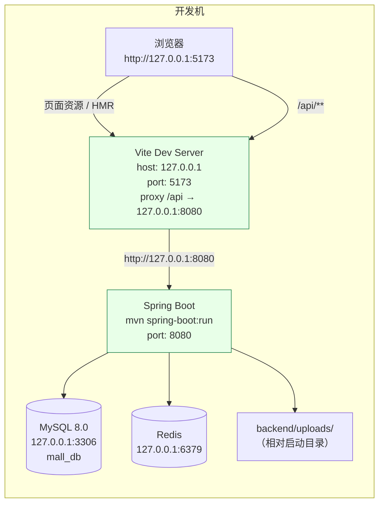

**启动步骤**：

| 步骤 | 命令 | 说明 |
| --- | --- | --- |
| 1. 初始化数据库 | `mysql -h127.0.0.1 -P3306 -uroot -p123456 --default-character-set=utf8mb4 < sql/01-schema.sql`<br>`mysql ... < sql/02-data.sql` | 建库建表 + 演示数据 |
| 2. 启动 Redis | 本机 Redis 服务 | 登录态依赖 |
| 3. 启动后端 | `cd backend && mvn spring-boot:run` | **必须在 `backend/` 目录启动**，否则 `./uploads` 相对路径会指到别处 |
| 4. 启动前端 | `cd frontend && npm install && npm run dev` | <http://localhost:5173> |

**Vite 代理配置（`vite.config.js`）**：

```js
server: {
  host: '127.0.0.1',
  port: 5173,
  open: false,
  proxy: {
    '/api': {
      target: 'http://127.0.0.1:8080',
      changeOrigin: true
    }
  }
}
```

**`/api` 代理同时覆盖接口与图片**：图片 URL 是 `/api/files/product/xxx.svg`，因此代理规则一并覆盖，前端无需配置第二个代理。

**后端可覆盖的环境变量（`application.yml`）**：

| 变量 | 默认值 | 说明 |
| --- | --- | --- |
| `MYSQL_HOST` | `127.0.0.1` | |
| `MYSQL_PORT` | `3306` | |
| `MYSQL_DATABASE` | `mall_db` | |
| `MYSQL_USERNAME` | `root` | |
| `MYSQL_PASSWORD` | `123456` | |
| `REDIS_HOST` | `127.0.0.1` | |
| `REDIS_PORT` | `6379` | |
| `REDIS_DATABASE` | `0` | |
| `REDIS_PASSWORD` | （空） | |
| `UPLOAD_PATH` | `./uploads` | 图片存储目录 |

### 8.2 Docker Compose 生产部署

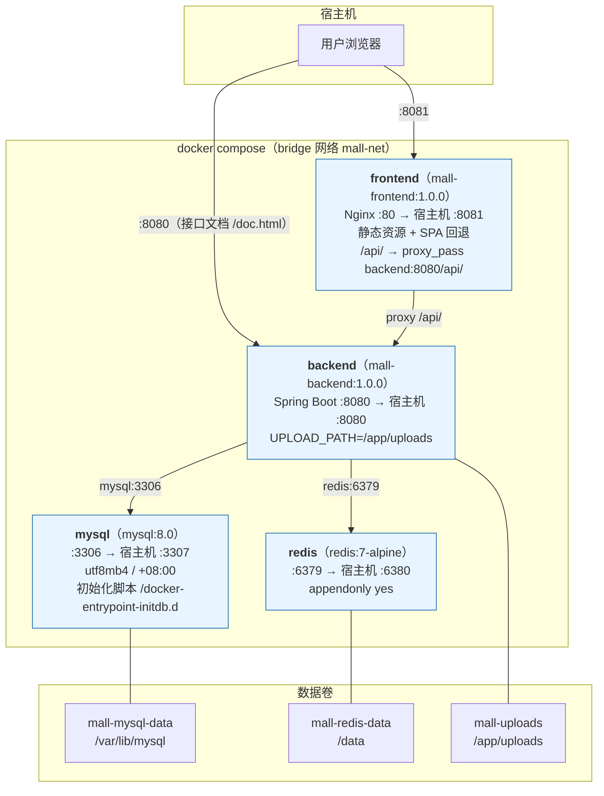

**服务编排要点（`docker-compose.yml`）**：

| 服务 | 镜像/构建 | 端口映射 | 依赖 | 数据卷 |
| --- | --- | --- | --- | --- |
| `mysql` | `mysql:8.0` | `3307:3306` | — | `mall-mysql-data:/var/lib/mysql`<br>`./sql:/docker-entrypoint-initdb.d:ro` |
| `redis` | `redis:7-alpine` | `6380:6379` | — | `mall-redis-data:/data` |
| `backend` | `build: ./backend`<br>`image: mall-backend:1.0.0` | `8080:8080` | `mysql` (healthy)<br>`redis` (healthy) | `mall-uploads:/app/uploads` |
| `frontend` | `build: ./frontend`<br>`image: mall-frontend:1.0.0` | `8081:80` | `backend` | — |

**端口错开的用意**：MySQL 映射到宿主机 `3307`（而非 3306）、Redis 映射到 `6380`（而非 6379），是为了**避免与开发机上已有的 MySQL/Redis 实例冲突**。前端 8081、后端 8080 同理。

**健康检查配置**：

```yaml
mysql:
  healthcheck:
    test: ["CMD", "mysqladmin", "ping", "-h", "127.0.0.1", "-uroot", "-p123456"]
    interval: 10s
    timeout: 5s
    retries: 12
    start_period: 40s      # ← MySQL 初始化较慢，给 40 秒宽限
redis:
  healthcheck:
    test: ["CMD", "redis-cli", "ping"]
    interval: 10s
    timeout: 5s
    retries: 10
backend:
  depends_on:
    mysql:
      condition: service_healthy     # ← 等 MySQL 健康再启动，避免连接失败
    redis:
      condition: service_healthy
```

**MySQL 初始化脚本挂载**：

```yaml
volumes:
  - ./sql:/docker-entrypoint-initdb.d:ro
```

MySQL 官方镜像会在**数据目录为空时**按文件名顺序执行该目录下的 `.sql`、`.sh` 文件。因此 `01-schema.sql` 先执行（建表），`02-data.sql` 后执行（数据）——**文件名前缀的数字排序正是为此设计**。

> **⚠️ 只在首次启动生效**：如果 `mall-mysql-data` 卷已存在（已有数据），初始化脚本**不会再次执行**。需要重置时应先 `docker compose down -v`（**会删除所有数据**）。

**后端环境变量（compose 中注入）**：

```yaml
backend:
  environment:
    MYSQL_HOST: mysql          # ← 用服务名，走 Docker 内网 DNS
    MYSQL_PORT: 3306           # ← 容器内端口（不是宿主机的 3307）
    MYSQL_DATABASE: mall_db
    MYSQL_USERNAME: root
    MYSQL_PASSWORD: 123456
    REDIS_HOST: redis
    REDIS_PORT: 6379           # ← 容器内端口
    REDIS_DATABASE: 0
    UPLOAD_PATH: /app/uploads  # ← 绝对路径，指向数据卷
    TZ: Asia/Shanghai
```

**注意端口的两套语义**：容器内用原生端口（`mysql:3306`、`redis:6379`），宿主机映射用错开端口（`3307`、`6380`）。

**Nginx 配置（`frontend/nginx.conf`）**：

```nginx
server {
    listen       80;
    server_name  localhost;
    root  /usr/share/nginx/html;
    index index.html;

    # 上传图片与 Excel 导入需要较大的请求体
    client_max_body_size 50m;

    gzip on;
    gzip_min_length 1k;
    gzip_comp_level 5;
    gzip_types text/plain text/css application/json application/javascript application/xml image/svg+xml;

    # 单页应用：所有前端路由回退到 index.html
    location / {
        try_files $uri $uri/ /index.html;
    }

    # 静态资源缓存 7 天
    location ~* \.(js|css|png|jpg|jpeg|gif|svg|woff2?|ttf|eot)$ {
        expires 7d;
        add_header Cache-Control "public, max-age=604800";
    }

    # 接口与图片反向代理到后端
    location /api/ {
        proxy_pass         http://backend:8080/api/;
        proxy_http_version 1.1;
        proxy_set_header   Host              $host;
        proxy_set_header   X-Real-IP         $remote_addr;
        proxy_set_header   X-Forwarded-For   $proxy_add_x_forwarded_for;
        proxy_set_header   X-Forwarded-Proto $scheme;
        proxy_connect_timeout 30s;
        proxy_read_timeout    120s;      # ← 导出 Excel 等慢接口需要较长超时
        proxy_send_timeout    120s;
    }
}
```

**关键配置说明**：

| 配置 | 作用 |
| --- | --- |
| `try_files $uri $uri/ /index.html` | **SPA 路由回退**：Vue Router 用 History 模式，`/admin/dashboard` 这类路径在服务器上没有对应文件，必须回退到 `index.html` 由前端路由处理 |
| `client_max_body_size 50m` | 与后端 `spring.servlet.multipart.max-request-size: 50MB` 对齐，否则 Nginx 会先返回 413 |
| `proxy_read_timeout 120s` | 商品/订单导出可能耗时较长，默认 60s 不够 |
| `proxy_set_header X-Forwarded-For` | 后端 `CommonUtils.getIp` 依赖此头获取真实客户端 IP，否则操作日志记录的是 Nginx 容器 IP |
| `gzip_types ... image/svg+xml` | 演示数据使用 SVG 占位图（文本格式），压缩收益明显 |

**部署命令**：

```bash
docker compose up -d --build
```

**访问地址**：

| 服务 | 地址 |
| --- | --- |
| 前台商城 + 管理后台 | <http://localhost:8081> |
| 管理后台登录 | <http://localhost:8081/admin/login> |
| 后端接口文档（Knife4j） | <http://localhost:8080/doc.html> |
| MySQL | `localhost:3307`（root / 123456） |
| Redis | `localhost:6380` |

> **交付环境说明**：交付环境未安装 Docker，`docker-compose.yml` **未在本机实测**。首次启动请留意 `docker compose logs -f backend`，重点确认：① MySQL 初始化脚本是否执行成功（`Unknown database 'mall_db'` 表示脚本未跑）；② 后端是否成功连上 `mysql:3306` 与 `redis:6379`；③ 前端容器内 Nginx 能否解析 `backend` 主机名。

### 8.3 两种部署模式对比

| 维度 | 本地开发 | Docker Compose |
| --- | --- | --- |
| 前端服务 | Vite Dev Server（5173） | Nginx 托管 dist（8081） |
| 前端构建 | 按需编译（ESM + HMR） | 预构建产物（Rollup） |
| 接口转发 | Vite proxy | Nginx reverse proxy |
| 后端运行 | `mvn spring-boot:run` | `java -jar` in 容器 |
| MySQL | 宿主机 3306 | 容器 3307→3306 |
| Redis | 宿主机 6379 | 容器 6380→6379 |
| 图片存储 | 宿主机 `backend/uploads/` | 数据卷 `mall-uploads` |
| 配置来源 | `application.yml` 默认值 | 环境变量覆盖 |
| 首次初始化 | 手工执行 SQL 脚本 | 容器自动执行 `/docker-entrypoint-initdb.d` |
| 数据持久化 | 本机文件系统 | Docker 命名卷 |

### 8.4 生产部署建议（超出当前实现）

以下为**当前代码未实现**但生产环境必须考虑的事项：

| 项 | 当前状态 | 建议 |
| --- | --- | --- |
| JWT 密钥 | 硬编码在 `application.yml`（`mall-ecommerce-system-jwt-secret-key-2026-10-13-keep-it-safe-0x9F`） | 改为环境变量注入，且每个环境不同；定期轮换 |
| 数据库密码 | 明文在 `application.yml` 与 `docker-compose.yml` | 使用 Docker secrets / 配置中心 |
| CORS | `allowedOriginPatterns("*")` + `allowCredentials(true)` | 收敛为具体域名白名单 |
| Redis 密码 | 空 | 生产必须设置 `requirepass` |
| HTTPS | 无 | Nginx 加 TLS 证书；`proxy_set_header X-Forwarded-Proto` 已预留 |
| 图片存储 | 单机本地磁盘（**多实例部署时各实例数据不共享**） | 迁移到对象存储（OSS/S3）或挂载共享存储 |
| MySQL 备份 | 无 | 定时 `mysqldump` 或主从复制 |
| 操作日志清理 | 仅手动接口 | 加 `@Scheduled` 自动清理 |
| 超时订单清理 | 惰性触发（买家查询时才跑） | 加定时任务 + 分布式锁 |
| 监控告警 | 无 | 接入 Prometheus + Grafana；`/actuator/health` 需先引入依赖 |
| 日志收集 | 仅控制台（`logging.pattern.console`） | 输出到文件 + ELK 收集 |
| 前端构建优化 | 全量引入 Element Plus 与全部图标 | 按需引入（`unplugin-vue-components`），可显著减小包体 |
| 数据库索引 | 已覆盖主要查询 | 定期用慢查询日志复核；`product.name` 的 `LIKE '%x%'` 可考虑全文索引 |
| 死锁处理 | 依赖 MySQL 自动回滚，前端重试 | 统一按 SKU ID 排序后加锁，从源头避免死锁 |

---

## 九、架构决策记录（ADR）

| 编号 | 决策 | 理由 | 代价 |
| --- | --- | --- | --- |
| ADR-01 | 采用 JWT + Redis 而非纯 JWT 或 Session | 需要"禁用账号/改权限/退出登录立即生效"的能力 | 每次请求多一次 Redis 往返；同账号仅支持单设备在线 |
| ADR-02 | 前端单工程双布局，而非两个独立工程 | 共享 axios 封装、组件、工具函数；一次构建 | 打包产物含无用代码；需处理两种 Token 共存 |
| ADR-03 | 库存用条件原子 UPDATE 而非乐观锁或悲观锁 | 无需重试；无锁等待；一条 SQL 完成判断与扣减 | 无法感知"为什么失败"（只能提示库存不足）；高冲突时依赖数据库重试机制 |
| ADR-04 | 交易数据用快照冗余，而非 JOIN 现表 | 历史单据永久自洽，不受商品改名/改价/删除影响 | 存储冗余；快照字段与源数据可能不一致（这是期望行为） |
| ADR-05 | `spec_data` 用 JSON 字符串而非关联表 | 一次查询拿到完整组合；无需三表 JOIN；结构灵活 | 无法按规格维度做 SQL 查询；依赖应用层校验 JSON 合法性 |
| ADR-06 | 订单号在应用层生成（`MO` + 时间 + 随机 + 查重） | 可读性好（人工可识别下单时间）；不依赖数据库序列 | 并发下可能重试；依赖唯一索引兜底 |
| ADR-07 | 图片存本地磁盘而非对象存储 | 演示环境零外部依赖；部署简单 | 多实例不共享；无引用计数，删除即不可恢复 |
| ADR-08 | 超时订单惰性取消而非定时任务 | 无调度线程；多实例无重复执行问题 | 无人访问的订单不取消，库存长期占用 |
| ADR-09 | 操作日志同步写入（非异步/消息队列） | 实现简单；业务失败也能记录（`finally`） | 写日志的耗时计入请求响应时间；日志表故障不影响业务（已 try/catch） |
| ADR-10 | 逻辑删除只用于 9 张表而非全部 | 只对需要"可追溯 + 被快照引用"的数据保留；过程性数据物理删除 | 需逐表判断，规则不统一 |
| ADR-11 | 系统配置表 9 项中仅库存阈值运行时生效 | 其他参数由 `application.yml` 的 `@Value` 注入或未使用 | 后台改配置不生效，易造成误解（需文档说明） |
| ADR-12 | 前端 `hasPermission` 对超管短路返回 `true` | 容错：避免权限数组加载失败导致超管无任何菜单 | 与后端判定不一致，收回超管权限后会出现"按钮可见但点击 403" |
| ADR-13 | 金额全部用 `DECIMAL(10,2)` + `BigDecimal` | 精确到分，避免浮点误差 | 每次运算需显式 `setScale(2, HALF_UP)` |
| ADR-14 | 分页 `maxLimit=200` + Service 层二次截断 | 双层防护，防止恶意大分页拖垮数据库与内存 | 超出部分静默截断（前端需知悉上限） |
| ADR-15 | 售后"仅退款"不回补库存 | 商品未退回仓库，库存不应增加 | 需在文档与用户提示中明确区分"退款"与"退货" |

---

> 本文档所有类名、包路径、配置项、SQL 片段、端口号、依赖版本均取自代码与配置文件的真实内容。
> 涉及"未实现"或"建议改进"的部分已明确标注，不代表当前系统已具备该能力。
